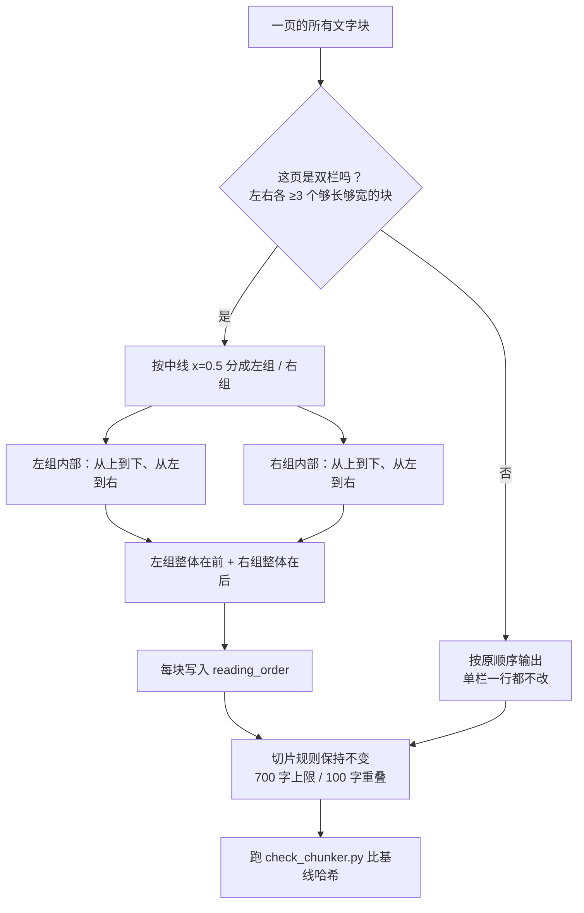
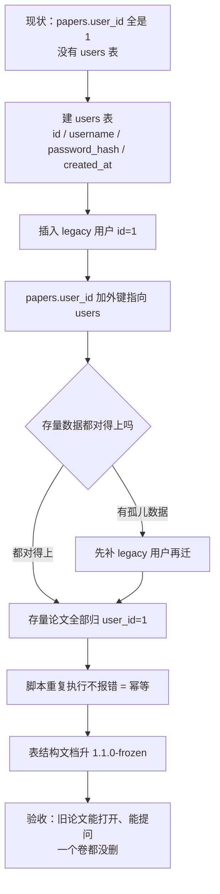
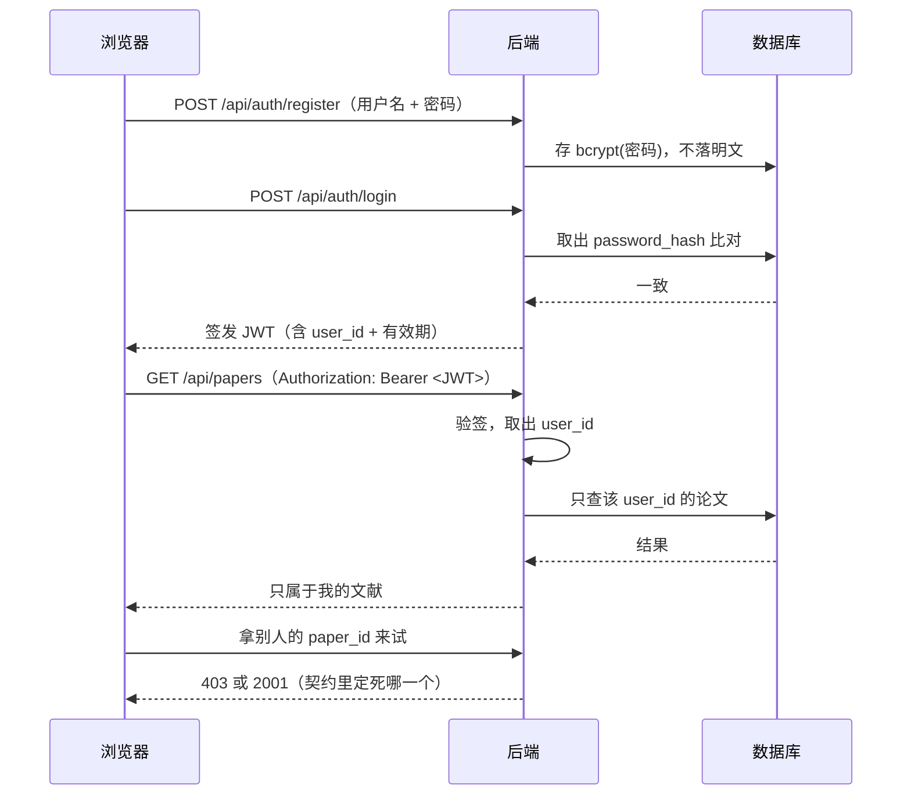
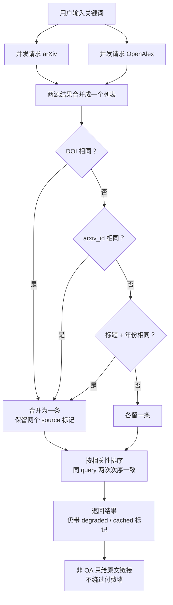

# PaperMind · Beta 功能说明

> 配套文档：`Beta需求卡.md`（那是「签合同」，写验收标准和依赖；这份是「讲清楚」，说人话）
> 起草：P1 林子航 · 2026-11-16 · 周期：Beta 四周（11-16 → 12-13）
> **怎么读**：先看第一节（一分钟明白 Beta 在干嘛），再看第二节找到自己的名字，最后只读自己那几张卡的详细说明。

---

## 一、一分钟明白：Beta 到底在干什么

Alpha 我们已经做到了：**传上去、看得见、问得出、跳得准**。
但用户真拿它读论文，会卡在三件事上——Beta 就是把这三件事解决掉。


| 用户的抱怨                                         | Beta 要做什么                                    | 涉及的功能卡            |
| -------------------------------------------------- | ------------------------------------------------ | ----------------------- |
| 「双栏论文读起来乱，问它问题它答得也乱」           | **读得顺**：让电脑按「左栏→右栏」的真人顺序读字 | B01 B02 B03 B04 B11     |
| 「我和室友用同一台电脑，我的论文跑到他列表里去了」 | **分得清**：每人一个账号，各看各的               | B05 B06 B07 B08 B09 B15 |
| 「上次演示前数据差点没了，网一断还说'没搜到'」     | **管得住**：能备份、能报警、能自动检查代码       | B13 B14 B16 B17 B18     |

还有两个小尾巴（B10 问答答不上概括题、B12 选个空格也弹浮层）和两件收尾（B19 B20）。

**一句话记住 Beta**：把「能演示的 Demo」变成「敢给别人用的产品」。

---

## 二、你该看哪几张卡


| 谁            | 你负责的卡      | 一句话理解你的活                                   |
| ------------- | --------------- | -------------------------------------------------- |
| **P1 林子航** | B13 B19         | 先定图纸（接口契约），最后定验收口径               |
| **P2 杨靖**   | B02 B03 B04     | 让双栏论文在页面上按列读，框点在那一段上           |
| **P3 杨绎平** | B08 B12         | 做登录页 / 拦截空选区                              |
| **P4 刘万礼** | B06 B07 B14 B15 | 发通行证、按人分数据、搜索合并去重、搜过的词记下来 |
| **P5 吴啸天** | B01 B10 B11     | 让电脑按栏读字、让概括题能答、让引用是整句         |
| **P6 刘征**   | B05 B16 B17     | 建用户表并迁移、上自动检查、做备份还原             |
| **P7 李义朋** | B09 B18 B20     | 验数据隔离、验断网表现、出报告                     |

> ⚠️ 三条纪律先记住，不然又会撞车：
>
> 1. **B01 出数据在前，B02 接渲染在后** —— 别同时改 `ReaderView.vue`（`#41`/`#42` 撞过一次）
> 2. **B05 必须第一周（11-22 前）迁完**，不然后面登录相关的活全悬空
> 3. **契约（B13）没冻结不开工** —— 边写边猜必然返工

---

## 三、逐卡说明

# A 组 · 让论文「读得顺」

---

## B01 · 双栏列序重排算法　👤 P5

### 现在什么样

PDF 里的文字被切成一个个「块」。`pdf_extractor.py` 抽出来时用的是 PyMuPDF 自带的排序（`sort=True`），交给 `chunker.py` 直接顺着用。

单栏论文没问题。**双栏论文就出事了**：一页左边一段、右边一段，原始顺序经常是「左上 → 右上 → 左中 → 右中」，也就是横着扫。我们现在的 `_is_double_column()` 能**判断**这是双栏页，但判断完只是给它打了个 `bbox_mode = "block"` 的标记，**没有真的重新排队**。

结果就是：喂给大模型的上下文是「这句在左栏，下句跑到右栏，再下一句又回左栏」，模型读得云里雾里，答得自然不好。

### 要变成什么样

```
现在：左上 → 右上 → 左中 → 右中 → 左下 → 右下   ❌ 横着扫
之后：左上 → 左中 → 左下 → 右上 → 右中 → 右下   ✅ 竖着读完换栏
```

就像读报纸：先把左栏从上读到下，再换右栏，而不是两栏横着跳。

### 为什么值得做

这是 Beta 最核心的技术点，**也是全组最难的一张卡**。它一做对，问答质量、引用框精度、阅读体验三样一起变好；它做不对，后面 B02/B03/B11 全是白忙。

### 大概怎么做（大白话）

1. 已经有一段代码能判断「这页是双栏」（左右各至少 3 个够长、够宽的文本块，纵向有重叠）
2. 新增一步：按页面中线（x = 0.5）把块分到左组、右组
3. 左组内部按「从上到下、从左到右」排；右组同样排；最后左组整体在前、右组整体在后
4. 每一块记一个序号 `reading_order`（这页里我排第几），存进数据库
5. **切片规则一个字都不许改** —— 700 字上限、100 字重叠、超长段硬切，全都保持原样

> 🔑 **术语一句话**：`chunk` = 一小段文字。我们把论文切成很多 chunk 存起来，问问题时按相似度找最相关的几段喂给模型。

### 怎么算做完

- 3 篇双栏论文（CVPR / NeurIPS 那种排版）抽 5 段人工看：段落连贯，**没有一句话左一半右一半**
- 单栏论文的结果和现在**一模一样**（跑 `check_chunker.py`，基线哈希不能变）
- 双栏页的 `bbox_mode` 老实标 `block`，**不许为了好看标 `precise`**

### 做的时候注意

- 三栏、异形版面（图表横跨两栏）不做，直接走原顺序，标 `layout=unknown`，在 B19 里如实写上
- 改完先跑 `check_chunker.py` 比哈希，这是唯一能证明「没有顺手改坏单栏」的办法

---

## B02 · 双栏滚动与引用定位　👤 P2

### 现在什么样

阅读页把整页 PDF 当图片渲染（pdf.js），页面位置是死的，**字搬不动**。所以这块不是"把双栏重排成单栏"，而是解决两个具体的毛病：

**毛病 A：滚动时不知道你在哪一栏。** 现在判断"当前第几页"是看"视口上部 30% 落在哪一页"。单栏没问题；双栏时一页里左右两栏高度重叠，这条判断线会同时压到两栏内容，页码和进度显示来回跳。

**毛病 B：点引用只能跳"页顶"。** 滚过去一看，那段话在右栏中间，还得自己往下找。

### 要变成什么样

- 滚动时系统知道"你现在在左栏还是右栏"，进度不乱跳
- 点引用直接滚到**那段话所在的位置**，而不是滚到页面顶部

> ⚠️ 明确不做：把双栏页面重新排版成单栏流。PDF 是排版文件，重排等于重做版面引擎，这一轮吃不下。名字就叫"滚动与引用定位"，不承诺"重排"。

### 为什么值得做

用户唯一真正感知到的"双栏做好了"，就是这两件事：进度不乱、点引用能到那一段。收益比做重排大得多。

### 大概怎么做

1. 拿 B01 给的 `reading_order`，在双栏页上维护"当前栏"状态：判据是**阅读顺序里最后可见的那个块**，不是页
2. 引用跳转改成块级定位：

```js
// 现在：滚到页面顶
// 改成：滚到块顶，再留 40px 呼吸空间
const y = pageEl.offsetTop + cite.bboxY0 * pageEl.offsetHeight - 40
scrollContainer.scrollTo({ top: y, behavior: 'smooth' })
```

3. 缩放时用现有 `captureAnchor` / `restoreAnchor` 机制重算，别另造一套

### 怎么算做完

- 双栏论文连续滚动：页码/进度不再来回跳
- 点引用：页面滚到那段话附近（上下不超过半屏），不是停在页顶
- 单栏论文行为与 Alpha **完全一致**（回归项）

### 做的时候注意

**你和 P5 不能同时改 `ReaderView.vue`。** B01 先出数据，你后接渲染。要改同一个文件先在群里喊一声。

---

## B03 · 引用框列内精确化　👤 P2（+ P5 供数据）

### 现在什么样

点答案里的页码，会跳到 PDF 对应页并画一个框。**双栏论文的框是一大块**，横跨左右两栏——因为框是「这一小段文字涉及的几个块的并集」，而这几个块左边右边都有，一合并就糊成一整片。

Alpha 测的 65 个双栏引用，**全是 `block`（整块）**，没有一个精确到栏内。

### 要变成什么样

框住的是**那一段**，而且框不跨栏。左边的内容只在左半边画框，右边的内容只在右半边。

### 为什么值得做

这是「论文阅读器」和「PDF 播放器」的分界线。指路要指到门口，不能指到整栋楼。

### 大概怎么做

1. 有了 B01 的列序，就知道每个块属于哪一栏
2. 框只在**同一栏内**合并（左栏的块不跟右栏的块取并集）
3. 前端三态样式不变：精确 = 实线，整块 = 虚线，没有坐标 = 只闪一下页

### 怎么算做完

- 双栏 10 道题：`bboxMode = precise` **至少 7 道**，剩下允许 `block`
- 框**不跨栏**（左右边界落在同一栏里）
- 旋转页 90° / 180° / 270° 还对得齐（用 F6-08 那个样本）

### 做的时候注意

**不承诺逐字精确。** 契约 1.2.0 里写死了「双栏降级整块框」，别在验收时改口径。

---

## B04 · 双栏联调与回归　👤 P2（+ P5、P7）

### 干什么

B01/B02/B03 做完之后，双栏和单栏**各跑一遍主链六步**（起栈 → 上传 → 阅读 → 提问 → 点引用跳页 → 传非 PDF 报错），把结论写进 `docs/验收走查/`。

### 为什么单独列一张卡

Alpha 的教训：P7 11-05 只测了改动的那个功能，没跑回归，F1-04 就从「通过」悄悄变成了「不通过」，下一批复测才发现。**双栏改动面很大，回归必须专门排一条。**

### 怎么算做完

有一份带截图的走查记录；发现的问题挂进 `BugList.md`，不在群里口头带过。

---

# B 组 · 让账号「分得清」

---

## B05 · 建用户表 + 数据归属迁移　👤 P6

### 现在什么样

数据库里 `papers.user_id` 这一列**一直是 1**——就是说全项目其实只有「用户 1」一个人，所有上传的论文都挂在它名下。**连 `users` 表都还没建。**

Alpha 这么做是对的（先保主链），但 Beta 要做登录，必须先有「人」这个概念。

### 要变成什么样

- 新建一张 `users` 表：编号、用户名（不能重）、密码（存加密后的乱码，**不是明文**）、注册时间
- `papers.user_id` 从「一个随便填的数字」变成「必须指向真实用户」——加外键
- **以前传的 20 多篇论文怎么办？** 全部归到一个「老账号」（id = 1），不丢数据

### 为什么值得做

这是所有登录功能的地基。地基没打好，B06/B07/B08/B09 全都悬空。

### 大概怎么做

1. 写建表语句进 `docs/03-数据库表结构.sql`（这个文件是唯一标准，别在别处偷偷执行）
2. 写一个迁移脚本：建表 → 加外键 → 存量数据归 user_id = 1 → 建 legacy 用户
3. 脚本要**幂等**——跑一次和跑三次结果一样，不报错
4. 表结构文档版本升 **1.1.0-frozen**，头部写清「为什么升」

> 🔑 **术语一句话**：`幂等` = 同一个操作执行多次，效果和执行一次相同。部署脚本必须这样，否则出事了不敢重跑。

### 怎么算做完

- 旧论文全都能正常打开、正常提问
- 迁移脚本重复执行不报错
- **一个卷都没删**（`pgdata` / `uploads` / `hf-cache` 全在）

### 做的时候注意

⛔ **绝对不许 `docker compose down -v`。** `-v` 会把 `hf-cache`（2.2GB 向量模型）和 `uploads`（所有 PDF）一起删掉，模型没了要重新联网下，演示环境当场报废。这是 README 里写过的血泪。

⚠️ **这张卡没有降级预案。** 11-22 前迁不完就上报，B07/B08/B09 顺延并上会说明。

---

## B06 · 注册 / 登录 + 通行证（JWT）　👤 P4

### 现在什么样

没有登录。谁打开页面都是「用户 1」。

### 要变成什么样

有注册页、有登录页。登录成功后服务端发一张**有时限的通行证**，之后每次请求都带着它，服务端一看证就知道「你是张三」。

### 为什么值得做

老师要求的多用户数据隔离，卡在这一步。而且这一块是「安全」相关的，做错了比不做更糟——密码泄露是硬伤。

### 大概怎么做

1. 两个新接口：`POST /api/auth/register`（注册）、`POST /api/auth/login`（登录）
2. 密码用 **bcrypt** 加密后存库。bcrypt 是「加盐单向哈希」——**加盐**让同样的密码在不同用户那里长得不一样，**单向**意味着拿到库也反推不出原密码
3. 登录成功签发 JWT，里面装用户编号、有效期，用密钥签名
4. 每次请求带 `Authorization: Bearer <证>`，拦截器验签
5. 错误码要分开：密码错 → 4001，证过期 → 4002。但**账号不存在也用 4001**，别让人试出「这个用户名存在」

> 🔑 **术语一句话**：JWT = 一张有签名、有有效期的通行证。服务端不用记住你，看证上的签名就知道证是真的。

### 怎么算做完

- 注册 → 登录 → 带证访问，全程通
- 密码**不落明文、不写日志**（日志里出现密码等于事故）
- 假证、改过签名的证、过期的证，全部被拦住
- token 有效期写进契约，别靠代码里埋的魔法数字

### 做的时候注意

- 找回密码、短信验证码、第三方登录（微信/GitHub）**一律不做**
- 卡住了可以退成「服务端 Session 存 Redis」，接口签名不变，但要在 B19 里写明偏离

---

## B07 · 全链路按人分数据　👤 P4

### 现在什么样

所有接口都不区分人。你把 `paper_id` 改成别人的编号，照样能看到别人的论文。

### 要变成什么样

**合租房模型**：每人一把钥匙，只能开自己那扇门。拿着别人的门牌号去敲，要么「查无此门」，要么「不是你的」，**绝不能把别人屋里的东西递出来**。

### 为什么值得做

数据隔离是「多用户」这句话的全部意义。这一条不做，B06 的登录就只是装饰。

### 大概怎么做

至少这 **6 处**都要按通行证里的用户编号过滤：

1. 文献列表
2. 文献详情
3. 删除文献
4. 提问
5. 划词翻译 / 术语解释
6. 检索结果导入

### 怎么算做完

- 用自己的账号只能看到自己的论文
- 访问别人的论文：统一返回同一种错误（403 或 2001，**在契约里定死一个，不许两种并存**）
- 越权的响应里**连标题都不许带**，连「这篇存在」都不能泄露
- 删别人的论文：被拦住，且**真的没删**

### 做的时候注意

🚫 常见错误：只在列表接口加了过滤，详情接口忘了。**6 处一个都不能漏**，P7 会挨个试。

---

## B08 · 登录页 + 门口守卫　👤 P3

### 现在什么样

打开就是文献列表页，没有登录这回事。

### 要变成什么样

- 没登录，想看文献列表 / 阅读页 → 自动送去登录页
- 登录完**回到你原本要看的那一篇**（不是回到首页从头找）
- 通行证存在浏览器里，刷新不掉线
- 任何接口说「你没证」（401）→ 自动登出 + 中文提示，别让用户对着白屏发呆

### 为什么值得做

登录做得好不好，用户体感全在这一步。后端再严谨，前端体验断掉照样白搭。

### 怎么算做完

- 上面四条逐条点一遍
- 注册完能直接登录，不需要管理员开通
- 错误提示走现有的统一组件，别新造一套红色裸文本

### 做的时候注意

不做「记住我」，不改现有页面布局风格，不加别的花活。

---

## B09 · 验数据真的隔离了　👤 P7

### 干什么

开两个账号 A 和 B，交叉做 **9 件坏事**：用 A 的证去看 B 的列表、看 B 的详情、删 B 的论文、用 B 的论文提问……**全部必须被拒绝**。

### 为什么单独列一张卡

「我做了隔离」和「我证明了隔离」是两件事。Alpha 的出口条件能立住，靠的就是「每条结论带证据」。这条同样要留证。

### 怎么算做完

9 条用例全部有结论，在**容器环境（8081）**跑（开发环境的 5173 行为不一样，BUG-013 就只在容器里出现过），结果进 Beta 用例表。

### 做的时候注意

P7 只提 Issue，**不许顺手改代码**（`团队分工明细.md` §四 的红线）。

---

# C 组 · 补两个体验上的洞

---

## B10 · 让「这篇讲了什么」能答出来　👤 P5

### 现在什么样

你问「这篇文献讲了什么」，它可能回你一句：**「本文未涉及该内容」**。换个问法（问具体方法）就答得出来。

Alpha 测试里唯一的失败案例 B3 就是这个。

### 为什么

不是模型笨，是我们自己把门关太紧，**三道关卡叠加**：


| 关卡                   | 现在                                         | 毛病                                                           |
| ---------------------- | -------------------------------------------- | -------------------------------------------------------------- |
| 只找 3 段（`top_k=3`） | 相似度最高的 3 个 chunk                      | 「讲了什么」这种问题，全篇都相关，3 段装不下摘要 + 方法 + 结论 |
| 相似度门槛 0.35        | 第一段低于 0.35 直接拒答                     | 「讲了什么」这种短问题的向量很「飘」，相似度天然偏低           |
| Prompt 措辞            | 「只是字面相关、但没给出答案，同样算未涉及」 | 概括题本来就没有「原文那一句」，模型于是老实说没涉及           |

### 要变成什么样

问概括类问题（「讲了什么」「解决了什么问题」「贡献是什么」「用的什么数据」「结论可靠吗」）→ 给概括。问具体的、原文确实没有的 → 还是回「本文未涉及该内容」，**不许为了能答就瞎编**。

### 大概怎么做

1. 先识别问题类型：是不是概览类（关键词 / 简单分类都可以）
2. 概览类放宽到找 8 段，并特意带上首段、末段、摘要附近的段
3. **拒答机制不能拆** —— 未涉及还是要拒，这是 Alpha 唯一 100% 的指标

### 怎么算做完

- 新增 5 道概括题，**至少答对 4 道**
- Alpha 原来那 10 道题**不能退步**（还得 ≥9/10）
- 「未涉及」类问题仍然 **100% 拒答**

### 做的时候注意

不加多轮对话记忆、不换模型、不换 embedding 模型。识别不准就退成「概览类固定找 8 段」，别引新依赖。

---

## B11 · 让引用片段是整句话　👤 P5（+ P2）

### 现在什么样

引用片段是这样切的：`snippet[:200]` —— 第 200 个字是什么就切在哪。

后果：**词中间被切一半**（“transfor…”），有时候开头还撞上小标题、表格残片、公式的半个下标。

### 要变成什么样

引用是**完整的句子**，从头到尾读得通，结尾落在句号或段落结束处。

### 为什么值得做

引用是「让人信」的东西。切一半的句子读起来像抓包截断，用户第一反应是「这系统不靠谱」。

### 大概怎么做

1. 按段落边界截，不按字数硬切
2. 开头如果是标题 / 表格 / 公式碎片，往后挪到第一个完整句子
3. 结尾补到最近的句末（中文「。」或英文「.」）
4. 长度仍然控制在 200 字以内

### 怎么算做完

- 抽 10 条引用：**词中截断 0 条**
- 每条都以句末 / 段末收尾
- 引用页码命中率不下降（仍 ≥9/10）

---

## B12 · 别让选个空格也弹浮层　👤 P3

### 现在什么样

在 PDF 里选中一个空格、单个字母、几个数字，浮层照弹，点了还报错。

Alpha 测试把它判成「不适用」——因为**契约里没写要拦**。这个判定本身没错，但对用户来说这就是个 bug。

### 要变成什么样

只有「值得翻译的文字」才弹浮层。选空白、单字母、纯数字 → 什么都不弹。

### 大概怎么做

1. **先改契约**（B13 里补一条明文），再改代码 —— 顺序不能反，否则又是一次「实现和契约对不上」
2. 前端判断选区内容：去空白后长度够、且不是纯数字，才弹

### 怎么算做完

- 选空白 / 单字母 / 纯数字，不弹浮层
- 正常选词，浮层照旧
- F7-04 这条用例状态从「不适用」改成「通过」

### 做的时候注意

后端那段「截断 / 上限判断」是 D18 例会决定**搬到后端**的，别改回前端。

---

# D 组 · 让流程「管得住」

---

## B13 · 先把图纸定了（契约 1.3.0）　👤 P1

### 现在什么样

契约停在 `1.2.0-frozen`。Beta 要加的一堆东西（登录接口、`reading_order`、错误码 4001/4002、越权到底返回 403 还是 2001）**契约里都还没有**。

### 为什么要先做这个

组员的心得里写了两次同一句话：**「契约要先看再动手，字段名没冻结就写代码，返工成本比想象的高」**（P4、P5 都写了）。P6 也踩过：和 P4 同时改一个文件直接冲突。

施工前不定图纸，七个人照着七张草图盖房子，最后一定对不上。

### 要变成什么样

`docs/01-api-contract.yaml` 升到 **1.3.0-frozen**，包含：

- 登录注册 4 个接口
- `chunks.reading_order` 字段
- 划词拦截规则（B12 的前置）
- 错误码 4001 / 4002
- 越权口径：**403 还是 2001，选一个写死**
- 头部 changelog 写清「为什么升」

### 怎么算做完

例会上逐条过一遍，全员确认。**第一周内（11-22 前）**，逾期则 B02/B14 顺延一周并上会说明。

### 做的时候注意

非必要不改既有字段名和错误码。要改，单独提 PR 找 P1 审。

---

## B14 · 一次搜两个源，合并去重　👤 P4

### 现在什么样

检索一次只查**一个源**（`source=arxiv` 或 `source=openalex`，二选一）。缓存 key 是「来源 + 关键词 + 分页」，存 24 小时。

问题：同一篇论文在 arXiv 和 OpenAlex 都有，用户得切两次、还得自己认出来「这俩是同一篇」。

### 要变成什么样

```
现在：搜一次 → 只看 arXiv
之后：搜一次 → arXiv + OpenAlex 同时查 → 合并 → 去掉重复 → 排好序
```

### 大概怎么做

**去重三级**，一级比一级宽：

1. 先比 **DOI**（论文的身份证号，最准）
2. 没有 DOI 就比 **arxiv_id**
3. 都没有，比「标题 + 年份」

排完序再返回，每条保留它来自哪个源。

### 怎么算做完

- 一次搜索拿到两个源合并后的结果
- 同一篇论文只出现一次（不并列两条）
- 同一关键词连搜两次，**结果次序一致**（排序要稳定，不能随机抖）
- 响应里 `degraded` / `cached` 两个标记仍然在（BUG-017 修过的东西不许回退）
- 非开放获取的论文**只给原文链接**，绝不绕过付费墙

### 做的时候注意

不做 Semantic Scholar 第三源，**不碰知网 / 万方 / IEEE / Web of Science**（没有公开 API 或需要机构订阅，这是合规红线）。

---

## B15 · 记住你搜过什么　👤 P4

### 干什么

把你最近 20 个搜索关键词存起来（按账号存），7 天后自动清掉。下拉列表里能点，点了直接重新搜。

### 为什么值得做

读论文是反复搜同一批关键词的活。这是个小功能，但用起来很省事。

### 怎么算做完

- 存 Redis，按 `user_id` 分开，7 天过期
- 下拉能点回填
- 有清空按钮，清空只清自己的

### 做的时候注意

不做跨设备同步、不做搜索建议 / 自动补全。

---

## B16 · 门口装个安检机（CI）　👤 P6

### 现在什么样

**连 `.github/` 目录都没有。** 谁改完代码，只要自己说「我本地跑通了」，就能合进 master。

Alpha 出过好几次这种事：改完没测就提交、CSS 用了 `//` 注释导致白屏查了一个半小时、只测改动的功能没跑回归。

### 要变成什么样

每次提 PR，机器自动跑三件事：后端编译 + 单测、前端能构建、AI 服务的自检脚本。**红的就不许合。**

### 大概怎么做

1. `.github/workflows/ci.yml`
2. 三个 job：`mvn -B test`、`npm ci && npm run build`、`python check_chunker.py` 等
3. PR 模板加一条勾选：「本地已跑通 / 已在容器 8081 验证」

### 怎么算做完

- master 上显示绿勾
- 故意提一个坏 PR，**真的被拦住**（没被拦住等于没装）

---

## B17 · 存档点：备份和还原　👤 P6

### 现在什么样

数据只有一份。库里没了、卷删了，就真没了。

### 要变成什么样

一条命令备份（数据库 + 上传的 PDF），一条命令还原，**并且真的试过一次还原**。

### 大概怎么做

- `scripts/backup.ps1`：导出 PostgreSQL 数据 + 打包 `uploads` 卷
- `scripts/restore.ps1`：还原后列表和问答都能用
- **不备份 `hf-cache`**（2.2GB 向量模型）—— 它删了大不了重新下，但备份它会拖慢每次操作

### 怎么算做完

**实测还原一次**并留记录。没实测过的备份等于没有备份。

### 做的时候注意

别在备份脚本里顺手写 `docker compose down -v`，那是删卷命令。

---

## B18 · 网断了到底给用户看什么　👤 P7

### 干什么

四类异常各测一条，每一条都要有结论：


| 异常         | 用户应该看到                                          |
| ------------ | ----------------------------------------------------- |
| 外部接口超时 | 「数据源暂不可用，请稍后重试」，不是空白              |
| 断网         | 有缓存就给缓存 + 提示更新时间；没缓存就明确说网络问题 |
| 缓存过期     | 重新请求，不报错                                      |
| 429 限流     | 明确提示，不是转圈到死                                |

### 为什么值得做

BUG-017 就栽在这：降级时没带 `degraded` 标记，前端分不清「真没搜到」和「网断了」。修完之后必须有人守住它。

### 怎么算做完

四条用例全部有结论，没有空白格。断网时前端文案和 `degraded=true` 必须一致。

---

# E 组 · 收尾

---

## B19 · 把验收口径定死　👤 P1

### 为什么要改

`三轮功能路线图.md` 里写的 Beta 出口条件是四项：

> 双栏阅读 + 点击引用跳回原文并高亮 + 登录多用户 + 关键词检索导入可用

**后两项 Alpha 已经做完并验收了**（`#38` `#41`）。原文已经失效，不改就是把旧账当成新成绩。

### 要变成什么样

出口条件改为：**双栏阅读流 + 登录多用户 + 引用框列内精确 + 开放式召回**。

并且必须写清：

- 本轮范围口径变化了几次、每次为什么（沿用 Alpha §一 那张表的写法）
- 没达成的项、降级执行情况、已知限制，每条带理由
- **不许写「全部达成」这种无法验证的话**

### 为什么值得做

Alpha 那份出口条件之所以能让人信，就是因为把「口径改过三次」写在了最前面。这个习惯必须留着。

---

## B20 · 测试报告 + 博客　👤 P7

### 干什么

Beta 用例表 v1.0（每条有结论、不通过必带 Bug 编号）、测试报告（每条结论带证据）、一篇 Scrum 博客、`BugList.md` 升版。

### 怎么算做完

报告里每段都能回答一句：**「这个数字来自哪个文件？」** Alpha 立下的规矩：数字只有一个来源，不另起一套。

---

## 四、四张表贴在工位前

### 1. 每周目标与硬卡点


| 周 | 日期           | 目标                                                | 硬卡点（到期没做到就上报）                            |
| -- | -------------- | --------------------------------------------------- | ----------------------------------------------------- |
| W1 | 11-16 → 11-22 | 契约冻结、用户表迁完、双栏算法出 demo、登录接口骨架 | 11-22 双栏 demo 能演示，否则降级「按列滚动 + 整块框」 |
| W2 | 11-23 → 11-29 | 双栏渲染 + 引用框列内精确；登录全链路跑通           | 11-29 登录主链通                                      |
| W3 | 11-30 → 12-06 | 检索合并/历史、CI、备份、划词拦截、隔离验收         | 12-06 **功能冻结**，之后只修 bug                      |
| W4 | 12-07 → 12-13 | 全量回归、出口条件定稿、报告、演示脚本              | 12-13 无 P0                                           |

### 2. 明确不做（留 RC，别偷做）

批注 / 书签、跨文献对比、阅读行为看板、压测、一键部署包、演示视频、扫描件 OCR、Semantic Scholar 第三源。

理由：路线图本来就排在 RC；12 月有期末考核，W4 人力按 60% 算。**偷做等于把 RC 的活干完了却没验收**。

### 3. 三条错峰纪律


| 纪律                           | 为什么                                       |
| ------------------------------ | -------------------------------------------- |
| B01 出数据在前，B02 接渲染在后 | `#41`/`#42` 并行改 `ReaderView.vue` 撞过一次 |
| B05 第一周必须迁完             | 不然后面四张卡全悬空                         |
| 契约没冻结不开工               | 边写边猜必然返工（P4、P5 心得里都写了）      |

### 4. 卡住怎么办

**卡住 2 小时立刻上报 P1，不许自己憋着。** 这是 Alpha 就定下的规矩，Beta 照旧。

---

## 五、附：四张方法流程图

只画「步骤最容易讲乱」的四张。其余卡片按第三节的文字照做即可。

### 1. B01 双栏重排怎么排



### 2. B05 用户表迁移怎么迁



### 3. B06 登录怎么走



### 4. B14 两个源怎么合并去重


