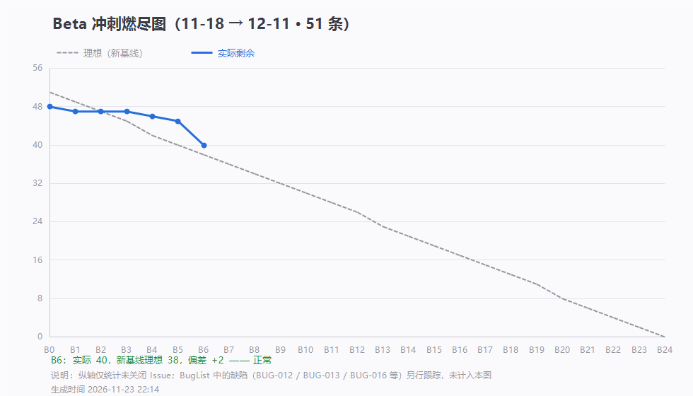

# 七仙过海 · Beta 冲刺第 10 周 Scrum Meeting 记录

> 团队：七仙过海 · 项目：PaperMind 论文阅读助手 · 中国海洋大学 软件工程
>
> 迭代：Beta 阶段（D21–D44）· 本周覆盖：第 10 周（2026-11-23 至 2026-11-29）
>
> 代码仓库：https://github.com/lin612320/TeamProject-PaperReadingHelper
>
> 发布地址：https://www.cnblogs.com/7ICS/p/23814216

---

## 一、本周迭代概览

本周连开四次站会，**关单 17 条**（#79 #81 #87 #88 #89 / #71 #59 #65 / #72 #90 #96 #82 / #73 #74 #75 #84 / #85），燃尽图从 **+2 落后转为 −1 领先**。主线是数据迁移、认证隔离、测试体系三条；11-28 站会把 Beta 出口收敛为“两大核心模块”。

| 日期       | 站会  | 出席  | 剩余 / 理想 | 主题                                        |
| -------- | --- | --- | ------- | ----------------------------------------- |
| 11-23（一） | 无记录 | —   | 40 / 38 | 连关 5 单：#79 #81 #87 #88 #89；审出 BUG-024~027 |
| 11-24（二） | 站会  | 7/7 | 37 / 36 | 关 #71 #59 #65；实跑暴露 BUG-028/029            |
| 11-25（三） | 无记录 | —   | 37 / 34 | 补 `reading_order` 列、三端 CI、契约 1.3.2        |
| 11-26（四） | 站会  | 7/7 | 33 / 32 | 连关 4 条：#72 #90 #96 #82                    |
| 11-27（五） | 站会  | 7/7 | 29 / 30 | 连关 4 条：#73 #74 #75 #84；契约 1.3.3/1.3.4     |
| 11-28（六） | 站会  | 7/7 | 27 / 28 | 关 #85；定出口口径；#76/#60、BUG-030/031           |
| 11-29（日） | —   | —   | —       | —                                         |

> 本周有会议记录 4 次（11-24、11-26、11-27、11-28）；11-23、11-25 无会议记录。

---

## 二、本周每人工作

### P1 林子航 · 组长 / 架构 / 集成

**本周已完成**

- 推动数据线（P6 主责）：[#87](https://github.com/lin612320/TeamProject-PaperReadingHelper/issues/87) [#88](https://github.com/lin612320/TeamProject-PaperReadingHelper/issues/88) [#89](https://github.com/lin612320/TeamProject-PaperReadingHelper/issues/89) 关单；一键启动脚本入库（`29288a0`）
- 契约三次升版：1.3.2 新增 5001（`1cadc9a`）、1.3.3 超时 25/15（`8c0bd72`）、1.3.4 explain 12/15（`d044498`）
- Docker 实跑复核 auth：BUG-026 通过、BUG-024 复现、新增 BUG-028/029（`a1841ae`）
- 11-28 主持 B11，定出口口径（`0943b64`）；燃尽图 B6–B11 更新

**计划完成**

- [#55](https://github.com/lin612320/TeamProject-PaperReadingHelper/issues/55) 双栏端到端走查（12-03）
- [#56](https://github.com/lin612320/TeamProject-PaperReadingHelper/issues/56) 单栏回归走查 + 与 Alpha 行为对比（12-04）
- [#57](https://github.com/lin612320/TeamProject-PaperReadingHelper/issues/57) Beta 出口条件定稿（12-10–11；11-28 站会已定“本轮不出出口条件文件”，需先确认关单或调整）
- [#58](https://github.com/lin612320/TeamProject-PaperReadingHelper/issues/58) Beta 演示脚本 + 一次彩排（12-09–10）
- 另：11-28 站会待办——功能清单整理为思维导图，11-30 前给全员

### P2 杨靖 · 前端 PDF 核心

**本周已完成**

- 引用框三态样式与图例（`1a5f18d`，[#59](https://github.com/lin612320/TeamProject-PaperReadingHelper/issues/59)）
- 长论文首屏：缩放只重绘当前页、取消过期渲染（`ac17a96`，[#60](https://github.com/lin612320/TeamProject-PaperReadingHelper/issues/60)）
- 11-28 站会提出“功能点太散、缺全局视角”，被采纳为 P1 的思维导图任务

**计划完成**

- [#60](https://github.com/lin612320/TeamProject-PaperReadingHelper/issues/60) 长论文首屏渲染优化（>50 页 ≤3 秒；代码已合未关）
- [#61](https://github.com/lin612320/TeamProject-PaperReadingHelper/issues/61) 双栏页「当前栏」判定（11-25–26）
- [#62](https://github.com/lin612320/TeamProject-PaperReadingHelper/issues/62) 引用块级跳转（11-26–27）
- [#63](https://github.com/lin612320/TeamProject-PaperReadingHelper/issues/63) 缩放 50%/200% 定位重算（11-28–29）
- [#64](https://github.com/lin612320/TeamProject-PaperReadingHelper/issues/64) 双栏 10 题框套准 + 旋转页对齐（12-01–02）

### P3 杨绎平 · 前端页面

**本周已完成**

- 11-27 提交登录/注册页静态稿与表单校验（`e8d84f3`，#66），等接口联调

**计划完成**

- [#66](https://github.com/lin612320/TeamProject-PaperReadingHelper/issues/66) 登录/注册页静态稿 + 表单校验（静态稿 11-27 已交，待联调关单）
- [#67](https://github.com/lin612320/TeamProject-PaperReadingHelper/issues/67) 划词低质输入拦截（11-23）
- [#68](https://github.com/lin612320/TeamProject-PaperReadingHelper/issues/68) 路由守卫 + 登录后回原页（11-28–29）
- [#69](https://github.com/lin612320/TeamProject-PaperReadingHelper/issues/69) token 持久化（刷新不掉线，12-01–02）
- [#70](https://github.com/lin612320/TeamProject-PaperReadingHelper/issues/70) 401 自动登出 + 统一错误提示（12-03–04）

### P4 刘万礼 · 后端业务

**本周已完成**

- [#72](https://github.com/lin612320/TeamProject-PaperReadingHelper/issues/72) 注册/登录/me + bcrypt（`134d0e3`），同时修 BUG-026
- BUG-024 explain 归属校验、BUG-029 映射 5001（`8970daf`）
- 11-28：BUG-031 explain 25s→12s（`8b3f963`）、BUG-030 429/403 限流 8s（`b6aeb04`）、#76 双源合并（`6e62084`）

**计划完成**

- [#76](https://github.com/lin612320/TeamProject-PaperReadingHelper/issues/76) 检索双源并发调用 + 结果合并（12-01；代码已合未关）
- [#77](https://github.com/lin612320/TeamProject-PaperReadingHelper/issues/77) 三级去重 + 稳定排序（12-02–03）
- [#78](https://github.com/lin612320/TeamProject-PaperReadingHelper/issues/78) 非 arXiv 来源导入打通 + `source` 枚举冲突修复（12-04–05）

### P5 吴啸天 · AI / RAG

**本周已完成**

- [#81](https://github.com/lin612320/TeamProject-PaperReadingHelper/issues/81) 写 `reading_order`（`afdcba6`）、[#82](https://github.com/lin612320/TeamProject-PaperReadingHelper/issues/82) 基线回归（`8cfe532`）
- [#84](https://github.com/lin612320/TeamProject-PaperReadingHelper/issues/84) 概览识别与召回（`8174c90`）、[#85](https://github.com/lin612320/TeamProject-PaperReadingHelper/issues/85) 修正概览引用（`f520ffd`）

**计划完成**

- [#83](https://github.com/lin612320/TeamProject-PaperReadingHelper/issues/83) 按 column 取主栏 bbox，标 `precise`/`block`（11-30–12-01）
- [#86](https://github.com/lin612320/TeamProject-PaperReadingHelper/issues/86) 引用片段截断与碎片过滤（12-02–04）
- 另：11-28 站会待办——概览匹配词库覆盖不全的排查结论，11-30 前

### P6 刘征 · 数据 / 部署

**本周已完成**

- [#87](https://github.com/lin612320/TeamProject-PaperReadingHelper/issues/87) [#88](https://github.com/lin612320/TeamProject-PaperReadingHelper/issues/88) users 表 + 外键 + 幂等迁移（`2de677d`）
- BUG-027 补 `reading_order` 列（`ef406cd`）；[#90](https://github.com/lin612320/TeamProject-PaperReadingHelper/issues/90) 三端 CI（`ca084aa`）；[#92](https://github.com/lin612320/TeamProject-PaperReadingHelper/issues/92) PR 模板（`c78de0a`）
- BUG-025 收尾：`8000` 宿主机映射已移除（`06d7036`）

**计划完成**

- [#91](https://github.com/lin612320/TeamProject-PaperReadingHelper/issues/91) 单测 + ai-service 脚本自检 job（11-27–28）
- [#92](https://github.com/lin612320/TeamProject-PaperReadingHelper/issues/92) PR 模板 + 故意提坏 PR 验证（模板已提，12-01 前验证）
- [#93](https://github.com/lin612320/TeamProject-PaperReadingHelper/issues/93) `backup.ps1`（不备 hf-cache，12-03）
- [#94](https://github.com/lin612320/TeamProject-PaperReadingHelper/issues/94) `restore.ps1` + 实测还原一次（12-04）
- 另：12-05 前收掉 5432/6379/8080 宿主机端口

### P7 李义朋 · 测试 / 文档

**本周已完成**

- [#95](https://github.com/lin612320/TeamProject-PaperReadingHelper/issues/95) 用例表 v1.1 首日回填（20 通过/6 不通过，`0fde6f0`）
- **#96** B18-01 超时 30.1s、B18-02 断网通过；**#97** B18-03 缓存过期、B18-04 429 通过（`1458d64`）
- BUG-022/024/027/029 回归关闭；BUG-031 登记并跟踪（`ab91dde`）
- 用例表升 v1.4（27 通过/2 不通过），BugList v1.11（30 条/已修复 24）
- 撰写 **第 10 周 Scrum Meeting 博客**（本篇，11-28 完成）

**计划完成**

- [#98](https://github.com/lin612320/TeamProject-PaperReadingHelper/issues/98) 多用户隔离 9 条交叉用例（12-05–06）
- [#99](https://github.com/lin612320/TeamProject-PaperReadingHelper/issues/99) 隔离结果入用例表 + 异常挂 BugList（12-06）
- [#100](https://github.com/lin612320/TeamProject-PaperReadingHelper/issues/100) Beta 测试报告（每条带证据来源，12-08–10）
- [#101](https://github.com/lin612320/TeamProject-PaperReadingHelper/issues/101) Scrum 博客 + BugList 升版 + 用例表定稿（12-10–11）

## 三、燃尽图

仓库位置：`docs/燃尽图/燃尽图-Beta-当前.png`、`docs/燃尽图/燃尽图-Beta模板.csv`

| 节点  | 日期    | 剩余  | 理想  | 偏差  | 说明            |
| --- | ----- | --- | --- | --- | ------------- |
| B6  | 11-23 | 40  | 38  | +2  | 连关 5 单        |
| B7  | 11-24 | 37  | 36  | +1  | 关 #71 #59 #65 |
| B8  | 11-25 | 37  | 34  | +3  | 无会议记录         |
| B9  | 11-26 | 33  | 32  | +1  | 连关 4 条        |
| B10 | 11-27 | 29  | 30  | −1  | 首次领先          |
| B11 | 11-28 | 27  | 28  | −1  | 关 #85         |

> 口径：燃尽只统计未关闭 Issue，不统计 BugList；“代码已合、单没关”会体现为曲线不动。

---

## 四、本周遇到的困难

**1. 代码审查挖出四条隔离缺陷。** BUG-024 explain 不校验归属、BUG-025 `/internal/*` 无鉴权（11-28 已移除 8000 映射）、BUG-026 静默回退 user1、BUG-027 `reading_order` 无建列——都是读代码读出来的，只测界面会整类漏掉。

**2. 存量库不跑迁移，注册直接 500。** `03` 里有 `users` 建表与幂等迁移，但旧卷不会自动执行；补跑后恢复，新增 BUG-028 记录升级路径缺口。

**3. DB 异常被错报 4001。** 排查方向被带向磁盘；契约 1.3.2 新增 5001，11-26 代码改为 5001（BUG-029）。

**4. 超时靠故障注入才测得出。** 正常使用碰不到（检索 30s vs 1–3s）；用只接不回服务、`docker pause`、导入改 1s、429 mock 分别验出 30.1s/25s/1.03s/0.197s，同时发现前端划词 15s 先撤、后端白跑。

**5. 契约三天升三版，BUG-031 修了又开。** 1.3.2 加 5001、1.3.3 超时 25/15、1.3.4 explain 12/15；文档改了但 `app.explain.timeout-seconds` 仍是 25，直到 11-28 `8b3f963` 才对齐。

**6. “做完了没关”反复出现。** #71/#79、#73/#74/#75、#60/#66/#76/#77/#78 都是代码在 master、单没关，燃尽曲线多次失真；站会已改为“先对单、再开新活”。

**7. 出口口径临时调整，且对外端口未收。** 11-28 决定 Beta 不强制双栏与用户系统，收敛为「个人知识库 + 学习记录反馈」；同时 5432/6379/8080 仍暴露，演示前必须收掉。

---

## 五、例会照片

本周 4 次站会，均为腾讯会议线上形式。

**11-24（7/7）**

**11-26（7/7）**

**11-27（7/7）**

**11-28（7/7）**

> 11-28 参会截图中刘征显示为昵称「12341234」，已核对为本人。

---

## 六、每人的代码 / 文档签入记录

> 本周主要提交节选，合并与重复提交未单列；完整记录可用 `git log --since=2026-11-23 --until=2026-11-29` 复现。

### P1 林子航

| commit    | 日期    | 说明                                                  | Issue       |
| --------- | ----- | --------------------------------------------------- | ----------- |
| `8b05231` | 11-23 | 燃尽 B6 至 40；新增 BUG-027                               | #81 #87 #88 |
| `a1841ae` | 11-24 | Docker 实跑 auth：BUG-026 通过、BUG-024 复现、新增 BUG-028/029 | #71 #72     |
| `1cadc9a` | 11-25 | 契约 1.3.2 新增 5001                                    | #54 #72     |
| `8c0bd72` | 11-27 | 契约 1.3.3：qa 25s、3002 文案、explain 15s                 | #100        |
| `d044498` | 11-27 | 契约 1.3.4：explain 后端 12s、前端 15s                      | #100        |
| `0943b64` | 11-28 | 11-28 站会记录：定最终出口口径                                  | #3          |

### P2 杨靖

| commit    | 日期    | 说明           | Issue |
| --------- | ----- | ------------ | ----- |
| `1a5f18d` | 11-24 | 引用框三态样式与图例   | #59   |
| `ac17a96` | 11-28 | 长论文首屏：只重绘当前页 | #60   |

### P3 杨绎平

| commit    | 日期    | 说明               | Issue |
| --------- | ----- | ---------------- | ----- |
| `e8d84f3` | 11-27 | 登录/注册页静态稿 + 表单校验 | #66   |

### P4 刘万礼

| commit    | 日期    | 说明                          | Issue           |
| --------- | ----- | --------------------------- | --------------- |
| `134d0e3` | 11-24 | 注册/登录/me + bcrypt，修 BUG-026 | #72             |
| `8970daf` | 11-26 | explain 归属校验 + DB 异常 5001   | BUG-024 BUG-029 |
| `8b3f963` | 11-28 | explain 25s→12s             | BUG-031         |
| `b6aeb04` | 11-28 | 429/403 识别为限流、单次 8s         | BUG-030         |
| `6e62084` | 11-28 | 检索双源合并 + 三级去重               | #76             |

### P5 吴啸天

| commit    | 日期    | 说明                                  | Issue |
| --------- | ----- | ----------------------------------- | ----- |
| `afdcba6` | 11-23 | 按 band/column/y0/x0 写 reading_order | #81   |
| `8cfe532` | 11-24 | reading_order 基线回归                  | #82   |
| `8174c90` | 11-27 | 概览召回增强                              | #84   |
| `f520ffd` | 11-28 | 概览识别与引用修正                           | #85   |

### P6 刘征

| commit    | 日期    | 说明                       | Issue   |
| --------- | ----- | ------------------------ | ------- |
| `2de677d` | 11-23 | users 表 + 外键 + 幂等迁移      | #87 #88 |
| `ef406cd` | 11-25 | chunks 补 reading_order 列 | BUG-027 |
| `ca084aa` | 11-25 | 三端 CI workflow           | #90     |
| `c78de0a` | 11-28 | PR 模板                    | #92     |

### P7 李义朋

| commit    | 日期    | 说明                              | Issue    |
| --------- | ----- | ------------------------------- | -------- |
| `0fde6f0` | 11-25 | 用例表 v1.1 回填 20/6                | #95 #96  |
| `ff017c7` | 11-26 | #96 两条通过；超时专项汇总；BUG-031         | #96 #100 |
| `1458d64` | 11-27 | #97 收尾 + 四条 Bug 回归；v1.4 / v1.11 | #97 #100 |

## 七、小结

- 本周关单 17 条，燃尽 +2 → −1；数据迁移、认证隔离、测试体系、检索召回四条线接上；
- BUG-024/025/026/027 来自代码审查，BUG-028/029 来自实跑；BUG-022/024/027/029 已回归关闭，BUG-030/031 于 11-28 修复；
- 契约连升 1.3.2/1.3.3/1.3.4，BUG-031 直到代码对齐 explain 12s 才具备关闭条件；
- 11-28 定出口口径：两大核心模块，不强制双栏与用户系统；单篇引用跳转保留，砍跨文献跳转。
