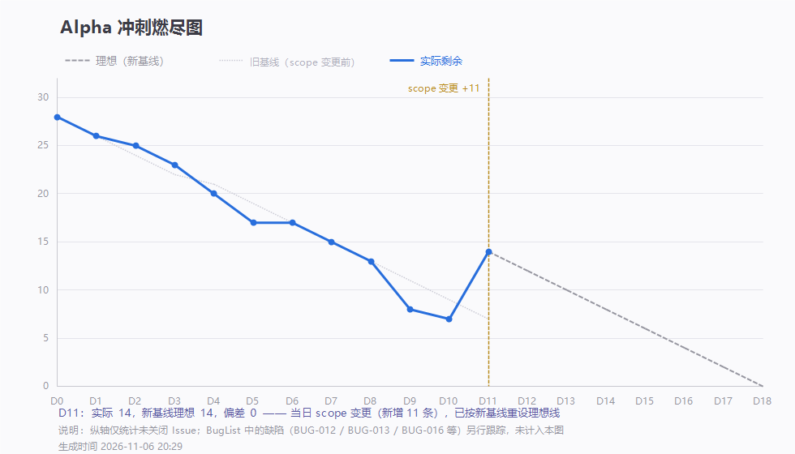

# 七仙过海 · Alpha 冲刺第 7 周 Scrum Meeting 记录

> 团队：七仙过海 · 项目：PaperMind 论文阅读助手 · 中国海洋大学 软件工程
>
> 迭代：Alpha 阶段（第 5–8 周，D1–D18）· 本周覆盖：第 7 周（2026-11-02 至 2026-11-08）
>
> 代码仓库：https://github.com/lin612320/TeamProject-PaperReadingHelper
>
> 发布地址：https://www.cnblogs.com/7ICS/p/23594426.html

---

## 一、本周迭代概览

本周是 Alpha 的转折点：原计划 D15（11-10）收尾，D11 晚按老师建议延展到 D18（11-13），并把 Beta 的三项功能（关键词检索导入、引用 bbox 高亮、划词翻译）提前到本轮。范围从 28 条 Issue 扩到 37 条基线。

| 日期       | 站会     | 出席  | 剩余 / 理想 | 本周主题                                        |
| ------------- | ------------ | ------- | ------------- | -------------------------------- |
| 11-03（一） | 第 8 天  | 7/7 | 13 / 13 | 翻页缩放合入、上传动作修好、问答转发补充、一次整站白屏事故               |
| 11-04（二） | 第 9 天  | 7/7 | 12 / 11 | 容器化一条命令起全栈、AI 问答接口打通、端到端走查第一轮               |
| 11-05（三） | 第 10 天 | 7/7 | 7 / 9   | 解析超时改 180 秒、上传后缀校验、引用页码跳转、F3 抽样 9/10        |
| 11-06（四） | 第 11 天 | 7/7 | 14 / 14 | 端到端六步全过、契约升 1.0.2、Alpha 延展至 D18             |
| 11-07（六） | 无站会    | —   | —       | 延展段启动：契约 1.1.0 起草、BugList v1.0、用例表 36 条入库   |
| 11-08（日） | 第 13 天 | 7/7 | 13 / 10 | 契约 1.1.0 冻结、arXiv 检索上线、bbox 主体完成、BUG-013 修复 |

> D12（11-07，周六）按计划不集合，故无站会与燃尽数据；本周实际召开 5 次站会。

---

## 二、本周每人工作

### P1 林子航 · 组长 / 架构 / 集成

**本周已完成**

- 端到端走查从手册到结论闭环：[#4](https://github.com/lin612320/TeamProject-PaperReadingHelper/issues/4)（六步全过，已关闭）
- 对外契约升 1.0.2：`AskRequest` 新增 `apiKey/baseUrl/model`，写明「不落库、不写日志、不回显」
- 容器化三处缺陷修复：nginx 上传上限 1m→55m、ai-service 挂 uploads 卷、torch 换 CPU 版省约 5GB
- 按老师反馈制定延展段计划并拆出 9 条 Issue（[#38](https://github.com/lin612320/TeamProject-PaperReadingHelper/issues/38)–[#46](https://github.com/lin612320/TeamProject-PaperReadingHelper/issues/46)）
- 燃尽图三次修正：不再把 scope 变更判成落后 → 改双基线
- 对外契约冻结 **1.1.0**：`/api/search` 实装、新增 `/api/papers/import`、`bboxMode` 语义化、错误码 3003、时间须带时区（`482ba58`）
- D13 站会记录与燃尽数据修正（`fb91454` `47d464b` `ab8ac5b` `b017e03` `88a5db0`）

**计划完成**

- 软工原理 / 方法 / 技能报告统稿：[#45](https://github.com/lin612320/TeamProject-PaperReadingHelper/issues/45)
- 出口条件按延展后范围重写：[#28](https://github.com/lin612320/TeamProject-PaperReadingHelper/issues/28)

### P2 杨靖 · 前端 PDF 核心

**本周已完成**

- [#6](https://github.com/lin612320/TeamProject-PaperReadingHelper/issues/6) 翻页 + 缩放 + 跳页完成并合入（已关闭）
- 修复自己引入的一次整站白屏：`<style>` 里写了 `//` 注释（`39e56a8`）
- [#8](https://github.com/lin612320/TeamProject-PaperReadingHelper/issues/8) 引用页码点击跳转 PDF 对应页（已关闭）

**计划完成**

- [#41](https://github.com/lin612320/TeamProject-PaperReadingHelper/issues/41) 引用 bbox 高亮层：跳页 + 半透明框 + 淡出 + 缩放对齐

### P3 杨绎平 · 前端页面

**本周已完成**

- [#9](https://github.com/lin612320/TeamProject-PaperReadingHelper/issues/9) 上传页修复：上传按钮 / 拖拽 / 进度条 / 开发代理（BUG-001 关闭）
- [#12](https://github.com/lin612320/TeamProject-PaperReadingHelper/issues/12) API 与 PDF 异常提示统一，避免裸露技术错误
- 新增 AI 问答 API Key 配置页面
- 修复 BUG-013（S1）：nginx 静态资源 MIME（`.mjs` → `application/javascript`），容器内阅读页白屏解决（`50fa38e`，合并 `e451dd9`）

**计划完成**

- [#39](https://github.com/lin612320/TeamProject-PaperReadingHelper/issues/39) 检索结果页 + 一键导入（三态齐全）
- [#42](https://github.com/lin612320/TeamProject-PaperReadingHelper/issues/42) 划词翻译浮层（配合 P5 接口）

### P4 刘万礼 · 后端业务

**本周已完成**

- [#13](https://github.com/lin612320/TeamProject-PaperReadingHelper/issues/13) 解析超时改可配置（180 秒）、失败原因按类型返回、上传加后缀校验
- [#15](https://github.com/lin612320/TeamProject-PaperReadingHelper/issues/15) 问答转发改 `HttpClient` 强制 HTTP/1.1、未知路径返回 404
- 恢复 PDF 文件头校验（`03ca4b8`），阻止 docx 改名入库（BUG-004 回归关闭）
- 恢复 `apiKey/baseUrl/model` 三字段透传、时间统一 Asia/Shanghai、`file_path` 改相对路径
- 新增错误码 `3003 AI_SERVICE_AUTH_ERROR`，问答区分 Key 无效
- 新增 `GET /api/search` + `ArxivClient`，接入 arXiv 检索并映射 `PaperMeta`（`de7bbe4`，`#38` 起步）

**计划完成**

- [#38](https://github.com/lin612320/TeamProject-PaperReadingHelper/issues/38) 补 `/api/papers/import` 导入逻辑（arXiv 检索已完成），再加 OpenAlex 兜底与 10s 超时降级

### P5 吴啸天 · AI / RAG

**本周已完成**

- [#19](https://github.com/lin612320/TeamProject-PaperReadingHelper/issues/19) 问答链路闭环：检索 + Prompt + DeepSeek + `/internal/qa/ask` + 自检脚本（已关闭）
- embedding 启动预热，避免首次提问超时；bge-m3 改为优先本地缓存
- 修复双栏块顺序并过滤 PDF 控制字符
- [#20](https://github.com/lin612320/TeamProject-PaperReadingHelper/issues/20) F3 抽样：3 篇论文 10 题命中 **9/10**、未涉及 3/3
- [#40](https://github.com/lin612320/TeamProject-PaperReadingHelper/issues/40) 主体：块级归一化 bbox，切片携带坐标与版面模式（`12da76a`）

**计划完成**

- [#40](https://github.com/lin612320/TeamProject-PaperReadingHelper/issues/40) `bboxMode` 入库、问答响应返回 bbox（单栏 ≥8/10 套准；双栏标 `block`）
- [#42](https://github.com/lin612320/TeamProject-PaperReadingHelper/issues/42) `/api/explain` 划词翻译 / 术语解释接口

### P6 刘征 · 数据 / 部署

**本周已完成**

- [#23](https://github.com/lin612320/TeamProject-PaperReadingHelper/issues/23) 一条命令起全栈：三份 Dockerfile + nginx 反向代理 + compose 五服务（已关闭）
- 补齐全栈 healthcheck、后端启动自检日志 `[STARTUP]`、README 更新

**计划完成**

- [#43](https://github.com/lin612320/TeamProject-PaperReadingHelper/issues/43) 检索缓存 + 外部接口降级（Redis，24 小时）
- 容器化两个 S1 的处置已在 D13 定案：BUG-013 由 P3 修复并已复测；BUG-012 决定接受风险、不修

### P7 李义朋 · 测试 / 文档

**本周已完成**

- [#24](https://github.com/lin612320/TeamProject-PaperReadingHelper/issues/24) 冒烟用例表从 v0.6 迭代到 v0.9：35 条用例，截至 D13 为 **33 通过 / 1 不通过（F4-01）/ 1 未测（F4-07）**
- [#25](https://github.com/lin612320/TeamProject-PaperReadingHelper/issues/25) BugList 从 v0.4 到 v1.1：15 条缺陷记录，**14 条已修复、1 条接受风险（BUG-012）**
- 容器化后新增 BUG-011（时间差 8 小时）、BUG-012（模型缺失）、BUG-013（`.mjs` MIME）、BUG-015（绝对路径）、BUG-016（apiKey 未转发）
- 新增 Alpha 延展段冒烟用例表 36 条（F5 检索 / F6 bbox / F7 划词 / F8 工程化 / F9 契约）
- 复测 BUG-013 通过（8081 阅读页正常渲染）；BugList 升 v1.1，BUG-012 按 D13 决定转「不修复（接受风险）」
- 第 7 周 Scrum Meeting 博客（本篇）

**计划完成**

- [#44](https://github.com/lin612320/TeamProject-PaperReadingHelper/issues/44) Alpha 测试报告（四份散文档收敛为一份）
- [#24](https://github.com/lin612320/TeamProject-PaperReadingHelper/issues/24) / [#25](https://github.com/lin612320/TeamProject-PaperReadingHelper/issues/25) 收口、[#28](https://github.com/lin612320/TeamProject-PaperReadingHelper/issues/28) 出口条件定稿

---

## 三、燃尽图

仓库位置：`docs/燃尽图/燃尽图-当前.png`（每日更新）、`docs/例会/2026-11-0X/燃尽图-D8~D13.png`（每日快照）

| 节点         | 剩余 Issue       | 理想  | 说明                                                          |
| -------------- | ------------ | -------- | ------------------------------------ |
| D8（11-03）  | 13             | 13  | 连续三天压线（与理想持平）                                               |
| D9（11-04）  | 12             | 11  | 首次落后理想线 1 条                                                 |
| D10（11-05） | 7              | 9   | 领先 2 条                                                      |
| D11（11-06） | 14             | 14  | 范围扩到 37 条基线后重设理想线，正好压线                                      |
| D12（11-07） | —              | —   | 按计划周六不集合，无站会、无燃尽数据                                          |
| D13（11-08） | 13（关 #24 后 12） | 10  | 落后 3 条（会上复盘归因于 issue 颗粒度过粗）；arXiv 检索与 bbox 主体进主干，BUG-013 修复 |

> 口径说明：燃尽度量的是**未关闭 Issue 数**。D11 的阶跃是老师要求扩范围导致的 scope 变更，图上保留该点并注明原因；D12（11-07，周六）不集合，无站会与燃尽数据。

---

## 四、本周遇到的困难

**1. 解析链路的瓶颈**

真实解析一篇 16 页论文要 60 秒以上（65 个切片），后端原来的上限只有 25 秒，导致上传后必然 `parseStatus=failed`、`chunkCount=0`。页数与问答正例全部无法验证。直到 D10 把超时改成可配置（默认 180 秒），同文件 50.7 秒解析成功，这条链路才通。

**2. 容器化暴露了一类"本机能跑 ≠ 交付可用"的问题。**

连续遇到四处问题：容器 JVM 是 UTC 导致时间差 8 小时；命名卷是空的、镜像又没预置模型，干净环境解析必失败；nginx 的 `mime.types` 里没有 `.mjs`，pdf.js worker 被浏览器按 ES 模块规范拒绝执行、阅读页白屏；`file_path` 存的是绝对路径，切换运行方式后旧记录打不开。共同点是：宿主机的时区、缓存、代理、开发服务器行为，全部是隐式依赖，容器里一个都不存在。

**3. 容器健康状态会"骗人"。**

AI 服务预热失败不阻塞启动，容器一直显示 `healthy`，但模型根本不可用。`docker compose ps` 全绿并不等于能用——这条后来写进缺陷的附加风险，也提示健康检查应该探"模型是否就绪"而不是"进程是否活着"。

**4. API Key 这条链路改了三轮。**

契约 1.0.2 新增 `apiKey/baseUrl/model`，但后端转发时把三个字段丢了，用户填了 Key 也不生效；修好后还要区分"用户 Key 无效"和"AI 服务故障"——最终新增错误码 `3003 AI_SERVICE_AUTH_ERROR`（HTTP 400），而不是复用语义完全不同的 2002。

**5. 环境与网络的不可控**

Docker Hub 直连不可达（`auth.docker.io` 解析到污染地址）、HuggingFace 下载模型动辄十分钟、校园网对境外接口时通时断。需要团队把"降级"做进设计：检索加 Redis 缓存、模型优先读本地缓存、演示前预跑一遍。（见 D9/D13 站会记录与《Alpha 延展段计划》§七风险表）

**6. 回归发现"改一处、坏一处"。**

修复 BUG-009（按后缀校验）时把已有的 `isPdf()` 文件头校验漏掉了，导致 BUG-004 回退、F1-04 由通过变不通过。这条在 D11 被复测抓出来，随后 `03ca4b8` 修复。说明单点修改后要再跑一遍回归用例。

**7. Issue 颗粒度过粗，把燃尽图测“歪”了。**

D13 会上复盘：两天里合了 bbox、检索、MIME 修复、BugList v1.0、36 条用例，图却一直平着走。根因不是没人干，而是一条 Issue 里装着好几天的活（心得、测试报告、检索适配层都是），做到 80% 也不能关。决定：以后按模块拆 issue，一条对应一个可独立验收的交付物，写进 `CONTRIBUTING`。

**8. 契约改完没提交、没通知，三个人按旧图纸施工。**

契约从 1.0.2 改到 1.1.0 后没有及时提交和通知：P5 不知道 `bboxMode` 字段叫什么，P4 不知道有 `/api/papers/import`（只能搜不能导），文档里已关闭的 #19/#20 还标着「顺延」。契约是团队唯一的字段真相，改完不提交等于没改。规则补一条：契约改动必须「提交 + 群里通知 + 点名受影响的人」，一次做完。

**9. 同一个 Bug 被分给了两个人。**

BUG-013 同时被告知分给 P3 和 P6，两边都以为对方在做。决定：分配一律以 issue 上的 assignee 为准，口头分配后立刻补到 issue，避免「两个人都以为对方在做」。

---

## 五、例会照片

本周共 **5 次**记录在案的站会，均为腾讯会议线上形式。D12（11-07，周六）按计划不集合，故无站会与照片。

**11-03（第 8 天，7/7）**

**11-04（第 9 天，7/7）**

**11-05（第 10 天，7/7）**

**11-06（第 11 天，7/7）**

**11-08（第 13 天，7/7）**

---

## 六、每人的代码 / 文档签入记录

> 本节为本周主要提交节选（合并提交、重复提交未单列），完整记录可用 `git log --author=<姓名> --since=2026-11-02 --until=2026-11-08` 复现。
> 各 Issue 编号对应的工作内容与 GitHub 链接见第二节。本周 7 人共 86 次提交。

### P1 林子航

| commit    | 日期    | 说明                                           | Issue          |
| ------------ | ------------- | ------------------------------------ | -------------- |
| `aa9dc28` | 11-06 | Alpha 延展至 D18，提前 3 项 Beta 功能、新增 #36–#46      | #3 #37 #44 #45 |
| `abc95c7` | 11-06 | 对外契约升 1.0.2（`apiKey/baseUrl/model`，密钥不落库）    | #19            |
| `3f897b8` | 11-06 | 容器化三处缺陷：nginx 上传 55m、uploads 卷、torch CPU 版   | #4 #23         |
| `ce97abc` | 11-06 | Alpha 端到端验收报告（六步全过 + 8 条缺陷全过程）               | #4             |
| `87b3d8c` | 11-06 | 燃尽图改双基线，不再把 scope 变更判成落后                     | #3             |
| `0f12314` | 11-06 | 更正错误码：假 Key 返回 3003 而非 2002                  | #25 #28        |
| `482ba58` | 11-08 | 对外契约冻结 1.1.0（search 实装、import、bboxMode、3003） | #38 #40        |
| `fb91454` | 11-08 | D13 站会记录（燃尽归因、契约漏提交、BUG-013 已修、012 接受风险）     | #3 #25 #28     |

### P2 杨靖

| commit    | 日期    | 说明                            | Issue |
| ------------ | ------------- | ------------------------------------ | -------------- |
| `7f805d4` | 11-03 | PDF 阅读器翻页 + 缩放                | #6    |
| `39e56a8` | 11-03 | 修正 ReaderView 样式块中非法的 `//` 注释 | #6    |
| `9b35a62` | 11-05 | 引用页码点击跳转 PDF 对应页              | #8    |

### P3 杨绎平

| commit    | 日期    | 说明                                      | Issue |
| ------------ | ------------- | ------------------------------------ | -------------- |
| `6883357` | 11-02 | 修复上传页无法提交（BUG-001），上传按钮/拖拽/进度条          | #9    |
| `0fa39e8` | 11-02 | 统一 API 与 PDF 异常提示，避免裸露技术错误              | #12   |
| `9c50278` | 11-05 | 新增 AI 问答 API Key 配置页面                   | #9    |
| `50fa38e` | 11-08 | 修复 nginx 静态资源 MIME 导致 PDF 渲染失败（BUG-013） | #25   |

### P4 刘万礼

| commit    | 日期    | 说明                                                         | Issue |
| ------------ | ------------- | ------------------------------------ | -------------- |
| `bcd90cf` | 11-03 | 解析调用强制 HTTP/1.1、超时可配置、非法 JSON 返回 1001                      | #13   |
| `9e4d8fd` | 11-04 | 问答转发强制 HTTP/1.1、未知路径返回 404                                 | #15   |
| `410ed69` | 11-05 | 解析超时可配（180s）、失败原因可读、上传校验后缀                                 | #25   |
| `03ca4b8` | 11-05 | 恢复 PDF 文件头校验，阻止纯文本改名入库                                     | —     |
| `f84e85b` | 11-06 | 透传 apiKey/baseUrl/model、时间统一 Asia/Shanghai、file_path 改相对路径 | #25   |
| `0aeb4c0` | 11-06 | 新增错误码 3003 `AI_SERVICE_AUTH_ERROR`                         | #25   |
| `de7bbe4` | 11-08 | 新增 `GET /api/search`，接入 arXiv 并映射 PaperMeta                | #38   |

### P5 吴啸天

| commit    | 日期    | 说明                                    | Issue |
| ------------ | ------------- | ------------------------------------ | -------------- |
| `dd172d7` | 11-05 | ai-service 启动预热 embedding 模型          | #19   |
| `3bd560a` | 11-05 | 检索阶段超时文案改为「检索阶段耗时超过预算」                | #19   |
| `b8bee62` | 11-05 | 修复双栏块顺序并过滤 PDF 控制字符                   | #17   |
| `427d24a` | 11-05 | 三样本单论文 F3 题库测试                        | #20   |
| `ca2ae1d` | 11-05 | 记录 F3 论文抽样结果（9/10）                    | #20   |
| `fa47bc6` | 11-06 | AI 服务识别模型 401/403，返回 `LLM_AUTH_ERROR` | #25   |
| `12da76a` | 11-08 | 抽取块级归一化 bbox，切片携带坐标与版面模式              | #40   |

### P6 刘征

| commit    | 日期    | 说明                               | Issue |
| ------------ | ------------- | ------------------------------------ | -------------- |
| `7d39ee8` | 11-04 | `docker compose up` 一条命令起全栈，日志可查 | #23   |
| `7708fe5` | 11-05 | 补齐全栈 healthcheck、后端启动自检日志、README | #23   |

### P7 李义朋

| commit    | 日期    | 说明                                         | Issue   |
| ------------ | ------------- | ------------------------------------ | -------------- |
| `5d768f1` | 11-03 | 冒烟回归：新增 12 条全通过，Bug 复测 6 条通过               | #24 #25 |
| `d02344f` | 11-04 | BugList v0.5 新增 BUG-008/009/010，F3-08 通过   | #24 #25 |
| `0743c7f` | 11-05 | 用例 7 条通过、Bug 复测 4 条通过（31 通过 / 0 不通过）       | #24 #25 |
| `b8d3bcb` | 11-05 | BUG-004 回归：F1-04 回退不通过（30 通过 / 1 不通过）      | #24 #25 |
| `8f2c896` | 11-06 | 用例表 v0.9 / BugList v0.7，新增 BUG-011~013/015 | #24 #25 |
| `143a29d` | 11-07 | BugList v1.0（011/015/016 复测通过）、延展段用例表 36 条 | #24 #25 |

---

## 七、小结

- 六步演示链路（上传 → 渲染 → 提问 → 到达页码 → 点页码跳转 → 错误提示）在 D11 全部走通，`#4` 关闭；
- 冒烟 35 条用例累计 33 通过 / 1 不通过（F4-01）/ 1 未测（F4-07）；BUG-013 修复后 F4-01 待复测；BugList 15 条缺陷中 14 条已修复，1 条（BUG-012）经 D13 决定「接受风险、不修复」，前提是演示统一用预置好模型的机器、不清卷不换目录；
- 容器化两个 S1 里，BUG-013 已修复并复测通过；BUG-012 的风险落在“答辩机不是干净环境”这个假设上，需要 README 与启动脚本把“首次需预置模型”写明；
- 按老师建议把周期延展到 D18，并从 Beta 提前 3 项功能：契约 1.1.0、arXiv 检索接口、bbox 坐标主体都已在 D13 落进主干，剩下导入逻辑（`#38`）、`bboxMode` 入库（`#40`）、检索缓存（`#43`）三件事；
