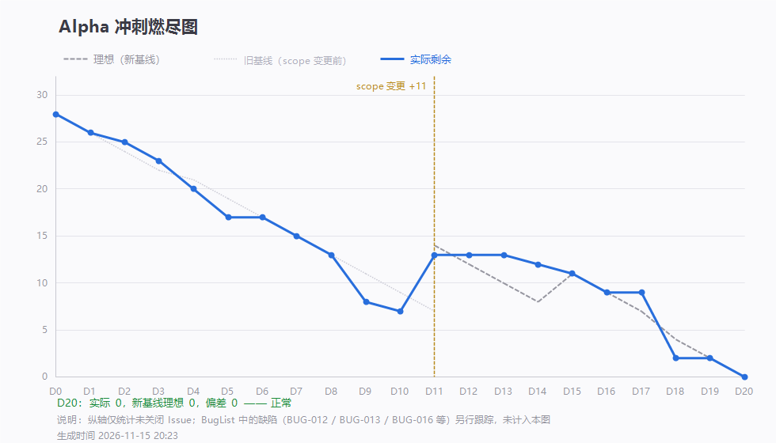

# 七仙过海 · Alpha 阶段交付博客

> 团队：七仙过海 · 项目：PaperMind 论文阅读助手 · 中国海洋大学 软件工程
> 迭代：Alpha（D1 2026-10-27 → D20 2026-11-15，共 20 天）
> 仓库：https://github.com/lin612320/TeamProject-PaperReadingHelper
> 本文含三部分：**一、Scrum Meeting（三周）** · **二、测试报告** · **三、习得的软件工程原理、方法与技能**
> 编写：P7 李义朋 · 2026-11-15

---

# 一、Scrum Meeting（三周迭代记录）

> 本节数据全部来自仓库一手记录：`docs/例会/` 14 份例会记录、`docs/燃尽图/燃尽图模板.csv`、`git log --since=2026-10-27 --until=2026-11-16`（共 208 条提交）

## 1.1 三周概览

| 周次    | 日期            | 例会                                | 提交数 | 剩余 Issue（起 → 止）     | 本周主线                              |
| ----- | ------------- | --------------------------------- | --- | ------------------- | --------------------------------- |
| 第 6 周 | 10-27 → 11-01 | 5 次（D1–D4、D6；10-31 休会）            | 56  | 26 → 17（基线 28）      | 三份契约冻结、Compose 骨架、PDF 渲染、上传链路首次跑通 |
| 第 7 周 | 11-02 → 11-08 | 5 次（D8–D11、D13；11-02 与 11-07 无站会） | 89  | 15 → 13（基线 28 → 37） | 端到端六步跑通、容器化、扩范围到 D18、契约 1.1.0     |
| 第 8 周 | 11-09 → 11-15 | 4 次（D15–D18；11-14、11-15 只收尾）      | 63  | 12 → 0（基线 37）       | 三项新功能收口、测试收官、出口条件定稿（完结日 D20）      |

> Alpha 期间共 14 次站会（腾讯会议），13 次 7/7 全员到齐，仅 D2（10-28）6/7——P4 身体不适缺席，会后补报进度。

---

## 1.2 燃尽图

| 节点         | 实际剩余 | 理想      | 说明                                                            |
| ---------- | ---- | ------- | ------------------------------------------------------------- |
| D0（10-26）  | 28   | 28      | 基线                                                            |
| D4（10-30）  | 20   | 21      | 首次领先                                                          |
| D9（11-04）  | 8    | 11      | 会后连关 4 个 issue，单日完成 5 条                                       |
| D11（11-06） | 13   | 14（新基线） | 第一次变动：应老师要求新增三项功能、保持开发活动，完结日 D15 → D18；基线 28 → 37，新理想线从 14 起算 |
| D15（11-10） | 11   | 11      | 第二次变动：与助教讨论后，完结日 D18 → D20；文档三条重新计入，剩余回到 11                   |
| D18（11-13） | 2    | 4       | 三条新功能关单 + 心得/用例/BugList 收口，单日完成 7 条                           |
| D20（11-15） | 0    | 0       | 本博客交付后 Issue 全部清零                                             |

> 图上 D11 那根竖直虚线是**第一次变动**点，D15 那根是**第二次变动**点。两次都不是进度问题，而是范围与周期变了

## 1.3 第 6 周（2026-10-27 → 11-01）

> 第6周独立博客：https://www.cnblogs.com/7ICS/p/23514909.html

**每人已完成的工作**

| 成员         | 已完成的工作                                                                                                                                                                                                                               | Issue                                                                                                                                                                                                                                                                                                       |
| ---------- | ------------------------------------------------------------------------------------------------------------------------------------------------------------------------------------------------------------------------------------ | ----------------------------------------------------------------------------------------------------------------------------------------------------------------------------------------------------------------------------------------------------------------------------------------------------------- |
| **P1 林子航** | 维护三份接口契约并把 bbox 坐标约定并入；Docker Compose 骨架并验证 `up -d` 可用；环境与数据库验收脚本 `verify-db.ps1`；Issue 板 / 燃尽图体系 / 五次例会记录与留证；bbox 坐标约定单列成文档并同步契约 1.0.1；分支开发与合并规则写入文档；`release` 合入 master 打快照 `v0.4-alpha-d6`；完成近两天 29 个文件、+1516 −176 的代码审查并列出 6 条阻断 | [#1](https://github.com/lin612320/TeamProject-PaperReadingHelper/issues/1) [#2](https://github.com/lin612320/TeamProject-PaperReadingHelper/issues/2) [#3](https://github.com/lin612320/TeamProject-PaperReadingHelper/issues/3) [#7](https://github.com/lin612320/TeamProject-PaperReadingHelper/issues/7) |
| **P2 杨靖**  | PDF.js 单栏连续渲染接入，打开文献即可渲染（PR #34 已合入）                                                                                                                                                                                                 | [#5](https://github.com/lin612320/TeamProject-PaperReadingHelper/issues/5)                                                                                                                                                                                                                                  |
| **P3 杨绎平** | 上传页含非 PDF 格式校验；文献列表页；问答侧栏 loading / 错误 / 重试三态；修复阅读页返回列表的跳转问题                                                                                                                                                                         | [#9](https://github.com/lin612320/TeamProject-PaperReadingHelper/issues/9) [#10](https://github.com/lin612320/TeamProject-PaperReadingHelper/issues/10) [#11](https://github.com/lin612320/TeamProject-PaperReadingHelper/issues/11)                                                                        |
| **P4 刘万礼** | 初始化 Spring Boot 骨架与统一响应结构；接入 JDBC 与 PostgreSQL 数据源；文件上传接口与本地存储（「接收 → 存盘 → 入库」链路跑通）；列表接口改真实查询 + 文献详情；异步解析流程；文献删除、PDF 文件流、解析 mock/真实切换；按测试报告修复 4 类问题（响应结构、文件头校验、超限 1003、请求日志），待复测                                                      | [#13](https://github.com/lin612320/TeamProject-PaperReadingHelper/issues/13) [#14](https://github.com/lin612320/TeamProject-PaperReadingHelper/issues/14)                                                                                                                                                   |
| **P5 吴啸天** | ai-service 骨架接口服务；PyMuPDF 文本抽取（按 blocks 顺序）；论文切片与 Embedding 写入 `chunks` 表（`#18` 已关闭）；内部论文解析与清理接口                                                                                                                                     | [#17](https://github.com/lin612320/TeamProject-PaperReadingHelper/issues/17) [#18](https://github.com/lin612320/TeamProject-PaperReadingHelper/issues/18)                                                                                                                                                   |
| **P6 刘征**  | 建库建表，含 bbox 可空字段与 `reading_session` / `annotation` 空表；后端接入 Redis（能存能取、连接地址走环境变量，待验收）；README 补「改建表 SQL 需 `down -v` 才生效」                                                                                                               | [#21](https://github.com/lin612320/TeamProject-PaperReadingHelper/issues/21) [#22](https://github.com/lin612320/TeamProject-PaperReadingHelper/issues/22)                                                                                                                                                   |
| **P7 李义朋** | 冒烟测试用例表 v0.1（35 条 + L1/L2/L3 分层）；首轮执行：13 条可执行用例 8 通过 / 4 不通过 / 1 测不了；BugList 7 条缺陷；第 6 周 Scrum Meeting 博客原文入库                                                                                                                        | [#24](https://github.com/lin612320/TeamProject-PaperReadingHelper/issues/24) [#25](https://github.com/lin612320/TeamProject-PaperReadingHelper/issues/25) [#26](https://github.com/lin612320/TeamProject-PaperReadingHelper/issues/26)                                                                      |

**例会照片**（本周 5 次；出席 10-27 7/7、10-28 6/7、10-29 7/7、10-30 7/7、11-01 7/7）

**签入记录**（节选，全部经 `git log` 核对）

| 成员  | 代表提交                                                        | 说明                                                  | Issue       |
| --- | ----------------------------------------------------------- | --------------------------------------------------- | ----------- |
| P1  | `16702a8` `ee70284` `c140083` `7b115a1` `ae54710`           | D1–D6 例会记录与燃尽图、bbox 约定转 markdown、11-01 留证、分支规则、验收脚本 | #2 #3 #7    |
| P2  | `10e1afe` `b8c7320`                                         | PDF.js 单栏连续渲染、PR #34 合入                             | #5          |
| P3  | `8b32111` `fe9381c` `b8aea63` `2292113` `5a436cb` `93e3fa0` | 上传格式校验、文献列表页、问答侧栏三态、返回列表跳转修复                        | #9 #10 #11  |
| P4  | `a971a0f` `7473f4b` `3e4c30d` `e7526f5` `8e83d38` `d8c4397` | 骨架与统一响应、上传接口、列表真实查询、异步解析、删除与文件流、冒烟问题修复              | #13 #14     |
| P5  | `c80b12a` `1d8ebc1` `b54650f` `14a64f0` `0ce4c46`           | 骨架接口、PyMuPDF 抽取、切片与 Embedding 入库、内部解析清理、合法 PDF 校验   | #17 #18     |
| P6  | `b687747` `8ecb98c`                                         | 建表 SQL 说明、后端接入 Redis                                | #21 #22     |
| P7  | `2100371` `0c4f41f` `c35ca6e`                               | 用例表 v0.1（35 条）、首轮执行 + BugList 7 条、第 6 周博客入库         | #24 #25 #26 |

---

## 1.4 第 7 周（2026-11-02 → 11-08）

> 第7周独立博客：https://www.cnblogs.com/7ICS/p/23594426.html

**每人已完成的工作**

| 成员         | 已完成的工作                                                                                                                                                                                                                                                                               | Issue                                                                                                                                                                                                                                                                                                               |
| ---------- | ------------------------------------------------------------------------------------------------------------------------------------------------------------------------------------------------------------------------------------------------------------------------------------ | ------------------------------------------------------------------------------------------------------------------------------------------------------------------------------------------------------------------------------------------------------------------------------------------------------------------- |
| **P1 林子航** | 端到端走查从手册到结论闭环（六步全过，`#4` 关闭）；对外契约升 1.0.1（超时口径 180s/25s）→ 1.0.2（apiKey 三字段）→ 最终冻结 1.1.0；容器化三处缺陷修复（nginx 上传上限 1m→55m、ai-service 挂 uploads 卷、torch 换 CPU 版省约 5GB）；按老师反馈制定延展段计划并拆出 9 条 Issue（`#38`–`#46`）；燃尽图改双基线；D10/D11/D13 站会记录与走查留证；CONTRIBUTING 补「改校验别删别人的防线」                                          | [#3](https://github.com/lin612320/TeamProject-PaperReadingHelper/issues/3) [#4](https://github.com/lin612320/TeamProject-PaperReadingHelper/issues/4) [#37](https://github.com/lin612320/TeamProject-PaperReadingHelper/issues/37)                                                                                  |
| **P2 杨靖**  | PDF 阅读器翻页与缩放（`#6` 关闭）；修正 `ReaderView` 样式块中非法的 `//` 注释（整站白屏事故）；引用页码点击跳转 PDF 对应页（`#8` 关闭）                                                                                                                                                                                              | [#6](https://github.com/lin612320/TeamProject-PaperReadingHelper/issues/6) [#8](https://github.com/lin612320/TeamProject-PaperReadingHelper/issues/8)                                                                                                                                                               |
| **P3 杨绎平** | 上传页修复：上传按钮 / 拖拽 / 进度条 / 开发代理（BUG-001 关闭）；API 与 PDF 异常提示统一；AI 问答 API Key 配置页面；修复 nginx 静态资源 MIME 导致 PDF 渲染失败（BUG-013）                                                                                                                                                                 | [#9](https://github.com/lin612320/TeamProject-PaperReadingHelper/issues/9) [#12](https://github.com/lin612320/TeamProject-PaperReadingHelper/issues/12)                                                                                                                                                             |
| **P4 刘万礼** | 数据源改环境变量注入；解析调用强制 HTTP/1.1、超时可配置、非法 JSON 返回 1001、不存在文献返回 2001、补 `POST /api/qa/ask` 转发；问答转发强制 HTTP/1.1、未知路径 404；解析超时可配 180s、失败原因可读、上传校验后缀；恢复 PDF 文件头校验（BUG-004 回归关闭）；透传 `apiKey/baseUrl/model`、时间统一 Asia/Shanghai、`file_path` 改相对路径；新增错误码 `3003`；新增 `GET /api/search` + `ArxivClient` | [#13](https://github.com/lin612320/TeamProject-PaperReadingHelper/issues/13) [#15](https://github.com/lin612320/TeamProject-PaperReadingHelper/issues/15) [#22](https://github.com/lin612320/TeamProject-PaperReadingHelper/issues/22) [#38](https://github.com/lin612320/TeamProject-PaperReadingHelper/issues/38) |
| **P5 吴啸天** | 内联论文接口结构简化；Embedding 并发加载加锁与进度条分支；问答服务层（检索 + Prompt + DeepSeek）、`/internal/qa/ask` 与错误码映射、bge-m3 优先本地缓存、自检脚本、numpy 依赖补齐（`#19` 关闭）；API Key 传入支持与安全说明；embedding 启动预热；双栏块顺序修复 + PDF 控制字符过滤；F3 三样本抽样与逐题记录（`#20` 关闭）；块级归一化 bbox、切片携带坐标与版面模式（`#40` 主体）                                     | [#17](https://github.com/lin612320/TeamProject-PaperReadingHelper/issues/17) [#19](https://github.com/lin612320/TeamProject-PaperReadingHelper/issues/19) [#20](https://github.com/lin612320/TeamProject-PaperReadingHelper/issues/20) [#40](https://github.com/lin612320/TeamProject-PaperReadingHelper/issues/40) |
| **P6 刘征**  | `docker compose up` 一条命令起全栈、日志可查（`#23` 关闭）；补齐全栈 healthcheck、后端启动自检日志 `[STARTUP]`、README 更新                                                                                                                                                                                           | [#23](https://github.com/lin612320/TeamProject-PaperReadingHelper/issues/23)                                                                                                                                                                                                                                        |
| **P7 李义朋** | 用例表 v0.7 → v0.9（35 条，D11 时 31 通过 / 0 不通过）；BugList v0.5 → v1.0（15 条，新增 BUG-008/009/010/011~013/015）；冒烟回归 12 条全通过、Bug 复测 6 条通过；延展段用例表 36 条；第 6 周博客补发布链接、第 7 周博客入库                                                                                                                      | [#24](https://github.com/lin612320/TeamProject-PaperReadingHelper/issues/24) [#25](https://github.com/lin612320/TeamProject-PaperReadingHelper/issues/25) [#26](https://github.com/lin612320/TeamProject-PaperReadingHelper/issues/26) [#27](https://github.com/lin612320/TeamProject-PaperReadingHelper/issues/27) |

**例会照片**（本周 5 次（11-02 与 11-07 无站会）；全部 7/7）

**签入记录**（节选，全部经 `git log` 核对）

| 成员  | 代表提交                                                                                                                              | 说明                                             | Issue               |
| --- | --------------------------------------------------------------------------------------------------------------------------------- | ---------------------------------------------- | ------------------- |
| P1  | `aa9dc28` `abc95c7` `3f897b8` `87b3d8c` `482ba58` `ce97abc`                                                                       | 延展段计划、契约 1.0.2 / 1.1.0、容器化三修复、燃尽双基线、验收报告       | #3 #4 #19 #37       |
| P2  | `7f805d4` `39e56a8` `9b35a62`                                                                                                     | 翻页缩放、白屏修复、引用跳页                                 | #6 #8               |
| P3  | `6883357` `0fa39e8` `9c50278` `50fa38e` `e451dd9`                                                                                 | 上传页、异常提示、Key 配置页、nginx MIME 修复                 | #9 #12 #25          |
| P4  | `ceb5cd2` `b3d7851` `bcd90cf` `e062af4` `9e4d8fd` `410ed69` `03ca4b8` `f84e85b` `0aeb4c0` `de7bbe4`                               | 数据源环境变量、转发与错误码、解析超时、文件头校验、三字段透传、3003、检索接口      | #13 #15 #22 #25 #38 |
| P5  | `42b42f0` `c36a249` `1c91327` `dc84546` `588bb46` `4be6eb7` `fdbcf5e` `dd172d7` `b8bee62` `427d24a` `ca2ae1d` `fa47bc6` `12da76a` | 问答服务层与自检、本地缓存、API Key 传入、预热、双栏修复、F3 抽样、bbox 主体 | #17 #19 #20 #25 #40 |
| P6  | `7d39ee8` `7708fe5`                                                                                                               | 一键起栈、healthcheck 与自检日志                         | #23                 |
| P7  | `5d768f1` `d02344f` `0743c7f` `b8d3bcb` `8f2c896` `143a29d` `6162693`                                                             | 用例表 v0.9、BugList v1.0、延展段 36 条、第 7 周博客入库       | #24 #25 #27         |

---

## 1.5 第 8 周（2026-11-09 → 11-15）

**每人已完成的工作**

| 成员         | 已完成的工作                                                                                                                                                                                                                                 | Issue                                                                                                                                                                                                                                                                                                                                                                                                                                                                       |
| ---------- | -------------------------------------------------------------------------------------------------------------------------------------------------------------------------------------------------------------------------------------- | --------------------------------------------------------------------------------------------------------------------------------------------------------------------------------------------------------------------------------------------------------------------------------------------------------------------------------------------------------------------------------------------------------------------------------------------------------------------------- |
| **P1 林子航** | 内部契约 `Citation` 增 `bboxMode`、`chunks` 增 `bbox_mode` 列与迁移语句；契约 1.2.0-frozen（新增 `POST /api/explain`，11-10 审定合入）；燃尽三次口径修正与双基线；D15–D18 站会记录；Alpha 出口条件起草并定稿（11-15，`#28` 关闭）；心得汇总 7/7；新建 `#50` 用户视角自查；`#44` 更名与统稿                           | [#3](https://github.com/lin612320/TeamProject-PaperReadingHelper/issues/3) [#28](https://github.com/lin612320/TeamProject-PaperReadingHelper/issues/28) [#40](https://github.com/lin612320/TeamProject-PaperReadingHelper/issues/40) [#44](https://github.com/lin612320/TeamProject-PaperReadingHelper/issues/44) [#46](https://github.com/lin612320/TeamProject-PaperReadingHelper/issues/46) [#50](https://github.com/lin612320/TeamProject-PaperReadingHelper/issues/50) |
| **P2 杨靖**  | 引用 bbox 高亮层：点引用跳页 + 半透明框 + 约 2.8 秒淡出 + 缩放对齐 + 连点不残留（`#41` 关闭）                                                                                                                                                                          | [#41](https://github.com/lin612320/TeamProject-PaperReadingHelper/issues/41)                                                                                                                                                                                                                                                                                                                                                                                                |
| **P3 杨绎平** | 文献检索与导入页面（`#39` 关闭，11-10 提交、11-11 联调关闭）；划词翻译 / 术语解释浮层（`#42` 前端）；划词截断逻辑修正（前端不截断，只展示服务端 `truncated` 提示）                                                                                                                                  | [#39](https://github.com/lin612320/TeamProject-PaperReadingHelper/issues/39) [#42](https://github.com/lin612320/TeamProject-PaperReadingHelper/issues/42)                                                                                                                                                                                                                                                                                                                   |
| **P4 刘万礼** | `POST /api/papers/import` 一键导入并接入解析（`#38` 起步）；`GET /api/search` + OpenAlex 兜底源（非 OA 只给 `landingUrl`，`#38` 完成）；检索降级返回 `degraded`/`cached`（BUG-017 修复）；缓存按分页隔离 + 时间改东八区（BUG-018 修复）；新增并恢复 `/api/explain` 转发层（中间撤回一次，11-13 恢复）；划词截断逻辑移到后端 | [#38](https://github.com/lin612320/TeamProject-PaperReadingHelper/issues/38) [#42](https://github.com/lin612320/TeamProject-PaperReadingHelper/issues/42)                                                                                                                                                                                                                                                                                                                   |
| **P5 吴啸天** | chunks 落库 bbox、自动适配 `bbox_mode` 加列（`#40` 主体）；问答引用返回 `bboxX0~Y1` 与 `bboxMode`，补库/接口对账断言；`#40` 验收（确认 chunk 级框非逐句精确）；新增「翻译 & 解释」接口、LLM 配置、测试脚本、契约 1.2.0 文档                                                                                | [#40](https://github.com/lin612320/TeamProject-PaperReadingHelper/issues/40) [#42](https://github.com/lin612320/TeamProject-PaperReadingHelper/issues/42)                                                                                                                                                                                                                                                                                                                   |
| **P6 刘征**  | 检索缓存 + 外部接口降级（Redis 24h，断网返回缓存/降级不 500，`#43` 关闭）；`bbox_mode` 迁移语句转正，并把 BUG-018/019 标为已修复                                                                                                                                               | [#43](https://github.com/lin612320/TeamProject-PaperReadingHelper/issues/43) [#25](https://github.com/lin612320/TeamProject-PaperReadingHelper/issues/25) [#40](https://github.com/lin612320/TeamProject-PaperReadingHelper/issues/40)                                                                                                                                                                                                                                      |
| **P7 李义朋** | 用例表 v0.9 → v1.0（35/35 通过）；延展段用例表 v0.2 → v0.4（33 通过 / 3 不适用 / 0 测不了）；BugList v1.2 → v1.3（18 条：17 修复 / 1 接受风险 / 0 待修）；BUG-017/018/019 复测闭环；README 补断网与模型缺失处理；出口条件复核；测试报告（`#44` 第二块）；本博客                                                  | [#23](https://github.com/lin612320/TeamProject-PaperReadingHelper/issues/23) [#24](https://github.com/lin612320/TeamProject-PaperReadingHelper/issues/24) [#25](https://github.com/lin612320/TeamProject-PaperReadingHelper/issues/25) [#28](https://github.com/lin612320/TeamProject-PaperReadingHelper/issues/28) [#44](https://github.com/lin612320/TeamProject-PaperReadingHelper/issues/44)                                                                            |

**例会照片**（本周 4 次（11-14、11-15 只收尾不日会）；全部 7/7）

**签入记录**（节选，全部经 `git log` 核对）

| 成员  | 代表提交                                                                                                | 说明                                                     | Issue                  |
| --- | --------------------------------------------------------------------------------------------------- | ------------------------------------------------------ | ---------------------- |
| P1  | `68ac066` `0f62304` `8a2e0b1` `251f3ac` `e41b2f0` `8b7909e` `7b5347b` `09cabd1` `4e7dbd0` `f54c17b` | 契约与迁移文档、周期延长、契约 1.2.0 合入、出口条件初稿、心得汇总、D15–D18 燃尽与站会     | #3 #28 #40 #44 #46 #50 |
| P2  | `a94f22c`                                                                                           | 引用 bbox 高亮层（跳页 + 画框 + 淡出 + 缩放对齐）                       | #41                    |
| P3  | `f232600` `6778fad` `614d2a0`                                                                       | 检索导入页、划词浮层、截断逻辑修正                                      | #39 #42                |
| P4  | `7e46a27` `8dd04db` `a3a4733` `28ce007` `510a874` `bf8403c` `8da2ab6` `44298f4`                     | 导入接口、degraded、explain 新增与撤回/恢复、缓存时区、OpenAlex、截断移后端     | #38 #42                |
| P5  | `66dd16f` `6b4ef19` `59e8e2f` `56cf3b0` `d03bae6` `01bab2e` `be151fb`                               | chunks 落库 bbox、问答返回 bbox、验收、explain 接口与契约              | #40 #42                |
| P6  | `1bc9439` `e7b8203`                                                                                 | 检索缓存 + 降级、迁移转正                                         | #43 #25 #40            |
| P7  | `80e8053` `9a0abb0` `cfad300` `9041c1c` `30d2088` `dcbd9e1` `9f4189d` `30a78aa` `23e28b4` `7fe7474` | README 断网处理、用例表 v1.0/v0.4、BugList、F7-05 复测、出口条件复核、测试报告 | #23 #24 #25 #28 #44    |

---

## 1.6 三周里遇到的困难

**① 术语与概念不熟，边学边做。** 跨域、接口契约、错误码、PDF 坐标、RAG 各环节，多数人是第一次接触。

**② 解析链路的“等不起”。** 16 页论文真实解析 60 秒以上（65 个切片），后端上限只有 25 秒，上传后必然 `parseStatus=failed`、`chunkCount=0`，页数与问答正例全部无法验证。直到 D10 把超时改成可配置（180 秒），同文件 50.7 秒解析成功，链路才通。

**③ 容器化暴露了一类“本机能跑 ≠ 交付可用”。** 连续踩到四个：容器 JVM 是 UTC（上传时间差 8 小时）；命名卷是空的、镜像没预置模型（干净环境解析必失败）；nginx 的 `mime.types` 没有 `.mjs`（pdf.js worker 被浏览器拒绝，阅读页白屏）；`file_path` 存绝对路径（换运行方式旧记录打不开）。共同点是：宿主机的时区、缓存、代理、开发服务器行为，容器里一个都不存在。

**④ 容器健康状态会“骗人”。** AI 服务预热失败不阻塞启动，容器一直显示 `healthy` 但模型不可用——`docker compose ps` 全绿并不等于能用。

**⑤ API Key 这条链路改了三轮。** 契约 1.0.2 新增 `apiKey/baseUrl/model`，后端转发时却把三个字段丢了；修好后还要区分“用户 Key 无效”与“AI 服务故障”，最终新增 `3003 AI_SERVICE_AUTH_ERROR`（HTTP 400），而不是复用语义完全不同的 `2002`。

**⑥ 回归改错。** 修 BUG-009（按后缀校验）时把已有的 `isPdf()` 文件头校验漏掉了，导致 BUG-004 回退、F1-04 由通过变不通过，直到下一批复测才被抓出来。

**⑦ 契约改动没提交，三人按旧契约工作。** 契约从 1.0.2 改到 1.1.0 后没有及时提交和通知，导致 `bboxMode` 字段名、`/api/papers/import` 接口、文档状态三处对不上；其中一处直接造成 `degraded` 字段遗漏（实现比契约提交早 17 分钟，BUG-017）。

**⑧ 一条被注释掉的 SQL，让主链整体瘫痪。** `chunks.bbox_mode` 的迁移语句一直以注释形式留在文档里、没人执行；写入侧有兜底所以解析正常，读取侧没有兜底，于是所有论文的所有提问都返回 3001（BUG-019，S0）。只写在代码注释里的依赖，等于不存在。

**⑨ 度量方式本身也会误导人。** 燃尽图一度把“范围变更”画成“进度落后”，也曾因“一条 issue 装四天的活”而长期平走——两者都不是工作问题，而是度量与拆解的问题。

---

# 二、测试报告

> 数字以 `docs/测试/` 两份用例表与 `BugList.md` 为准，不另起一套；测试基准 `44298f4`（11-14，含划词截断逻辑调整后复测）。

## 2.1 测试范围与环境

### 2.1.1 测试范围

| 轮次                                | 范围                                                 | 用例数    | 说明                               |
| --------------------------------- | -------------------------------------------------- | ------ | -------------------------------- |
| Alpha 主体（D1–D14，10-27 → 11-09 收官） | F1 上传入库 / F2 阅读 / F3 问答 / F4 工程化                   | **35** | `docs/测试/冒烟用例表.md` v1.0          |
| Alpha 延展段（D12–D19，11-07 → 11-14）  | F5 检索导入 / F6 引用 bbox / F7 划词 / F8 容器工程化 / F9 契约与密钥 | **36** | `docs/测试/冒烟用例表-Alpha延展段.md` v0.4 |
| 合计                                | —                                                  | **71** | 全部取得结论                           |

不含范围：性能压测、并发、多用户隔离、双栏阅读流排序（均列入 Beta/RC）。

### 2.1.2 测试环境

| 项     | 值                                                                                  |
| ----- | ---------------------------------------------------------------------------------- |
| 宿主    | Windows 11 · Docker Desktop（Linux 容器）                                              |
| 编排    | `docker compose`，五服务：postgres / redis / backend / ai-service / frontend            |
| 数据库   | `pgvector/pgvector:pg16`（PostgreSQL 16 + pgvector）                                 |
| 缓存    | `redis:7-alpine`                                                                   |
| 后端    | Spring Boot **3.5.6** · Java **17** · 端口 8080                                      |
| AI 服务 | FastAPI + uvicorn · PyMuPDF · sentence-transformers（`BAAI/bge-m3`，1024 维）· 端口 8000 |
| 前端    | Vue **3.5.44** + Element Plus 2.14.7 + pdf.js 6.4.299 · 容器经 nginx 8081             |
| 访问入口  | `http://localhost:8081`（容器化，与交付形态一致）                                               |

> **所有结论以容器环境（8081）为准**——开发期 5173 走 Vite 代理，行为与交付形态不同（BUG-013 就只在容器里复现）。

### 2.1.3 测试方法与判定纪律

| 层           | 含义        | 手段             |
| ----------- | --------- | -------------- |
| **L1 主链冒烟** | 用户必经路径    | 浏览器操作          |
| **L2 功能验收** | 单功能行为     | 浏览器 + 肉眼判定     |
| **L3 接口异常** | 参数/错误码/边界 | `curl` + 数据库对照 |

**两条纪律**（全程执行）：

1. **状态跟着实测走，不跟着 fix 提交走**——BUG-004 曾修复后回退，F1-04 由「通过」变「不通过」，复测才发现。
2. **不通过必须带 Bug 编号；测不了必须写依赖**——不允许出现没有原因的空白格。

---

## 2.2 用例与结果汇总

### 2.2.1 总体

| 用例集       | 条数     | 通过     | 不通过   | 测不了   | 不适用   | 未执行   |
| --------- | ------ | ------ | ----- | ----- | ----- | ----- |
| 主体 F1–F4  | 35     | **35** | 0     | 0     | 0     | 0     |
| 延展段 F5–F9 | 36     | **33** | 0     | 0     | 3     | 0     |
| **合计**    | **71** | **68** | **0** | **0** | **3** | **0** |

**100% 有结论，0 条无原因空白。**

### 2.2.2 分模块明细

| 模块         | 条数  | 通过  | 不适用 | 关键结论                                                                        |
| ---------- | --- | --- | --- | --------------------------------------------------------------------------- |
| F1 上传与入库   | 10  | 10  | 0   | 含 `.pdf` 后缀 + docx 内容、0 字节、超 50MB、分页、重启持久化                                  |
| F2 阅读与交互   | 7   | 7   | 0   | 渲染、翻页、缩放 50%/200%、跳页、刷新保持、连续滚动                                              |
| F3 问答与引用   | 11  | 11  | 0   | 空问题 1001、不存在 2001、超长问题、页码准确、未涉及回答                                           |
| F4 工程化     | 7   | 7   | 0   | 一键起栈 12.1 秒、五容器 healthy、日志可定位、断网提示                                          |
| F5 检索与导入   | 12  | 12  | 0   | arXiv + OpenAlex 双源、导入 3 秒进阅读页、缓存 24h、断网 `degraded=true`、非 OA 只给 landingUrl |
| F6 引用 bbox | 10  | 10  | 0   | 归一化 0–1、约束无违例、库/接口一致、覆盖 10/10、双栏 `block` 65/65、旋转页对齐                        |
| F7 划词翻译    | 6   | 5   | 1   | 5 秒内译文、术语解释 ≤3 句且引用论文参数 N=6、超长截断有提示、停服务中文报错                                 |
| F8 容器工程化   | 4   | 2   | 2   | 阅读页正常、上传时间正确；两条因 BUG-012 接受风险不适用                                            |
| F9 契约与密钥   | 4   | 4   | 0   | 假 Key 400/3003、三字段透传、密钥不落库不写日志、缺省回退 `.env`                                  |

### 2.2.3 延展段三条「不适用」的理由

| 用例                    | 理由                                                                        |
| --------------------- | ------------------------------------------------------------------------- |
| **F7-04** 不选中/选空白不弹浮层 | 契约 1.2.0 未明文要求前端拦截空选区；实测选中空格仍会触发（后端按契约返回 `EMPTY_TEXT → 1001`），无实际影响，记为观察项 |
| **F8-01** 清空模型卷后解析    | 撞 BUG-012（已决定接受风险），该场景必然失败，不作为验收项                                         |
| **F8-03** 新目录重新 clone | 同上，新目录会新建空 `hf-cache` 卷，必然缺模型                                             |

---

## 2.3 答案质量（引用 `#20` 抽样结果）

**口径**（`docs/测试/命中率判定口径.md`）：命中需同时满足「答案不编造 + 至少一条引用页码正确 + 引用片段能在该页找到」。

| 指标      | 结果              | 标准     |
| ------- | --------------- | ------ |
| 引用页码命中  | **9 / 10（90%）** | ≥ 7/10 |
| 未涉及问题识别 | **3 / 3（100%）** | 100%   |

**样本**：Adaptive-RAG（2403.14403）、Query Rewriting for RAG（2305.14283）、RT-DETR（2304.08069），题量配比 方法 4 / 结论 3 / 细节 3。

**唯一失败**：B3（结论题）返回「本文未涉及该内容」——属召回失败，非编造。**无编造案例**。

---

## 2.4 缺陷清单（引用 `BugList.md` v1.3）

### 2.4.1 总体

| 项         | 数量             |
| --------- | -------------- |
| 缺陷总数      | **18**         |
| 已修复       | **17**         |
| 不修复（接受风险） | **1**（BUG-012） |
| 待修复       | **0**          |
| P0        | **0**          |

### 2.4.2 分级分布

| 级别     | 数量  | 编号                                                                  |
| ------ | --- | ------------------------------------------------------------------- |
| **S0** | 3   | BUG-001（上传页无动作）、BUG-010（解析超时 25s）、BUG-019（缺 `bbox_mode` 列致问答全 3001） |
| **S1** | 10  | BUG-002、003、004、006、007、008、012（不修）、013、016、017                     |
| **S2** | 5   | BUG-005、009、011、015、018                                             |

### 2.4.3 缺陷清单

| 编号      | 级别  | 问题                                         | 状态            |
| ------- | --- | ------------------------------------------ | ------------- |
| BUG-001 | S0  | 上传页没有上传动作（选文件后无按钮）                         | 已修复           |
| BUG-002 | S1  | 上传响应泄露服务器绝对路径                              | 已修复           |
| BUG-003 | S1  | 上传响应字段不符契约                                 | 已修复           |
| BUG-004 | S1  | `.pdf` 后缀 + docx 内容被入库（回归）                 | 已修复           |
| BUG-005 | S2  | 超 50MB 返回 5000 而非 1003                     | 已修复           |
| BUG-006 | S1  | 页数/切片数写死 15/128                            | 已修复           |
| BUG-007 | S1  | 无访问日志，问题无法定位                               | 已修复           |
| BUG-008 | S1  | 解析失败原因只写 `unknown error`                   | 已修复           |
| BUG-009 | S2  | `.docx` 后缀被接口接受                            | 已修复           |
| BUG-010 | S0  | 解析超时（25s 上限 vs 实际 60s+）                    | 已修复（180s）     |
| BUG-011 | S2  | 上传时间早 8 小时（容器 UTC）                         | 已修复           |
| BUG-012 | S1  | 容器无模型，干净环境解析必失败，且健康检查假绿                    | **不修复（接受风险）** |
| BUG-013 | S1  | nginx 不认 `.mjs`，容器内阅读页白屏                   | 已修复           |
| BUG-015 | S2  | `file_path` 存绝对路径，换环境读不到                   | 已修复           |
| BUG-016 | S1  | `apiKey` 未转发，用户 Key 不生效                    | 已修复           |
| BUG-017 | S1  | 检索降级缺 `degraded`/`cached`，前端分不清「没结果」与「网断了」 | 已修复           |
| BUG-018 | S2  | 缓存提示时间用 UTC，慢 8 小时                         | 已修复           |
| BUG-019 | S0  | `chunks.bbox_mode` 列未建，问答全部 3001           | 已修复           |

### 2.4.4 缺陷的五个来源

| 来源          | 条数  | 代表                                                         |
| ----------- | --- | ---------------------------------------------------------- |
| **容器化部署复核** | 4   | BUG-011（时区）、012（模型）、013（MIME）、015（绝对路径）——**本机全部正常，容器里才暴露** |
| **契约逐字段对照** | 4   | BUG-003（字段不符）、008（错误原因）、016（apiKey 丢失）、017（缺 `degraded`）   |
| **边界与回归**   | 5   | BUG-004（回归）、005（50MB）、006（写死）、009（docx）、018（时区）            |
| **链路完整性**   | 3   | BUG-001（上传无动作）、010（解析超时）、019（缺列）                           |
| **安全与可观测性** | 2   | BUG-002（响应泄露绝对路径）、007（无访问日志）                               |

### 2.4.5 唯一未修复项的处置（BUG-012）

| 项    | 内容                                                                    |
| ---- | --------------------------------------------------------------------- |
| 问题   | 镜像未预置 embedding 模型，干净环境解析必失败；且预热失败不阻塞启动，健康检查恒为 healthy                |
| 决定   | D13 例会决定**接受风险**                                                      |
| 三条前提 | ① 不清 `hf-cache` 卷；② 不换运行目录（compose 项目名随目录变，会新建空卷）；③ 答辩与测试统一用预置好模型的笔记本 |
| 后果   | 干净环境首传必失败；换机演示前需先拷模型或预热                                               |

---

## 2.5 未测项与原因

### 2.5.1 三条「不适用」

见表 2.2.3（F7-04、F8-01、F8-03），均有契约依据或已决风险，**非漏测**。

### 2.5.2 本轮未覆盖、明确留待 Beta/RC

| 项            | 原因                                                                |
| ------------ | ----------------------------------------------------------------- |
| 性能与压测        | 单机演示规模，未做并发与长稳测试                                                  |
| 多用户 / 登录隔离   | 需 JWT 与 `user_id` 迁移，本轮保主链                                        |
| 双栏阅读流排序      | 版面分析算法未达可演示质量                                                     |
| 扫描件（图片型 PDF） | 旋转页本身已在 F6-08 用「真实论文改造的 90° 旋转页」验证通过；扫描件**无文字层**，需 OCR 才能解析，本轮不覆盖 |
| 引用片段语义质量     | 已记录问题（跨段/混标题/混表格/公式丢上下标/词中截断），本轮只验「覆盖」，未要求逐句精确                    |

---

### 2.5.3 已知限制

| 限制                         | 具体表现                                                                                                                    | 处置                           |
| -------------------------- | ----------------------------------------------------------------------------------------------------------------------- | ---------------------------- |
| **引用框为 chunk 级并集，不承诺逐句精确** | bbox 按文本块（chunk）存储，框覆盖整块；实测 10 条引用全部“能覆盖引用句”，但普遍多 1–2 行、跨段落，甚至混入小标题或表格行，公式上下标也会丢失（如 `10000^{2i/d}` 抽成 `100002i/dmode1`） | 已列入 Beta：切片按句子/段落边界，图表与公式块隔离 |
| **开放式概括提问存在拒答**            | 问「这篇文献讲了什么」可能被判「本文未涉及该内容」，换个问法（如「本文提出的方法核心是什么」）即可正常作答。题库口径 **9/10** 达标，但自然提问体验不足                                        | 已列入 Beta：优化召回阈值与查询改写         |

## 2.6 出口条件对照

引用 `docs/Alpha出口条件.md`（P1 起草，P7 2026-11-14 复核）。

| 判定项       | 标准                | 实测                                                                                                 | 结论  |
| --------- | ----------------- | -------------------------------------------------------------------------------------------------- | --- |
| **主链六步**  | 全部走通、无 P0         | ①起栈 12.1s 五容器 healthy ②上传 0.158s（F1-01 实测） ③阅读渲染/翻页/缩放正常 ④提问 1.31s 带引用 ⑤点页码跳转准确 ⑥非 PDF 返回 400/1002 | ✅   |
| **答案质量**  | 命中 ≥7/10、未涉及 100% | **9/10（90%）**、**3/3（100%）**                                                                        | ✅   |
| **三项新功能** | 真实环境跑通一次          | 检索→导入→提问、点位引用跳页+画框（含缩放/旋转/双栏）、划词译文+截断提示；检索导入与 bbox 高亮于 11-13 集成走查通过，划词于 11-14 在 `44298f4` 复测通过     | ✅   |
| **工程质量**  | 用例全部有结论           | 主体 35/35；延展段 33 通过 + 3 不适用                                                                         | ✅   |
| **缺陷**    | 无 P0、S1 有明确处置     | 18 条：17 修复、1 接受风险（三条前提）、0 待修复、0 P0                                                                 | ✅   |
| **契约**    | 与实现一致、可追溯         | 对外契约 1.2.0-frozen（changelog：1.0.0→1.0.1→1.0.2→1.1.0→1.2.0）                                               | ✅   |
| **交付文档**  | 博客 + 心得           | 心得 7/7（`#46` 已关闭）；本博客即 `#44` 交付物，随本文发布关闭                                                           | ✅   |

**结论**：Alpha 出口条件**成立**。降级预案（划词顺延 Beta）未触发。

---

# 三、习得的软件工程原理、方法与技能

## 3.1 七条原理

1. **需求必须可测**（「抽 10 题命中 ≥7」vs「实现智能问答」）
   → 出口条件七项判定全部写成可测判据；答案质量量化为 9/10 + 未涉及 3/3。证据：`docs/Alpha出口条件.md`、`docs/测试/命中率判定口径.md`、`#20`。

2. **契约先行**（1.0.0 → 1.0.1 → 1.0.2 → 1.1.0 → 1.2.0，每次都是踩坑后补）
   → 1.0.1 补超时口径（180s/25s）、1.0.2 补 `apiKey/baseUrl/model`、1.1.0 补 `/api/search` 与 `bboxMode`、1.2.0 补 `/api/explain`。证据：`docs/01-api-contract.yaml` changelog。

3. **分层留白**（Alpha 预埋 bbox 字段与空表，Beta 只填不改表）
   → `chunks` 预留 `bbox_x0~y1`、`reading_session` 与 `annotation` 空表先建；契约里 `source` 预留四源、错误码按段预留。证据：`docs/03-数据库表结构.sql`。

4. **燃尽图与范围变更**（两次基线变动，理想线不能靠措辞修饰）
   → D11 应老师要求延到 D18（基线 28 → 37），D15 与助教讨论后延到 D20；两次都以竖直虚线标注并重设理想线。证据：`docs/燃尽图/燃尽图模板.csv`。

5. **判定纪律**（BUG-010 误判撤回、代码改了 ≠ 交付了）
   → 每条缺陷都有复测记录；不通过必须带 Bug 编号；`#40` 关单时问答全 3001，说明“关单 ≠ 可用”。证据：`docs/测试/BugList.md`、`#25`。

6. **降级设计**（解析 180s、检索 10s 走缓存、bbox 双栏降 block）
   → 外部不可达返回已得结果并带 `degraded`/`cached`；双栏论文标 `bboxMode: block`（实测 65/65）；划词超长返回 `truncated=true`。证据：`SearchController`、`RAG.py`、F5-06 / F6-05 / F7-05。

7. **环境一致性**（容器才暴露的缺陷：1MB 上限、MIME、模型未缓存、时区）
   → nginx 上传上限 1m→55m、`.mjs` 必须显式 `application/javascript`、命名卷缺模型、容器 JVM 为 UTC。四条缺陷全部只在容器里复现。证据：BUG-011 / 012 / 013 / 015。

## 3.2 用到的技术与方法

| 领域  | 技术                         | 用到 / 学到                                                                              |
| --- | -------------------------- | ------------------------------------------------------------------------------------ |
| 前端  | Vue 3 + Element Plus       | 检索页 / 阅读页 / 划词浮层三态（加载、失败、重试）、路由跳转、选区定位                                               |
| 前端  | PDF.js                     | canvas 渲染、worker 配置、按页码跳转；归一化 bbox → 屏幕坐标换算                                          |
| 后端  | Spring Boot 3.5.6          | `JdbcTemplate` 查库、统一响应结构、全局异常处理、`@Async` 异步解析、multipart 上传                           |
| AI  | FastAPI + PyMuPDF + bge-m3 | blocks 抽取与块级坐标、`top_k=3` 检索、1024 维向量入库                                               |
| 数据  | PostgreSQL 16 + pgvector   | 4 张表（papers / chunks / reading_session / annotation）、`vector(1024)`、`CHECK` 锁枚举、级联删除 |
| 部署  | Docker Compose             | 五服务编排、`healthcheck`、命名卷、nginx 反向代理、配置走环境变量                                           |
| 测试  | Git / curl / psql          | 用例表与 BugList、接口直测、日志与表对账、`git log` 复现签入记录                                            |
