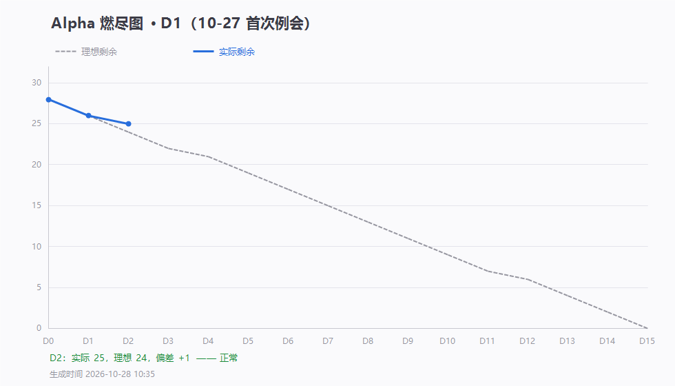

# 第 1 天站会记录（2026-10-27 20:30）· Alpha 首次例会

> 会前数据采集 19:30 · 会议 20:30–20:45 · 记录整理：P1 林子航
> 记录依据：腾讯会议元宝 AI 纪要（本次未开录制、未截屏，见第六节说明）
> 规范：[`每日站会SOP.md`](../../每日站会SOP.md)

- 形式：腾讯会议（线上）
- 出席：**7 / 7**（全员到齐）
- 缺席：无
- 剩余 Issue：**26 / 28**，理想 26，偏差 **0**（正好在理想线上）

---

## 一、每人三问（会上实报）

| 成员          | ① 推到哪一步                                                                                                            | ② 卡在哪                                                                 | ③ 接下来做什么                                    |
| ------------- | ------------------------------------------------------------------------------------------------------------------------ | ------------------------------------------------------------------------- | -------------------------------------------------- |
| **P1 林子航** | 燃尽图体系建成（网页可看曲线，数据按 Issue 开关自动统计）；三份契约冻结 `1.0.0-frozen`；Docker 配置文件 + 按角色环境清单 | 本机未装 Docker，`docker compose up` **尚未验证**；专业名词与框架边学边做 | 本机装 Docker，验证通过后关 #2；持续盯进度、审代码 |
| **P2 杨靖**   | 读完项目框架与排期文档，**未推代码**（当前任务无前后端交互，暂无可提交内容）                                             | 初次接触前端，需补课；**反馈任务时间节点有重叠**                        | 明天开始 PDF 渲染（#5）                            |
| **P3 杨绎平** | 项目框架查看完成，**本地环境部署完成**                                                                                   | 部分术语不熟                                                              | 明天正式开工（#9 上传页起）                        |
| **P4 刘万礼** | 搭好 Docker + IDEA 环境；后端**统一返回格式 + 全局异常处理**完成；解决国内镜像加速源；**自动建表跑通**                   | 无（基础设施障碍已扫清）                                                  | 核对契约后尝试上传接口（#13）                      |
| **P5 吴啸天** | 确认建表 SQL 可执行，四条自查截图已提交到 Issue 评论；FastAPI 框架跑通（未连数据库）                                     | embedding 用 API 还是本地未定                                             | 连数据库；先用 Python 本地处理切片（#17 #18）      |
| **P6 刘征**   | 建表 SQL 已随仓库提供，容器启动自动执行（`f15c7fb`）                                                                     | 无                                                                        | 配合 #21 四条自查收尾；#22 Redis                   |
| **P7 李义朋** | 浏览完 GitHub 文档，聚焦测试与文档模块                                                                                   | 博客发布平台与频率此前不明确（会上已定）                                  | 写出冒烟用例表（#24）；每日记录                    |

---

## 二、会上定的规则（8 条）

| # | 规则                                    | 说明                                                                            |
| - | --------------------------------------- | ------------------------------------------------------------------------------- |
| 1 | **完成一个 Issue 就推**                 | 严禁攒多个一起推；燃尽图靠 Issue 开关，攒推会让曲线失真                         |
| 2 | **契约已冻结，改字段先协商**            | 浏览器↔后端、后端↔大模型、数据库字段名三份均锁在 `1.0.0-frozen`，禁止私自改动 |
| 3 | **大模型 API Key 由该模块负责人自己出** | 测试开销不大，谁做模块谁负责 key 与调用测试                                     |
| 4 | **样本 PDF 由使用方按需认领**           | 需要用到 PDF 的人找负责人拿，发群文件，**不进 git**                             |
| 5 | **论文切片优先本地 Python 处理**        | 先轻后重：本地能跑就不调 API，跑不动再考虑大模型                                |
| 6 | **博客每周一篇，发 GitHub**             | 第 6 周、第 7 周各一篇；其中须含例会四要素                                      |
| 7 | **日常记录用会议摘要补充**              | 本次未录制，元宝纪要由 P1 整理入库                                              |
| 8 | **每人必须理解整个项目框架**            | 答辩可能多人上台，只懂自己模块会在对接环节翻车                                  |

---

## 三、障碍与决策

| 障碍                          | 决定                                                   | 责任人    | 时限        |
| ----------------------------- | ------------------------------------------------------ | --------- | ----------- |
| Docker 环境未验证（P1）       | 本机安装后验证 postgres + redis healthy，#2 即可关闭   | P1 林子航 | D2（10-28） |
| embedding 用 API 还是本地     | **先用 Python 本地处理**，不行再调 API                 | P5 吴啸天 | D2 起       |
| 博客平台/频率不明确           | 定为 GitHub，每周一篇                                  | P7 李义朋 | 即刻生效    |
| 本次会议未录制、未截屏        | 用元宝 AI 纪要代替文字记录；**明天起必须开录制并截屏** | P1 / P7   | D2 起       |
| **P2 反馈任务时间节点重叠** | 待 P1 核对排期后调整，见「会后议题」                   | P1 林子航 | D2 前答复   |

---

## 四、待办（会上确认，按人对应）

| 待办                                              | 负责人 | 期限         |
| ------------------------------------------------- | ------ | ------------ |
| 试跑 Docker 环境并验证，通过后关闭 #2             | 林子航 | D2           |
| 对接当前无交互的部分，明天开发 PDF 渲染（#5）     | 杨靖   | D2           |
| 核对契约后几轮内容，尝试做上传接口（#13）         | 刘万礼 | D2           |
| 先连数据库，用 Python 本地尝试论文切片（#17 #18） | 吴啸天 | D2           |
| 尽快做出冒烟用例表（#24），每日记录会议内容       | 李义朋 | D2           |
| 整理本次会议纪要并发 GitHub                       | 林子航 | 今晚（已做） |

---

## 五、会后议题（不占站会时间）

- **P2 反馈的任务时间重叠**：需核对 `docs/例会时间安排.md` 与 Issue 时间窗，D2 会前给出调整方案
- **embedding 方案**：若论文切块效果不足，Beta 阶段再评估 API 方案与成本
- **Docker 镜像加速**：刘万礼已解决国内拉取问题，需把方法写进 README 供全组复用

---

## 六、留证

| 证据             | 文件                          | 状态                                         |
| ---------------- | ----------------------------- | -------------------------------------------- |
| 燃尽图           | `燃尽图-D1.png`               | ✅                                           |
| 会议记录         | 本文档（依元宝 AI 纪要整理）  | ✅                                           |
| **参会名单截图** | `附件/meeting-attendance.png` | ✅ 已有（证明 7 人全到，会议号 455 982 023） |
| **会议画面截图** | `附件/meeting.png`            | ❌ 本次未截                                  |
| **签入记录**     | `附件/commits.txt`            | ✅ 已有（git log 文本记录，可直接查看）      |
| 腾讯会议回放     | —                            | 未录制                                       |

> ⚠️ **本次缺"例会照片"**。补救措施：
>
> 1. 到腾讯会议「会议详情」页截图元宝纪要页面，存为 `附件/meeting-yuanbao.png`，作为文字记录证据
> 2. 签入记录已生成文本版 `附件/commits.txt`（比截图更可核查）
> 3. **D2 起必须开录制 + 会中截屏参会人列表**，否则第 6 周博客的"例会照片"无法提供

---

## 七、AI 纪要的 5 处识别错误（重要，勿直接转发原纪要）

元宝纪要把发言人对错了，转发到群里会误导成员，已按实际情况修正：

| 元宝纪要原文                              | 实际情况                                                          |
| ----------------------------------------- | ----------------------------------------------------------------- |
| 「P1（李毅鹏）」                          | P1 是**林子航**                                                   |
| 「P6（李一鹏）：完成 FastAPI 基本框架搭建 | FastAPI 是 **P5 吴啸天** 的活；P6 是**刘征**，负责建表 SQL 已提供 |
| 「P2…暂未推送 BBVX 系统」                | 语音识别错误，实际是「当前任务无前后端交互，暂无可提交代码」      |
| 「找 K 五对接 BBVX 系统」                 | 语音识别错误，应为「对接当前无交互的部分」                        |
| 「P7（测试与文档）星念sky」               | 是**李义朋**（GitHub `xingniansky`）                              |
