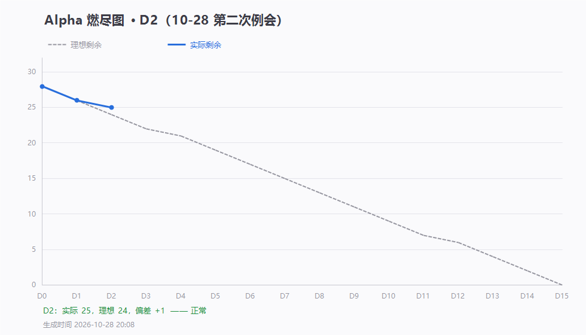

# 第 2 天站会记录（2026-10-28 20:30）· Alpha 第二次例会

> 会前数据采集 20:10 · 会议 20:30–20:45 · 记录整理：P1 林子航
> 会议前请务必：**点开录制 + 截一张能看到参会人列表的图**（昨天缺了，今天必须补）
> 规范：[`每日站会SOP.md`](../../每日站会SOP.md)

- 形式：腾讯会议（线上）
- 出席：＿ / 7（会上填）
- 缺席与原因：＿
- 剩余 Issue：**25 / 28**，理想 24，偏差 **+1**（落后 1 条）

---

## 一、会前数据快照

| 项 | 数值 | 说明 |
|---|---|---|
| 未关闭 Issue | **25** | 已关闭 3 条：#1 契约冻结、#2 Docker 骨架、#3 任务板 |
| 今日提交 | **4 条** | 杨靖 1（bbox 预研）+ 林子航 3（脚本/报告/契约 1.0.1） |
| 有提交的成员 | **5 / 7** | 林子航、刘万礼、吴啸天、刘征、杨靖 |
| **零提交成员** | **2 / 7** | **杨绎平 P3、李义朋 P7** |

---

## 二、昨日（D1）承诺 vs 今天实际

| 人 | 昨天说今天要做 | 实际交付 | 对得上吗 |
|---|---|---|---|
| P1 林子航 | 装 Docker、验证后关 #2 | ✅ Docker + WSL2 装好，`verify-db.ps1` 全通过，#2 已关闭 | ✅ |
| P2 杨靖 | 开发 PDF 渲染（#5） | ❌ 没做 #5；但交了 #7 bbox 预研（推在 feature 分支） | ⚠️ 做了别的 |
| P3 杨绎平 | 正式开工（#9） | ❌ **无任何提交** | ❌ |
| P4 刘万礼 | 核对契约 + 尝试上传接口 | ✅ 交了 Spring Boot 骨架（统一响应 + 全局异常），但**没有上传接口** | ⚠️ 部分 |
| P5 吴啸天 | 连数据库 + Python 切片 | ⚠️ 交了 ai-service 骨架（health 接口），**没连库、没切片** | ⚠️ 提前量 |
| P6 刘征 | #21 收尾 + #22 Redis | ❌ 无新提交（昨天的 compose 挂载仍有效） | ❌ |
| P7 李义朋 | 冒烟用例表 | ❌ **无任何提交** | ❌ |

> 结论：**2 人没动，3 人做了但没按自己说的做，只有 P1 完全对得上。** 这一栏是今晚最该摊开讲的。

---

## 三、每人三问（会上逐人填）

| 成员 | ① 昨天推到哪一步 | ② 卡在哪 | ③ 接下来推到哪 |
|---|---|---|---|
| P1 林子航 | | | |
| P2 杨靖 | | | |
| P3 杨绎平 | | | |
| P4 刘万礼 | | | |
| P5 吴啸天 | | | |
| P6 刘征 | | | |
| P7 李义朋 | | | |

---

## 四、今日已完成（P1 侧，可作为证据）

| 事项 | 结果 |
|---|---|
| Docker + WSL2 环境 | ✅ 装好并跑通，验证报告 `docs/环境验证/2026-10-28-首次跑通.txt` |
| `#2` Docker Compose 骨架 | ✅ **已关闭**（8 项检查全通过） |
| `#21` 建表 SQL 运行证据 | ✅ 已贴到 #21，四条自查全过 |
| 契约 bbox 坐标约定 | ✅ 升 `1.0.1-frozen`，补 4 条（物理页码 / 旋转页 / 取值约束 / 字段名） |
| bbox 预研文档 | ✅ 从 `.doc` 转为 `docs/bbox坐标约定.md` 并合入 master |
| 四人代码审查 | ✅ 完成，问题清单见第七节 |

---

## 五、障碍与决策

| 障碍 | 责任人 | 承诺时间 | 状态 |
|---|---|---|---|
| ＿ | | | |

**本次会议决策**：

-

---

## 六、会后议题（不占站会时间）

-

---

## 七、代码审查结论（会上通报，无需展开讨论）

| 人 | 做得对的 | 必须改的 |
|---|---|---|
| **P4 刘万礼** | 12 条错误码与契约逐条对上；统一响应 + 全局异常规范 | ① **缺 CORS**，前端一联调就跨域失败 ② `?page=abc` 返回 5000，应为 1001 |
| **P6 刘征** | compose 挂载建表 SQL 实测有效，四张表就是它建的 | ① README 补「改过 SQL 必须 `down -v`，会清空数据」 ② #21 四条自查补截图 |
| **P5 吴啸天** | health 接口字段与契约一致 | ① `.env.example` 补 `DEEPSEEK_API_KEY` ② 提交信息别再写 #17（内容是 health 骨架） ③ 依赖锁版本 |
| **P2 杨靖** | bbox 预研内容扎实，补了契约盲区 | ① `feature/7-bbox-research` **要合进 master** ② 别交 `.doc`，交 markdown ③ **字段名写 `bboxX0` 不是 `x0`** |
| **P3 杨绎平 / P7 李义朋** | — | 会上说明：是没开始，还是做了没推 |

---

## 八、留证

| 证据 | 文件 | 状态 |
|---|---|---|
| 燃尽图 | `燃尽图-D2.png` | ✅ 已生成 |
| 签入记录 | `附件/commits.txt` | ✅ 已生成 |
| **参会名单截图** | `附件/meeting-attendance.png` | ⬜ **今天必须截** |
| **会议画面截图** | `附件/meeting.png` | ⬜ **今天必须截** |

> ⚠️ 昨天只截了签到列表，没有会议画面。今天两张都要：
> 1. 会议开始后 1 分钟内截**能看到参会人头像/视频**的画面
> 2. 散会后在「会议详情」页截参会名单

---

## 九、待办（会上确认后补全）

| 待办 | 负责人 | 期限 |
|---|---|---|
| ＿ | | |
