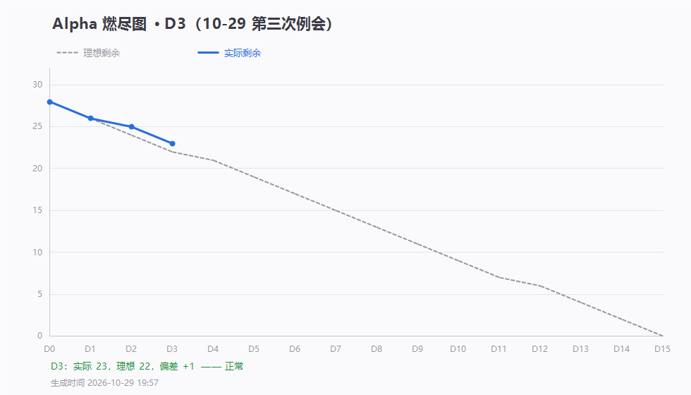

# 第 3 天站会记录（2026-10-29 20:30）· Alpha 第三次例会

> 会议 20:30–20:37 · 记录整理：P1 林子航（依会议实际发言）
> 规范：[`每日站会SOP.md`](../../每日站会SOP.md)

- 形式：腾讯会议（线上）
- 出席：**7 / 7**（全员到齐，三天来首次满员）
- 缺席：无
- 剩余 Issue：**23 / 28**，理想 22，偏差 **+1**（落后 1 条）

> ⚠️ 会上发出的燃尽图有误，由 **吴啸天当场指出**，已更正为本页这张（D3：23/28）。

---

## 一、每人三问（会上实报）

| 成员 | ① 推到哪一步 | ② 卡在哪 | ③ 接下来做什么 |
|---|---|---|---|
| **P1 林子航** | 三天例会记录与燃尽图归档；审查 4 位同学代码；调研博客发布平台（选博客园） | 成果都散在各自分支/本地，合不起来 | 监督合并规范；每天发进度表 |
| **P2 杨靖** | **完成前端样式设计** | 无（自评） | 明日完成 PDF 渲染代码，交可运行 demo |
| **P3 杨绎平** | 已提交 `#9 上传校验` 的 PR；基于该分支完成 `#10 文献列表页` | 等 `#9` 审查通过后才能提 `#10` 的 PR | `#9` 合入后立刻提 `#10` |
| **P4 刘万礼** | JDK 17 环境测试通过，**JDBC 依赖已接入** | **主动承认：合并前没拉取最新代码**（经排查无冲突） | 继续 #13 上传接口 |
| **P5 吴啸天** | **PDF 切分完成**、Docker 数据库连接测试通过，跨进程通信卡点已解决 | 无（已攻克） | 明日推进切片与 embedding 入库（#17 #18） |
| **P6 刘征** | #21 已闭环（README 补 `down -v` 说明） | 无 | #22 Redis、#23 一键启动 |
| **P7 李义朋** | 冒烟用例表完善并推送（`2100371`，35 条 + L1/L2/L3） | 无 | 随测试持续更新用例状态 |

---

## 二、会上定的规则（5 条）

| # | 规则 | 说明 |
|---|---|---|
| 1 | **开发前先拉最新代码** | 开工前把云端分支克隆/拉取到本地，再动手改 |
| 2 | **严禁在旧版本上直接开发** | 拿别人没改过的旧代码开写，合并时必然冲突 |
| 3 | **改完立刻合并并推送** | 分支上放着等于没做 |
| 4 | **master 可直接调试，两种合并方式都合规** | 直接推 master 或走 PR 均可，能跑通验收标准就行 |
| 4b | **允许分支开发，不必每天合** | 分支上可以慢慢做；本人认为完成、能演示时，自己合进 master，不需等组长审批 |
| 4c | **交付口径** | master 是"能跑的最新集成版"，`release` 才是交付版本，由组长在验收节点合并 |
| 5 | **代码审查转 GitHub 留言** | 不再占用会议时间，评审意见写在 Issue/PR 里 |

---

## 三、障碍与决策

| 障碍 | 处理 | 状态 |
|---|---|---|
| 组长会上发的燃尽图有误 | 吴啸天指出，已更正为 D3（23/28） | ✅ 已闭环 |
| 刘万礼合并前未拉最新代码 | 经排查无冲突，已在会上重申规范 | ✅ 已提醒 |
| 杨绎平 `#10` 依赖 `#9` 合并 | 采用串行提交：先合 `#9`，再提 `#10` | 进行中 |

**本次会议决策**：

- 博客平台定为**博客园**，由李义朋注册账号并负责发布
- 代码审查改为 GitHub 留言制，会上一律不讨论技术细节

---

## 四、待办

| 待办 | 负责人 | 期限 |
|---|---|---|
| 把更正后的燃尽图发到群里 | 林子航 | 今晚 |
| 注册博客园账号，准备发布第 6 周博客 | 李义朋 | 明日 |
| 完成 PDF 渲染，交可运行 demo | 杨靖 | 明日 |
| `#9` 审查通过后立即提 `#10` 的 PR | 杨绎平 | 明日 |
| 继续 #13 上传接口 | 刘万礼 | 明日 |
| 推进切片与 embedding 入库（#17 #18） | 吴啸天 | 明日 |
| #22 Redis 接入、#23 一键启动 | 刘征 | 明日 |
| 用例表随测试更新状态 | 李义朋 | 持续 |
| 例会记录与截图归档 | 林子航 | 今晚（已做） |

---

## 五、留证

| 证据 | 文件 | 状态 |
|---|---|---|
| **会议画面截图**（7 人） | `附件/meeting.png` | ✅ 已存 |
| 燃尽图 | `燃尽图-D3.png` | ✅ 已生成 |
| 签入记录（含未合并分支） | `附件/commits.txt` | ✅ 已生成 |
| **参会名单截图** | `附件/meeting-attendance.png` | ✅ 已存（20:26，会议号 849 518 476，7 人） |

---

## 六、本周倒计时

| 截止 | 日期 | 剩余 | 状态 |
|---|---|---|---|
| **第 6 周 Scrum 博客** | 11-01 | **3 天** | 平台定为博客园，账号待注册；素材已齐（D1–D3 记录 + 3 张燃尽图） |
| 第 7 周 Scrum 博客 | 11-08 | 10 天 | — |
| Alpha 收尾（端到端走查 #4） | 11-04 ~ 11-08 / 11-10 | 12 天 | — |

---

## 七、今日小结

**三天来最好的一天**：7 人全到、4 人交付、2 条 Issue 关闭、燃尽图从落后追到只差 1 条。

**但仍有一个共同问题**：杨靖的样式设计和吴啸天的切分还没提交。**分支开发是允许的**（会上已定：分支开发 → 完成时自行合入 master → 最终由组长合 release），但**长期只放分支不合入，别人用不上、也没法集成验证**。

**改进已在会上落地**：把"先拉后改、改完即合"定为纪律，代码审查改为 GitHub 留言制。
