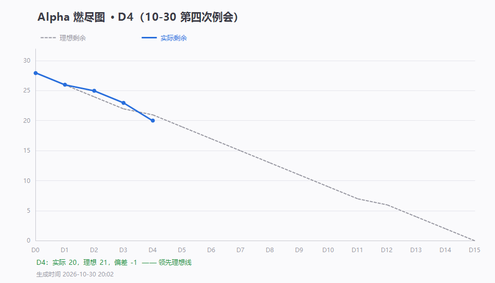

# 第 4 天站会记录（2026-10-30 20:30）· Alpha 第四次例会

> 会议 20:30–20:45 · 记录整理：P1 林子航
> 规范：[`每日站会SOP.md`](../../每日站会SOP.md)

- 形式：腾讯会议（线上）
- 出席：＿ / 7（会上填）
- 剩余 Issue：**20 / 28**，理想 21，偏差 **−1（首次领先）**

---

## 一、每人三问

| 成员 | ① 推到哪一步 | ② 卡在哪 | ③ 接下来做什么 |
|---|---|---|---|
| **P1 林子航** | release 分支与主版本对齐（落后 49 提交 → 0，13 → 88 个文件），打快照 tag `v0.3-alpha-d3`；燃尽图与数据归档；审刘万礼两个提交 | 见第二节 | 盯三处代码整改；落实博客；收各人交付 |
| P2 杨靖 | | | |
| P3 杨绎平 | | | |
| P4 刘万礼 | 上传接口（`7473f4b`）、列表真实查询（`3e4c30d`） | 三处需整改（见 `#13`） | 改完三处 → 关 `#13`；补 `GET /{id}` 与 `DELETE` |
| P5 吴啸天 | | | |
| P6 刘征 | | | |
| P7 李义朋 | | | |

---

## 二、P1 提出的问题：数据泄露

**本次例会重点强调的一条红线：**

| 项 | 要求 |
|---|---|
| **服务器路径** | 接口返回**不得带服务器绝对路径**（刘万礼上传接口返回了 `path`，必须删）；开发时代码里引用路径也**统一写相对路径** |
| **数据库密码** | 不得明文写死在 `application.properties`，改成 `${DB_PASSWORD:默认值}` 形式外部传入 |
| **API Key** | 一律走 `.env`，`.env` 不进仓库；仓库只放 `.env.example` 占位 |
| **判断标准** | 想一句：「这份文件如果公开，会不会让人知道我的电脑路径、密码、密钥？」会，就不能提交 |

---

## 三、会上决定

| # | 决定 | 说明 |
|---|---|---|
| 1 | **明天（10-31 周六）休会一天** | **休会不休工**，各人按自己的 Issue 正常推进 |
| 2 | **周日（11-01 20:30）照常开会** | 补周六这一次，会上核对第 6 周博客 |
| 3 | **博客今晚起落实，后天（11-01）发布** | 按 PPT 要求的四要素写；缺材料的找 P1 要 |
| 4 | 代码整改前不关 `#13` | 三处改完由 P1 放行 |

---

## 四、博客缺什么材料找 P1 要（已备齐）

| PPT 要求 | 材料位置 |
|---|---|
| 每人工作 + Issue 链接 | `docs/例会/2026-10-27 ~ 10-30` 四份记录 |
| 燃尽图 | 四张：`燃尽图-D1 ~ D4.png` |
| 例会照片 | 各例会 `附件/meeting.png`（会议画面）+ `meeting-attendance.png`（参会名单） |
| 签入记录 | 各例会 `附件/commits.txt` |

---

## 五、留证

| 证据 | 文件 | 状态 |
|---|---|---|
| 燃尽图 | `燃尽图-D4.png` | ✅ |
| 会议画面截图 | `附件/meeting.png` | ⬜ 会上截 |
| 参会名单截图 | `附件/meeting-attendance.png` | ⬜ 会后截 |
| 签入记录 | `附件/commits.txt` | ⬜ 待生成 |