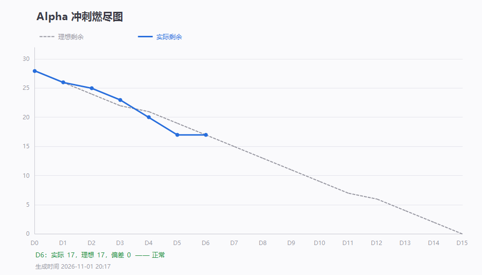

# 第 6 天站会记录（2026-11-01 20:28）· Alpha 第六次例会

> 会议 20:28 开始，约 15 分钟 · 记录整理：P1 林子航（依会议实际发言）
> 规范：[`每日站会SOP.md`](../../每日站会SOP.md)
> 说明：本次为周日补会，补 10-31（周六）休会那次

- 形式：腾讯会议（线上，会议号 901 143 261）
- 出席：**7 / 7**（全员到齐）
- 缺席：无
- 剩余 Issue：**17 / 28**，理想 17，偏差 **0（正好在理想线上）**

---

## 一、每人三问

| 成员 | ① 推到哪一步 | ② 卡在哪 | ③ 接下来做什么 |
|---|---|---|---|
| **P1 林子航** | `release` 合入并打快照 `v0.4-alpha-d6`；D5/D6 燃尽数据入库；近两天代码全审（29 个文件） | 不卡，等整改 | 盯阻断清零，明天打 `v0.5-alpha-d7` |
| **P2 杨靖** | `#6` **翻页 + 缩放**完成 | 跳页功能没做完，暂未提交 | 明天补跳页 |
| **P3 杨绎平** | `#12` 异常提示统一**即将完工** | 收尾未提交 | 明天上传，完成后前端部分全部结束 |
| **P4 刘万礼** | 异步解析链路跑通 + 文献详情；`#14` 列表/详情/删除/取文件四接口补齐 | — | 冒烟问题已修，转入收尾 |
| **P5 吴啸天** | `#18` 向量化入库 + 对外接口完成并推送 | — | 转向 `#19` |
| **P6 刘征** | `#22` Redis 完成 | Redis 接后端要改后端代码，**超出本人职责范围** | 会上已定对接人 |
| **P7 李义朋** | 博客**已写完**，待微调会议内容即可发布；测试进度同步 12 条 | — | 今晚发布并挂链接 |

---

## 二、这轮交付盘点（10-31 ~ 11-01）

| 人 | 提交 | 交付内容 |
|---|---|---|
| 吴啸天 | `0ce4c46` `b54650f` `14a64f0` | PDF 抽取只认合法 PDF 并更名；切片 + Embedding **写入 chunks 表**；内部解析与清理接口 |
| 刘万礼 | `e7526f5` `8e83d38` `d8c4397` | 异步解析 + 文献详情；删除 + PDF 文件流 + mock/真实切换；冒烟修复（响应结构、文件头校验、超限 1003、请求日志） |
| 李义朋 | `3f9604c` `0c4f41f` | 冒烟用例首轮执行记录 + BugList 7 条 |
| 刘征 | `8ecb98c` | 后端 Redis 读写打通，地址外置 |

- 本轮关闭 Issue：`#18`（切片 + Embedding 入库）
- 会上确认：**「上传 → 存盘 → 入库 → 切片 → 向量」这一段已打通**

---

## 三、代码审查结论（会上通报）

审查范围 `0497366..e9f736c`，29 个文件 / +1516 −176。**好消息**：入库那段「先删旧切片再写新的」写法是对的，同一篇重复解析不会变两份；判断 PDF 看文件头不看后缀也改对了。**问题按「两头」归**：

| # | 位置 | 事实 | 负责人 |
|---|---|---|---|
| 1 | 前端上传页 | 选完文件只显示「格式正确」，**没有上传按钮**，全前端无上传调用 | P3 |
| 2 | 后端 + AI 服务 | 缺 `POST /api/qa/ask` 与 `POST /internal/qa/ask` → 点提问必 404 | P4 + P5 |
| 3 | `ai-service/requirements.txt` | 缺 `sentence-transformers` / `numpy`，别人装完依赖 AI 服务起不来 | P5 |
| 4 | `application.properties` | DB 地址与密码仍硬编码（Redis 已外置，DB 未改） | P4 |
| 5 | `application.properties` | `app.parse.mock=true` 无环境变量开关 → 默认返回假页数 | P4 |
| 6 | `PaperController` | 删除/取文件传不存在编号返回 `4001`，契约要求 `2001` | P4 |

**其他（不阻断，随手改）**：`force` 参数无效；`@Async` 未配线程池；大模型首请求才加载导致第一次解析必超时；列表/详情请求无超时；`/api/redis/ping` 属调试接口不应进 `release`。

---

## 四、`release` 与快照口径

| 项 | 内容 |
|---|---|
| 动作 | `release` ← `master`（`52ef4f7` → `20053d6`），一次 `--no-ff` 合并，保留审计痕迹 |
| 结果 | 落后 22 个提交全部补齐，两侧内容零差异 |
| 快照 | tag `v0.4-alpha-d6`，说明写明**「存档快照 · 非验收通过」**并列出 6 条阻断 |
| 口径 | 该 tag 只作**回滚点**；阻断清零后再打 `v0.5-alpha-d7`，那个才标「首次全链可演示」 |

---

## 五、会上决定

| # | 决定 | 说明 |
|---|---|---|
| 1 | **博客今晚发布** | 贴到 `#26` 并同步到群里；**链接挂好之后才关 `#26`** |
| 2 | 前端未开发项（上传按钮、页数写死）**本轮暂不处理** | 先让李义朋改「能改的 bug」，不要卡在未开发功能上 |
| 3 | Redis 接后端涉及的代码改动 | 刘征与刘万礼直接对接，合并冲突走评审解决 |
| 4 | Issue 关闭口径 | 任务完成**直接关**；F1–F4 测试任务持续更新，**全部测完统一关** |
| 5 | 代码审查 6 条阻断 | 列入 D7 处理，不计入本轮验收 |

---

## 六、待办

| 待办 | 负责人 | 期限 |
|---|---|---|
| 博客发布 + 链接挂进 `#26`（然后关单） | 李义朋 | **今晚** |
| `#6` 补跳页功能 | 杨靖 | 11-02 |
| `#12` 异常提示统一收尾上传 | 杨绎平 | 11-02 |
| `#19` 起步 | 吴啸天 | 11-03 |
| `#22` 验收（与刘万礼对接后） | 刘征 | 11-02 |
| 补 `POST /api/qa/ask` | 刘万礼 | 11-02 |
| 补 `POST /internal/qa/ask` | 吴啸天 | 11-03 |
| 补齐 `requirements.txt` + README 首次启动说明 | 吴啸天 | 11-02 |
| DB 密码改环境变量、`mock` 默认关、`2001` 修正 | 刘万礼 | 11-02 |
| 冒烟用例表随修复情况更新 | 李义朋 | 持续 |
| 阻断清零后打 `v0.5-alpha-d7` | 林子航 | 11-02 |

---

## 七、留证

| 证据 | 文件 | 状态 |
|---|---|---|
| **会议画面截图** | `附件/meeting.png` | ✅ 已存（20:28，会议号 901 143 261，已参会 7 人） |
| **参会名单截图** | `附件/meeting-attendance.png` | ✅ 已存（7 人头像齐全） |
| 燃尽图 | `燃尽图-D6.png` | ✅ 已存（实际 17 / 理想 17） |
| 签入记录 | `附件/commits.txt` | ✅ 已存（13 条提交，按提交区间导出） |

---

## 八、今日小结

**7 人全到，4 人有实质交付**（吴啸天切片入库、刘万礼四接口、刘征 Redis、李义朋冒烟与 BugList）。燃尽 17 对 17，**持平**，没落后也没领先。

**这轮真正补上的是「后端到 AI 服务」这一段**，从存盘到切片入库已经通了。

**但浏览器这条路还差两步**：一是上传页没有上传按钮，二是问答没有后端接口。会上把前端未开发项**暂时搁置**，理由是先把能改的 bug 改完；代价是**演示时仍无法从浏览器上传文件**，D7 必须回头确认这一条，否则 F1/F3 验收仍开不了口。
