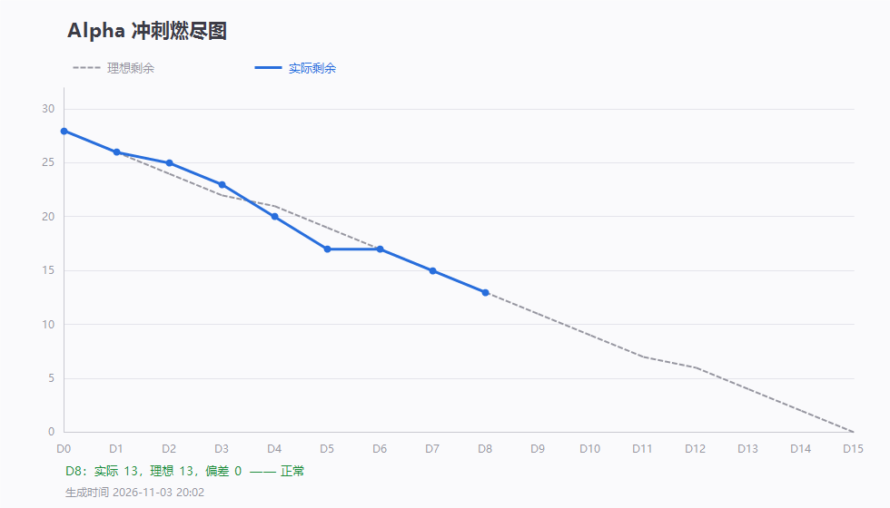

# 第 8 天站会记录（2026-11-03 20:28）· Alpha 第八次例会

> 会议 20:28 开始，约 15 分钟 · 记录整理：P1 林子航（依会议实际发言）
> 规范：[`每日站会SOP.md`](../../每日站会SOP.md)

- 形式：腾讯会议（线上，会议号 931 395 621）
- 出席：**7 / 7**（全员到齐）
- 缺席：无
- 剩余 Issue：**13 / 28**，理想 13，偏差 **0（连续三天压线）**

---

## 一、每人三问

| 成员 | ① 推到哪一步 | ② 卡在哪 | ③ 接下来做什么 |
|---|---|---|---|
| **P1 林子航** | `release` 对齐 master 打 `v0.5-alpha-d8`；D7/D8 燃尽数据入库；**端到端走查手册**（六步判据）写完；代码审查结论批注到 `#13 #14 #15 #19 #23 #25` 六个 Issue；把注释事故与构建门禁写进 `CONTRIBUTING` | 不卡，等 AI 侧问答接口 | D9（11-04）开走 ①②③⑥ 四步，④⑤ 登记阻塞 |
| **P2 杨靖** | `#6` **翻页 + 缩放 + 跳页**完成并合入；同时造成一次整站白屏（详见第三节），已修 `39e56a8` | 本地没跑构建就推了 master | 剩余收尾约两天 |
| **P3 杨绎平** | `#12` 异常提示统一完成；**BUG-001 上传动作修好**（上传按钮/拖拽/进度条，`6883357`）。前端开发部分全部完成 | 无 | 明天起进入前后端对接 |
| **P4 刘万礼** | 数据源改环境变量；解析线程池配上限；解析改真实调用；修复 JDK `HttpClient` HTTP/2 升级丢失请求体（强制 HTTP/1.1）；补 `/api/qa/ask` 参数校验与错误码映射；不存在文献返回 `2001` | 解析 25 秒上限容易超时，需与 P5 对接 | 与吴啸天商量解析超时方案 |
| **P5 吴啸天** | RAG 与 LLM 初稿代码跑通自测；Embedding 并发加载加锁 | **模块化程度不够，需再一天优化**；问答路由接口**已写好但未提交** | 优化后提交 commit 并关 `#19` |
| **P6 刘征** | 一键启动脚本代码完成 | 日志功能还没加 | 明天补日志即可完成 `#23` |
| **P7 李义朋** | 复测此前 6 个 Bug **全部通过**；用新版本重跑 12 条用例，**未发现新问题** | 无 | 持续跟踪 Bug 状态 |

---

## 二、今日交付盘点（14 条提交）

| 人 | 提交 | 交付内容 |
|---|---|---|
| 刘万礼 | `ceb5cd2` `b3d7851` `bcd90cf` `e062af4` | 数据源环境变量；不存在文献 `2001`、AI 错误码区分、mock/force 配置化、解析线程池、**新增 `POST /api/qa/ask` 转发**；解析强制 HTTP/1.1、非法 JSON 返回 `1001` |
| 杨靖 | `7f805d4` `d913914` `39e56a8` | **翻页 + 缩放**（含缩放后保持阅读位置）；修复样式块 `//` 注释导致的整站白屏 |
| 吴啸天 | `42b42f0` `0175fea` | Embedding 模型并发加载加锁、进度条开关；解析接口返回结构简化 |
| 李义朋 | `5d768f1` | 冒烟回归 12 条全通过、Bug 复测 6 条通过 |
| 林子航 | `aba888a` `0f13df7` `70b5521` `268d296` | D7/D8 燃尽数据与 D8 燃尽图；端到端走查手册；第 6 周博客正文与交付 PDF 入库；构建门禁与「已踩过的坑」 |

- **本轮关闭**：`#6`（翻页缩放）、`#22`（Redis）→ 累计 **15 关 / 13 未关**
- 冒烟累计：**23 通过 / 1 不通过 / 2 测不了 / 9 未测**

---

## 三、事故复盘：整站白屏（今日最重要的一条）

| 项 | 内容 |
|---|---|
| 现象 | 中午还能打开的页面，下午**整站白屏**，先后有人怀疑是合并冲突、是别人改的文件 |
| 根因 | `ReaderView.vue` 的 `<style>` 块里写了 `//` 注释。`.vue` 文件里 `<script>` 是 JS（`//` 合法）、`<style>` 是 **CSS（只认 `/* */`）**，写法混用导致整个样式块连同后续规则一起失效 |
| 修复 | `39e56a8`，已确认 `<style>` 块内 `//` 注释数量为 0 |
| 为什么没提前拦住 | 本地开发服务器没触发重编，**「我这儿能打开」不算通过**；合并前也没跑构建 |

**由此定下三条规矩**（已写入 `CONTRIBUTING.md` §4.1 与 §10）：

1. **合并前必跑构建**：`cd frontend && npm run build`，报错修完再推。这类语法错构建一定报，肉眼一定漏。
2. **任何人不得 force push 到 `master`**。今天有人提过这个建议，那一下会把别人当天的提交全部抹掉；`release` 只由组长在合并节点推送。
3. **对外交付不用 `.md`，出 PDF**：第 6 周博客发助教时图片全空白，就是相对路径在别人电脑上不存在。

---

## 四、代码审查与缺陷状态

审查范围 `1ab185f..e062af4`。11-01 提的 6 条阻断，**修好 4 条、未修 2 条**：

| # | 阻断项 | 状态 |
|---|---|---|
| 1 | 前端无上传动作 | ✅ 已修（`6883357`） |
| 2 | 缺 `/api/qa/ask` | ⚠️ 后端已加，**AI 侧 `/internal/qa/ask` 仍未提交** |
| 3 | `requirements.txt` 缺依赖 | ❌ 未修（`sentence-transformers` / `numpy` 仍缺） |
| 4 | DB 密码硬编码 | ✅ 已修（走环境变量） |
| 5 | `parse.mock` 默认开 | ✅ 已修（默认关） |
| 6 | 不存在 id 返回 `4001` | ✅ 已修（改 `2001`，`file`/`delete` 两处） |

缺陷跟踪：`BUG-001 ~ 005`、`BUG-007` 已修复；**`BUG-006`（页数恒 15）仍待修复**，等解析超时方案定了再复测。

---

## 五、会上讨论的三个技术问题

### 1. 解析 25 秒超时 —— 目前只是「临时放宽」，没有根治

- 现象：上传 PDF 后解析经常失败。
- 实测：**真实解析完整跑完约需 3 分钟**，而代码里的等待上限是 **25 秒**（契约原文写的也是 10~60 秒）。
- 影响：25 秒必然触发超时，表现为 `parse_status=failed`，页数拿不到，`BUG-006` 也复测不了。
- 结论：**当前只是把等待改回 25 秒，问题没解决**。由刘万礼与吴啸天对接，方案在「异步任务 + 前端轮询状态」与「放大超时到 180–300 秒」之间二选一，D9 定。

### 2. 大模型 API Key 怎么存

- 吴啸天提出想直接写在代码里。
- **决定：不硬编码、也不存数据库**。由前端提供「配置」入口，测试时各自填入，通过接口传给 AI 服务；后端预留字段。
- 附带要求：**新增字段要同步更新接口契约**（`docs/01-api-contract.yaml`），不能只改代码不改文档。
- 负责人：吴啸天 + 前端两位（杨靖、杨绎平）。

### 3. Git 推送规范

重申：**本地构建跑通再推远端**；冲突按 `pull --rebase` 走，不许 `push -f`。杨靖当场说明原因并接受，后续按其节奏两天内收尾。

---

## 六、待办

| 待办 | 负责人 | 期限 |
|---|---|---|
| 提交 `/internal/qa/ask` 路由（RAG 检索 + Prompt + 答案与页码） | 吴啸天 | 11-05 |
| RAG / LLM 模块化优化后提交并关 `#19` | 吴啸天 | 11-05 |
| 补 `ai-service/requirements.txt`（sentence-transformers / numpy） | 吴啸天 | 11-04 |
| 解析超时方案（异步轮询 or 放大到 180–300s）并与 AI 侧对接 | 刘万礼 + 吴啸天 | 11-04 |
| API Key 配置接口字段：后端预留 + 前端配置页 + **契约同步** | 吴啸天 + 杨靖 + 杨绎平 | 11-05 |
| 启动脚本补日志功能，完成 `#23` | 刘征 | 11-04 |
| 前后端对接联调 | 杨绎平 | 11-04 起 |
| D9 端到端走查 ①②③⑥ 四步，④⑤ 登记阻塞 | 林子航 | 11-04 |
| `BUG-006` 复测（解析方案定稿后传 10 页文件看页数） | 李义朋 | 11-05 |
| 全部成员：本地构建通过再推远端 | 全体 | 即刻执行 |

---

## 七、留证

| 证据 | 文件 | 状态 |
|---|---|---|
| **会议画面截图** | `附件/meeting.png` | ✅ 已存（20:28，会议号 931 395 621，已参会 7 人） |
| **参会名单截图** | `附件/meeting-attendance.png` | ✅ 已存（7 人齐全，末位成员设备名为 12341234） |
| 燃尽图 | `燃尽图-D8.png` | ✅ 已存（实际 13 / 理想 13） |
| 签入记录 | `附件/commits.txt` | ✅ 已存（14 条提交） |

---

## 八、今日小结

**7 人全到，5 人有实质交付。** 燃尽 13 对 13，连续三天压住理想线，节奏是稳的。

**今天最大的收获不是关了两个 Issue，是把一次事故变成了规矩。** 中午整站白屏——`<style>` 里写了 `//` 注释，整块样式失效。三个人先后怀疑合并冲突，绕了一圈才定位。修好只是第一步，真正有价值的是后面那三条：合并前跑构建、禁 force push、对外发 PDF。这三条已经写进 `CONTRIBUTING`，下次不该再犯。

**最大的隐患是解析那 25 秒。** 实测真实解析要 3 分钟，等待上限 25 秒——也就是说现在上传一篇论文，大概率直接失败。这不是「慢一点」的问题，是「走不通」。D9 必须定方案。

**F3 问答仍差最后一环**：AI 侧接口写好了但没提交。今晚记录在案，11-05 前必须见到。
