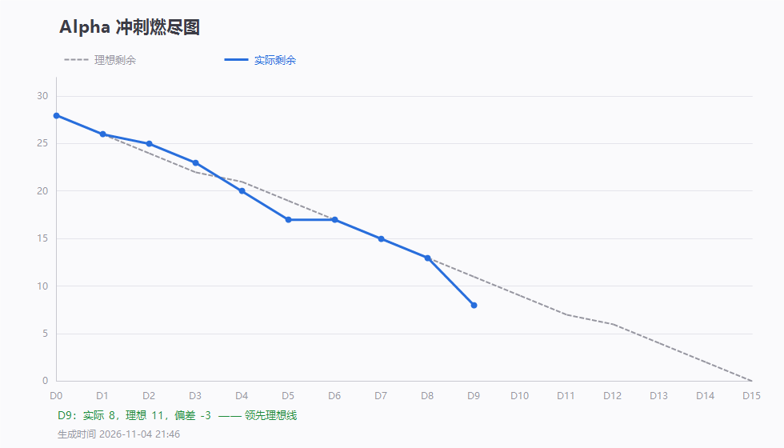

# 第 9 天站会记录（2026-11-04 20:26）· Alpha 第九次例会

> 会议 20:26 开始，约 15 分钟 · 记录整理：P1 林子航（依会议实际发言）
> 规范：[`每日站会SOP.md`](../../每日站会SOP.md)

- 形式：腾讯会议（线上，会议号 758 351 935）
- 出席：**7 / 7**（全员到齐）
- 缺席：无
- 剩余 Issue：**12 / 28**，理想 11，偏差 **+1（首次落后理想线）**

---

## 一、每人三问

| 成员 | ① 推到哪一步 | ② 卡在哪 | ③ 接下来做什么 |
|---|---|---|---|
| **P1 林子航** | 端到端走查第一轮：上传 **0.38 秒通过**、真机 PDF 渲染通过、提问错误分支全对（2002/2003/2001）；走查表与截图入库；7 个 Issue 的验收结论已批注 | 本机 AI 服务没起，解析全部 `failed`，④ 正例测不了 | 补测 ④ 与翻页缩放；盯落后差距 |
| **P2 杨靖** | `#8` 引用页码跳页 — 思路已梳理清楚 | 尚未落代码 | 明天完成并修相关 bug |
| **P3 杨绎平** | API Key 配置的前端页面还没做完 | 未完成 | 明天完成并上传 |
| **P4 刘万礼** | 完成与 P5 的联调，**问答链路跑通**；写了 12 条用例脚本（列表/删除/文件流/错误分支）；**一键启动 5 个容器成功，入口均返回 200** | — | 配合验收，`#14` 尚未关闭（不影响进度） |
| **P5 吴啸天** | `#19` 闭环：检索 + Prompt + DeepSeek + 问答路由 + 自检脚本 + 依赖补齐，链路跑通 | **bge-m3 模型联网下载不稳定**，无代理时长时间等待甚至失败 | 已改为优先读本地缓存、无缓存才下载；明天推进 `#20` |
| **P6 刘征** | 一键部署环境搭好，五个容器可起 | 等代码验收 | 验收通过后正式部署收口 |
| **P7 李义朋** | 此前因超时阻塞的测试，实测耗时 **0.38 秒**已恢复 | — | 会后继续跑 F3 那批用例 |

---

## 二、今日交付盘点（9 条提交）

| 人 | 提交 | 交付内容 |
|---|---|---|
| 吴啸天 | `c36a249` `1c91327` `dc84546` `588bb46` `4be6eb7` | 问答服务层（检索 + Prompt + DeepSeek 调用）、`/internal/qa/ask` 接口与错误码映射、bge-m3 优先本地缓存、`check_rag`/`check_qa` 自检脚本、补齐 `numpy` 依赖 |
| 刘征 | `7d39ee8` | 三份 Dockerfile + nginx 反向代理 + compose 五个服务，`docker compose up` 一条命令起全栈 |
| 林子航 | `8418f59` `5858db8` `e3c955f` | D9 燃尽数据与 D9 燃尽图；端到端走查表 + 三张截图；走查结论更正（撤回一条误判） |

- **本轮关闭**：`#19`（检索 + Prompt + 返回答案与页码）→ 累计 **16 关 / 12 未关**
- 冒烟累计：**23 通过 / 1 不通过 / 2 测不了 / 9 未执行**

---

## 三、会上决定：开发策略调整为「原型模型」

针对燃尽滞后与验收困难，会上确认两点：

| # | 决定 | 说明 |
|---|---|---|
| 1 | **先跑通骨架，再逐项加模块** | 不再按「各模块并行做完整功能」推进；先保证主链能从头走到尾，再往上叠细节。理由是现在卡在「全链路跑通」这个前置环节 |
| 2 | **Issue 拆分要更细** | 每个子模块功能独立成项，避免燃尽图上出现「长期不动 → 最后断崖式下降」的曲线 |

---

## 四、验收批注结果（今日重点）

会上安排的验收已逐条批注到 Issue 上（详见各 Issue 评论区）：

### ✅ 判定通过，可关（4 个）

| Issue | 验收标准 | 证据 |
|---|---|---|
| `#13` 文件上传接口 | 10 页 PDF < 3s | 实测 **0.380 秒**；伪装 PDF `1002`、空文件 `1001`、响应无 `path` |
| `#14` 文献 CRUD | Postman 全绿 | 列表 0.012s、详情 200、取文件字节一致、删除不存在 `2001` |
| `#15` 转发问答接口 | 请求透传成功，超时有提示 | 25s 超时与 3001/3002 映射齐备；错误分支实测 `2002/2003/2001` |
| `#16` 契约预留 `/api/search` | 契约中可见 | `01-api-contract.yaml` 第 157 行起，含 Beta 说明与合规红线 |

> `#15` 附一条待补：**正例（透传成功拿到答案）我这边未复现**（AI 服务未起），以 P4 联调结论为准，请补一次成功响应留证。

### ⚠️ 暂不关，需补齐（3 个）

| Issue | 差什么 |
|---|---|
| `#23` 一键启动 | ① **后端启动自检那一行没写**（Issue 明确要求：端口 / 数据库 / AI 连通）② ai-service 没有 healthcheck，`ps` 看不出它死没死 ③ README 还写着「应用服务容器尚未接入」 |
| `#24` 冒烟用例表 | 用例覆盖是达标的（35 条覆盖十二条标准），但 **F3 八条一条没执行**，F1-10 仍不通过 —— 现在关等于宣布测试做完了 |
| `#25` Bug List | 今天走查新发现两条未登记：`parseError` 只写 `unknown error`；`.docx` 后缀的真 PDF 被接口接受入库 |

---

## 五、会上记录的两个风险

### 1. 模型下载稳定性（吴啸天提出）
bge-m3 首次需要从官方源下载（约 2GB），无代理时极不稳定。已改为优先读本地缓存，但**换机器或容器重建仍会重下**。

处置建议：容器挂 `hf-cache` 卷；README 写清「首次启动需约 2GB 下载 / 或用镜像源」。

### 2. 燃尽首次落后
D9 实际 12 / 理想 11。剩 12 个 Issue、5 天（D10–D15），**每天必须关 2 个以上**才回得到线上；明天理想线是 9，需要追 3 个。

---

## 六、待办

| 待办 | 负责人 | 期限 |
|---|---|---|
| 完成 `#8` 引用页码跳页，并修相关 bug | 杨靖 | 11-05 |
| 完成 API Key 配置前端页面并上传 | 杨绎平 | 11-05 |
| 补 `#23` 三项（启动自检日志 / ai-service healthcheck / README） | 刘征 | 11-05 |
| 启动 AI 服务并配 `DEEPSEEK_API_KEY`，配合补测 ④ 正例 | 吴啸天 | 11-05 |
| 推进 `#20` 答案质量抽样（10 题，页码准确率 ≥70%） | 吴啸天 | 11-06 起 |
| F3 八条用例执行（AI 服务就绪后，优先 F3-01/02/03/04 四条 S0） | 李义朋 | 11-05 |
| `#25` 补登 BUG-008 / BUG-009，更新 BUG-006 处置 | 李义朋 | 11-05 |
| `parseError` 写清失败原因（BUG-008） | 刘万礼 | 11-05 |
| 定 `.docx` 口径（后端是否也校验后缀，或改用例判据） | 刘万礼 + 李义朋 | 11-05 站会 |
| 补测 ④ 正例、③ 翻页缩放跳页 | 林子航 | 11-05 |
| 已通过的 4 个 Issue 由作者关单并更新燃尽图 | 刘万礼 + 刘征 | 11-05 |

---

## 七、留证

| 证据 | 文件 | 状态 |
|---|---|---|
| **会议画面截图** | `附件/meeting.png` | ✅ 已存（20:26，会议号 758 351 935，已参会 7 人） |
| **参会名单截图** | `附件/meeting-attendance.png` | ✅ 已存（7 人齐全） |
| 燃尽图 | `燃尽图-D9.png` | ✅ 已存（实际 12 / 理想 11） |
| 签入记录 | `附件/commits.txt` | ✅ 已存（9 条提交） |
| 端到端走查表 | `../验收走查/走查表-2026-11-04.md` | ✅ 已入库（含三张截图） |

---

## 八、今日小结

**核心链路今天真的通了。** 吴啸天把问答服务层写完了，刘征把五个容器串起来了，刘万礼跑通了两边联调 —— 「上传 → 解析 → 检索 → 回答」这条主链第一次具备完整实现。

**但燃尽第一次落后了。** 今天只关了 `#19` 一个，理想线要 2 个。原因不是没人干活（9 条提交、两个人），而是**都在做「大件」，没有一个在中途可以关**——这正是会上决定改用原型模型、把 Issue 拆细的原因。

**验收上今天有实打实的进展：4 个 Issue 判定通过，3 个列出补齐清单。** 其中 `#13` 上传 0.38 秒是硬数据。同时我自己报了个错：下午用无头浏览器把渲染正常判成了缺陷，真机复核后已撤回 —— 判定缺陷之前，得先在真机上复现一次。

**明天最要紧的是两件**：AI 服务起来，把 F3 那八条用例跑掉；以及把落后的 3 个追回来。
