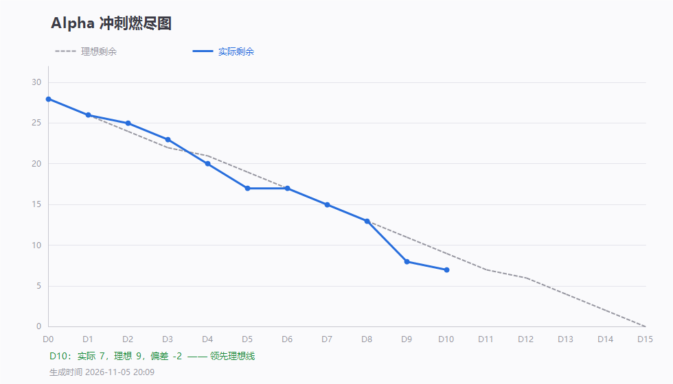

# 第 10 天站会记录（2026-11-05 20:27）· Alpha 第十次例会

> 会议 20:27 开始，约 15 分钟 · 记录整理：P1 林子航（依会议实际发言）
> 规范：[`每日站会SOP.md`](../../每日站会SOP.md)

- 形式：腾讯会议（线上，会议号 984 368 282）
- 出席：**7 / 7**（全员到齐）
- 缺席：无
- 剩余 Issue：**7 / 28**，理想 9，偏差 **−2（领先理想线）**



---

## 一、每人三问

| 成员 | ① 推到哪一步 | ② 卡在哪 | ③ 接下来做什么 |
|---|---|---|---|
| **P1 林子航** | 端到端第二轮：启动自检达标、上传 0.33 秒、解析失败原因可读；内部契约升 1.0.1（解析 180 秒 / 问答 25 秒分开）；发现并通报 BUG-004 回归 | AI 服务未起，页数/问答正例/点页码三项验不了 | 复核命中率口径；盯回归修复；D11 补测 |
| **P2 杨靖** | `#8` 引用页码跳转完成，`#8` 已关 | — | 参考主流 Vue 项目风格做前端美化，顺手修 bug |
| **P3 杨绎平** | 用户输入 API Key 的前端接口**开发完成** | 待提交、待联调验证 | 与 P5 确认数据传输接口 |
| **P4 刘万礼** | 解析超时改回 180 秒、失败原因按类型返回 | 文件校验引入回归（见第三节） | 恢复文件头校验 |
| **P5 吴啸天** | 模型载入已改为优先本地缓存；跑了一篇 2024 年双栏论文，**问答命中 8/10** | 首次下载约 2GB 易卡；API Key 需共享或自填 | 通宵跑完剩余测试；与 P3 对接前端接口 |
| **P6 刘征** | 一键部署与日志相关 bug 修复完成并提交，`#23` 已关 | — | 待代码整体验收 |
| **P7 李义朋** | 新测 7 条用例全通过；昨晚 3 个 Bug 复测无问题；累计 **31 通过 / 0 不通过** | 与 P1 对「伪装文件」的复测结果不一致（见第三节） | 复测文件校验；补测 F4 用例 |

---

## 二、今日交付盘点（10 条提交）

| 人 | 提交 | 交付内容 |
|---|---|---|
| 刘万礼 | `410ed69` | 解析超时可配置（默认 180 秒）、失败原因按类型返回、上传加后缀校验 |
| 刘征 | `7708fe5` | 三处 healthcheck、后端启动自检日志 `[STARTUP]`、README 更新 |
| 杨靖 | `9b35a62` | 引用页码点击跳转（页码合法性校验 + 1.2 秒高亮） |
| 吴啸天 | `dd172d7` `3bd560a` | embedding 启动预热、检索超时文案区分 |
| 李义朋 | `0743c7f` `acc4a51` | 用例 7 条通过、Bug 复测 4 条通过 |
| 林子航 | `bbaad78` | 内部契约 1.0.1、D10 走查表、D10 燃尽图 |

- **本轮关闭**：`#8`（引用页码跳转）、`#23`（一键启动 + 运行日志）
- 冒烟累计：**31 通过 / 0 不通过 / 2 测不了 / 2 未执行**

---

## 三、会上两个没谈拢的问题，会后已定

### 问题一：伪装文件到底能不能传上去？

**分歧**：李义朋说他测的没问题（会被拒），林子航实测能传上去。

**结论：两个人测的不是同一个文件，都对。**

| 文件 | 后缀 | 真实内容 | 应然 | 实测 |
|---|---|---|---|---|
| A | `.docx` | 是 PDF | 拒 | **拒，400/1002** ✅ 李义朋测的是这个 |
| B | `.pdf` | 不是 PDF（纯文本 1.9KB，头是 `This`） | 拒 | **收，HTTP 200，入库 `id=10`** ❌ 林子航测的是这个 |

根因：`410ed69` 加后缀校验时，**把 `isPdf()` 的调用删掉了**。方法还在 `PaperController.java:195`，全后端零调用，成了死代码。

- 后缀对、内容假 → 现在能进库（BUG-004 回归）
- 后缀错、内容真 → 现在被拒（BUG-009 的修复生效）

**修法**：两个校验并存，先后缀后内容。

```java
if (originalName == null || !originalName.toLowerCase().endsWith(".pdf")) {
    throw new BizException(ErrorCode.FILE_NOT_PDF);   // 快速拒绝后缀不对的
}
if (!isPdf(file)) {                                    // 再验真实内容，防伪装
    throw new BizException(ErrorCode.FILE_NOT_PDF);
}
```

### 问题二：命中率到底怎么算？

吴啸天报 8/10，但「多页参考」「非连续文本」怎么判没有定义。会上没拍板（P1 说会后查需求再答复），**会后已定稿**：

→ [`docs/测试/命中率判定口径.md`](../测试/命中率判定口径.md)

三条要点：

1. **命中 = 三条同时成立**：答案不编造 + 至少一条引用页码正确 + 片段能在该页找到
2. **答案跨多页**：只要有一条页码正确即算命中，不要求全部正确；但**三条页码全错直接判不命中**（前端要拿页码跳转，跳错等于功能失效）
3. **论文未涉及的问题单独记**，要求 100% 返回「本文未涉及该内容」+ 空引用，**不计入 70%**

抽样要求：2–3 篇论文、覆盖「方法 / 结论 / 细节」三类难度，禁止只问「这篇文章讲什么」。

**当前 8/10 = 80%，按口径需复核**：补到 2–3 篇、逐题填表、确认是按页码判的而不是按“读起来对”判的。

---

## 四、会上决定

| # | 决定 | 说明 |
|---|---|---|
| 1 | **文件校验「先后缀、后内容」两段都要有** | 只留一段必然漏一类：只查后缀 → 伪装文件进库；只查内容 → 后缀错的会被误收 |
| 2 | **解析超时 180 秒、问答超时 25 秒，两个必须分开配** | 之前混用 25 秒，导致解析每次都超时；已写进内部契约 1.0.1 |
| 3 | **API Key 不入仓库**，测试时自填或用组内共享 | `.env` 已在 `.gitignore`；容器侧走 `DEEPSEEK_API_KEY` 环境变量 |
| 4 | **命中率按新口径复核后才算达标** | 口径已成文，见上 |
| 5 | 已完成个人任务的同学**通读全项目代码** | 收尾阶段减少“只有一个人懂某模块”的风险 |

---

## 五、待办

| 待办 | 负责人 | 期限 |
|---|---|---|
| 恢复 `isPdf()` 文件头校验（两段校验并存） | 刘万礼 | 11-05 当晚 |
| 复测「后缀 .pdf、内容非 PDF」的伪装文件，BUG-004 状态改回待复测 | 李义朋 | 11-06 |
| 补测 F4-01 / F4-02（healthcheck 已就绪，现在能测） | 李义朋 | 11-06 |
| 按命中率口径复核 10 题（2–3 篇论文，逐题填表） | 吴啸天 | 11-06 |
| AI 服务起起来并配 Key，配合补测页数 / 问答正例 / 页码跳转 | 吴啸天 + 林子航 | 11-06 |
| API Key 前端接口与 AI 服务数据传输对接 | 杨绎平 + 吴啸天 | 11-06 |
| 前端美化（参考 Vue 主流范式）并修 bug | 杨靖 | 11-07 |
| D11 端到端全链走查 | 林子航 | 11-06 |
| 第 7 周博客、Alpha 出口条件定稿 | 李义朋 / 林子航 | 11-08 前 |

---

## 六、留证

| 证据 | 文件 | 状态 |
|---|---|---|
| **会议画面截图** | `附件/meeting.png` | ✅ 已存（20:27，会议号 984 368 282，已参会 7 人） |
| **参会名单截图** | `附件/meeting-attendance.png` | ✅ 已存（7 人齐全，末位成员昵称为“。”） |
| 燃尽图 | `燃尽图-D10.png` | ✅ 已存（实际 7 / 理想 9） |
| 签入记录 | `附件/commits.txt` | ✅ 已存（10 条提交） |
| D10 走查表 | `../验收走查/走查表-2026-11-05.md` | ✅ 已入库 |
| 命中率判定口径 | `../测试/命中率判定口径.md` | ✅ 已入库 |

---

## 七、今日小结

**今天最有价值的两件事都不是写代码。**

第一件，把「伪装文件能不能传」这个扯不清的分歧，拆成了两个不同的测试用例 —— 两个人各自都对，只是文件不一样。定下「先后缀后内容」两段校验，以后不会再吵。

第二件，把「命中率」这种一句话指标变成了可执行的判据：三条同时成立才算命中、多页引用只要一条对、编造单独记且要求 100%。口径不定，8/10 和 5/10 都只是各说各话。

**技术上的进展也实在**：启动自检日志第一次打出了 `[STARTUP] port=8080 db=ok redis=ok`，解析超时从“必然失败”修成可配置 180 秒，失败原因从 `unknown error` 变成能看懂的中文。

**但今天也暴露了一个坏习惯**：修一个问题（后缀校验）时把另一个问题的修复（文件头校验）删掉了。**修 bug 前先看清这段代码为什么存在**，别顺手清掉别人的防线 —— 这条要写进 `CONTRIBUTING` 的「已踩过的坑」。

**明天全压在一件事上**：AI 服务起来。它一起来，页数、问答正例、页码跳转三项一小时能补齐；起不来，D13 就要走降级。
