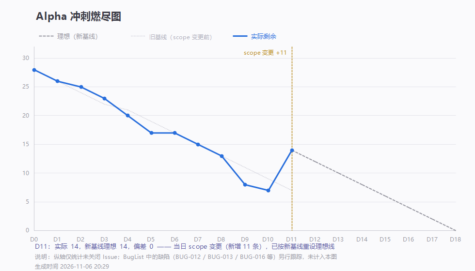

# 第 11 天站会记录（2026-11-06 20:27）· Alpha 第十一次例会

> 会议 20:27 开始，约 20 分钟 · 记录整理：P1 林子航（依会议实际发言）
> 规范：[`每日站会SOP.md`](../../每日站会SOP.md)

- 形式：腾讯会议（线上，会议号 880 530 111）
- 出席：**7 / 7**（全员到齐；截图中两位以昵称入会：「。」「12341234」）
- 缺席：无
- 剩余 Issue：**14 / 37**（新基线），新基线理想 14 —— **正好在理想线上**

> 为什么是 14：今天下午收工时剩余 5 条，晚上按老师要求**扩容 11 条新 Issue**。图上 D11 那条竖直虚线就是 scope 变更点，旧理想线停在 7，新理想线从 14 起算到 D18=0。

---

## 一、每人三问

| 成员 | ① 推到哪一步 | ② 卡在哪 | ③ 接下来做什么 |
|---|---|---|---|
| **P1 林子航** | 端到端六步**全部通过**，`#4` 关闭；对外契约升 1.0.2（`AskRequest` 增 `apiKey/baseUrl/model`）；验收报告落地 | 容器化路径还有两个 S1 未修（见第三节） | 契约前置冻结、延展段排期与燃尽基线重设、试跑出口条件初稿 |
| **P2 杨靖** | 手上任务已清空 | — | 明天开始 **bbox 引用高亮**（#41）；其余时间继续学前端深度学习相关 |
| **P3 杨绎平** | 界面部分有进展；新报的 bug 已定位 | 该 bug 根因在**后端 API Key 转发逻辑**，不在前端 | 明起接**检索结果页**（#39）与划词翻译浮层（#42） |
| **P4 刘万礼** | 昨晚已修 PDF 上传（文件头校验 `03ca4b8`，今天复测 400/1002 通过） | 尚未跟进 issue、未拉最新代码 | 会后拉最新代码排查并提交；明天修 **BUG-016 apiKey 转发**（S1） |
| **P5 吴啸天** | 30 篇样本抽 10 题**命中 9 题**；相关 issue 已关闭；顺手修了前端返回的 API 逻辑 | 命中率要按口径出逐题表（#20）才作数 | **bbox 回填**（#40）、`/api/explain` 划词翻译（#42）；RAG 优化 |
| **P6 刘征** | 任务已清零 | — | 接**检索缓存 + 外部接口降级**（#43）；配合第 7 周博客素材 |
| **P7 李义朋** | 用例表 v0.9、BugList v0.7 已推（`8f2c896` `e823607`） | 容器化环境报了 **4 个新问题**（见第三节），会上无法当场定位 | 截图发群里逐一建单跟踪；明天接新任务 |

---

## 二、今日交付盘点（16 条提交）

| 谁 | 提交 | 交付内容 |
|---|---|---|
| 林子航 | `7ddb762` `1595ead` `6ebbb40` | D11 走查表三次更新：网络根因定位、⑥ 回归复测通过、⑤ 页码跳转真机截图 |
| 林子航 | `abc95c7` | 对外契约 **1.0.2-frozen**：新增 `apiKey/baseUrl/model`，写明「不落库、不写日志、不回显」 |
| 林子航 | `3f897b8` | **容器化三处缺陷修复**：nginx 上传上限 1m→55m、ai-service 挂 uploads 卷、torch 改 CPU 版（省约 5GB） |
| 林子航 | `ce97abc` `210230d` | Alpha 端到端验收报告（六步全过 + 8 条缺陷全过程）；D11 燃尽数据 |
| 林子航 | `aa9dc28` `758bb19` `b69bed4` | **延展段计划**：从 Beta 提前 3 项功能、新增 9 条 Issue（#38–#46）、每人分配与截止 |
| 林子航 | `d4b4715` `55d9f7d` `87b3d8c` | 燃尽图三次修正：不再把 scope 变更判成落后 → 重拉数据 → **改双基线**（理想线不再中途上翘） |
| 李义朋 | `8f2c896` `e823607` | 用例表 v0.9、BugList v0.7，新增 BUG-011~013 / 015，并修正 Bug 归属 |
| 刘万礼 | `03ca4b8` | 恢复 `isPdf()` 文件头校验，阻止纯文本改名入库（BUG-004 回归关闭） |

- **本轮关闭**：`#4`（端到端联调与验收走查）
- **本轮新增**：`#38`–`#46` 共 9 条（另 2 条并入后关闭，见第四节）

---

## 三、会上三个必须说清的问题

### 问题一：为什么本来要收尾，又扩容了

老师明确回复：**提前结束说明"没规划好进度 —— 要么工作量不够，要么还有改进空间你们放弃了"**，要求在这个周期内保持开发活动，需求和交付口径可以动态调整。

据此确定：

| 项 | 原 | 现 |
|---|---|---|
| 周期 | D1–D15（10-27 … 11-10） | **D1–D18（10-27 … 11-13）** |
| 交付日 | 11-10 | **11-12（第八周周四）** |
| 交付内容 | F1–F4 六步 | 六步 + **Beta 提前的 3 项功能** + 3 份报告 |
| 燃尽基线 | 28 条 | **37 条** |

**提前的 3 项功能**（都是原本排在 Beta 的，表结构与契约早已预埋，属填空不属改表）：

1. **arXiv 关键词检索 → 一键入库 → 直接问答**（#38 后端 / #39 前端 / #43 缓存）
2. **答案引用的那句话在原页高亮标出**（现在只是跳到那一页）（#40 出坐标 / #41 画框）
3. **选中一段文本点翻译，弹中文**（顺带解释术语）（#42）

### 问题二：API Key 设置页是断的（S1）

**现象**：前端填了自己的 Key 也不生效。传一个**假 Key `sk-fake` 照样能正常作答** —— 说明后端把字段丢了，实际用的是服务器 `.env` 里的 Key。

**根因**：`QaController.java:79-82` 组装转发请求时只带 `paperId/question/topK/maxCitations`。

**结论**：登记为 **BUG-016（S1 / P4 / 待修复）**，D12 当天修完并复核。验收要求：假 Key 必须返回 `400/2002`，真 Key 生效，密钥不落库、不打日志、不回显。

> 另一条相关的**安全讨论**（吴啸天提）：若通过临时网址对外演示，前端把 Key 传给 AI 服务这段在跨服务器时没有保护。P1 承认初期规划没覆盖这块 —— **进 Backlog 评估，不插本轮**（符合"新需求进 Backlog"禁令）；真要对外推广必须租独立服务器，不能拿开发机当演示机。

### 问题三：容器化环境 4 个问题（李义朋报，会后逐一建单）

| 编号 | 现象 | 级别 | 归属 |
|---|---|---|---|
| BUG-011 | 上传记录时间比实际**早 8 小时**（后端返 UTC，前端原样显示） | S2 | P4 / P6 |
| BUG-012 | **hf 模型没随镜像缓存**，干净环境首次解析必失败（`EMBEDDING_FAILED`） | **S1** | P6 |
| BUG-013 | **阅读页白屏**：pdf worker 被 nginx 当 `application/octet-stream` 返回，浏览器拒绝执行 ES 模块 | **S1** | P3 |
| BUG-015 | `file_path` 存的是**绝对路径**，本地上传的记录切到容器就打不开 | S2 | P4 |

**统一处理口径（今晚定）**：

- **修 bug 不单开 Issue**，一律进 `docs/测试/BugList.md`，由 `#25` 收口 —— 之前 `#36`/`#37` 就是例子（当晚已并入后关闭：`#36`→BUG-016，`#37`→`#38`/`#40` 的前置）。
- 原因：Issue 一关，挂在评论里的缺陷就跟着消失。
- **别因为不进燃尽计数就当成不存在** —— BUG-012 / BUG-013 都在 D13 前必修。

---

## 四、会上决定

| # | 决定 | 说明 |
|---|---|---|
| 1 | **周期延到 11-12 交付，11-13 缓冲** | 18 天口径；11-13 只修 P0、彩排、归档 |
| 2 | **D12 先冻结契约前置** | `/api/search` schema + bbox 0–1 归一化；不冻结后面检索和高亮必各写一套 |
| 3 | **修 bug 不单开 Issue，统一进 BugList** | 由 `#25` 收口 |
| 4 | **做不完的砍法**：先砍划词翻译 → 再砍检索的 OpenAlex 第二源 → **bbox 高亮不砍** | 演示核心是 bbox |
| 5 | **D13 之后新需求一律进 Backlog** | 防止再次 scope 膨胀 |
| 6 | **演示方案**：开发机当服务器 + 预装 2GB 向量模型 + 演示时保持开机 | 正式服务器要花钱 |
| 7 | 正式对外用**第三方平台申请临时网址**过渡 | 交付形式待老师明确后再定 |
| 8 | **每人一篇两周心得 + 对团队的意见建议** | 写成 #46 的评论，同时私发老师；11-11 起交，11-12 齐 |

---

## 五、待办

| 待办 | 负责人 | 期限 |
|---|---|---|
| 修 **BUG-016** apiKey / baseUrl / model 未转发（假 Key 必须报错） | 刘万礼 | 11-07 当天 |
| 契约前置冻结：`/api/search` 实装 + bbox 0–1 归一化（并入 #38 / #40） | 林子航 | 11-07 |
| 修 **BUG-013** 容器内阅读页白屏（nginx MIME） | 杨绎平 | 11-07 |
| 修 **BUG-012** 干净环境首次解析失败（模型打包或预检提示） | 刘征 | 11-08 |
| 拉最新代码排查并提交，跟进 `#38` 检索适配层 | 刘万礼 | 11-07 起 |
| bbox 坐标回填，单栏 ≥8/10 套准（#40） | 吴啸天 | 11-10 |
| 答案质量逐题表按口径补齐（#20） | 吴啸天 | 11-10 |
| 检索缓存 + 外部接口降级（#43） | 刘征 | 11-11 |
| 冒烟用例表收口（#24）＋ BugList 收口（#25）＋ 测试报告（#44） | 李义朋 | 11-11 / 11-12 |
| 第 7 周博客（#27，第 8 周如需补写在本条内追加） | 李义朋 | 11-11 |
| Alpha 出口条件定稿（#28）：写清交付了什么、哪些顺延 Beta | 李义朋 + 林子航复核 | 11-12 |
| 两周心得与建议（#46） | 全员 | 11-11 起，11-12 齐 |
| API Key 跨服务器传输安全评估 | 吴啸天 + 林子航 | 进 Backlog，不插本轮 |

---

## 六、留证

| 证据 | 文件 | 状态 |
|---|---|---|
| **会议画面截图** | `附件/meeting.png` | ✅ 已存（20:27，会议号 880 530 111，共 7 人） |
| **参会名单截图** | `附件/meeting-attendance.png` | ✅ 已存（7 人齐全） |
| 燃尽图 | `燃尽图-D11.png` | ✅ 已存（实际 14 / 新基线理想 14，含 scope 变更点） |
| 签入记录 | `附件/commits.txt` | ✅ 已存（16 条提交） |
| D11 走查表 | `../验收走查/走查表-2026-11-06.md` | ✅ 已入库（六步终局判定） |
| Alpha 验收报告 | `../验收走查/Alpha端到端验收报告.md` | ✅ 已入库 |
| 延展段计划 | `../Alpha延展段-D12-D18计划.md` | ✅ 已入库（含可提前功能评估） |

---

## 七、今日小结

**今天分两段，下午和晚上是两种心情。**

下午是硬活：容器化三处缺陷修完，五个容器全部 healthy，用真实 1.2MB PDF 走通了 nginx 上的完整链路 —— 上传 0.071 秒、解析 21 秒、提问 1.31 秒、答案和原文对得上、引用页码 6/1/6、点「第 3 页」PDF 真的跳过去。**六步全部通过，`#4` 可以关了。**

晚上被泼了盆冷水：本想收尾，老师一句「提前结束说明没规划好进度」把节奏改了 —— 周期延到 11-12，还要往里加三个功能。

**这句反馈值得记下来**：提前完工在课程里不是加分项，**是"工作量不够"或"放弃改进"的证据**。真正的教训不在"我们做得快"，而在**一开始对 Alpha 的交付口径没对齐** —— 按 2.5 周排的活，实际 11 天就干完了，说明当初估的范围偏小。以后排期第一步应该是「这个周期的验收标准到底有多高」，而不是「我们能做多少」。

**技术上今天也学了两条硬的**：

1. **容器里的 bug 只有容器能暴露**。nginx 默认只收 1MB、ai-service 没挂 uploads 卷、镜像装成 CUDA 版 torch —— 这三条在本地开发环境全都看不见。开发机能跑 ≠ 答辩机能跑。
2. **燃尽图不能拿来自我安慰**。我今天先把它画成了"理想线中途上翘"的假图，又用一句"偏差不计入落后"去解释 —— 那都是粉饰。改成双基线（旧计划停在变更点、新计划从 14 起算）之后，图上自己就说明白了，不需要文字辩护。**度量一旦能被措辞修饰，就失去意义。**

**明天不集合（周六）**，D12 只卡两件：契约前置冻结、BUG-016 修完。其余按各自 issue 推。
