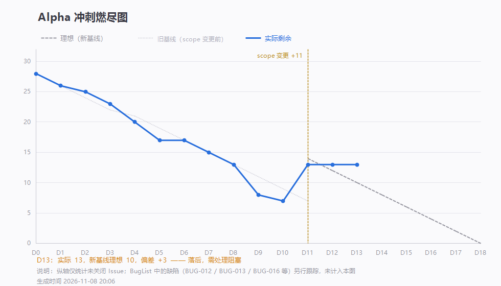

# 第 13 天站会记录（2026-11-08 20:23）· Alpha 第十三次例会

> 会议 20:23 开始，约 20 分钟 · 记录整理：P1 林子航（依会议实际发言）
> 规范：[`每日站会SOP.md`](../../每日站会SOP.md)

- 形式：腾讯会议（线上，会议号 113 864 212）
- 出席：**7 / 7**（全员到齐）
- 缺席：无
- 剩余 Issue：**13 / 37**，理想 10，偏差 **+3（落后）**
- 昨日（D12）无站会，按计划周六不集合

---

## 一、每人三问

| 成员 | ① 推到哪一步 | ② 卡在哪 | ③ 接下来做什么 |
|---|---|---|---|
| **P1 林子航** | 契约冻结到 **1.1.0**（`/api/search` 实装、新增 `/api/papers/import`、`bboxMode` 语义、错误码 3003）；燃尽图改双基线 | 契约更新后**没及时提交、也没在群里说**，三位同学按旧契约开发受阻（见第三节问题二） | 补契约通知；修正文档里「顺延」标记错误；写软工原理报告 |
| **P2 杨靖** | 这两天主要投入前端样式调整 | — | 空隙时间继续样式，并准备 `#41` 画框（等 bbox 服务端就绪） |
| **P3 杨绎平** | **BUG-013 已修并合入**（`50fa38e` → 合并提交 `e451dd9`）：nginx 补 `include mime.types` + `application/javascript mjs` | — | 准备接新任务；BUG-013 复测配合 |
| **P4 刘万礼** | 跑通 arXiv 检索，提交 `GET /api/search`（`de7bbe4`）；单元测试通过 | **契约里没有导入接口**，只能搜不能导 | 明天补导入逻辑；与我核对契约差异 |
| **P5 吴啸天** | bbox 主体完成（`12da76a`）：块级归一化坐标 + 切片携带 `bbox_mode` | **契约缺 `bboxMode` 字段**，无法精确到文字块高亮；另发现 #19/#20 已完成但文档仍标「顺延」 | 明天把 `bboxMode` 入库；补 health 的 `modelReady` |
| **P6 刘征** | 新任务规划中 | 会上被告知接手 BUG-012 / 013，但 P3 也收到了同样通知 —— **分配信息有偏差** | 以本记录为准：只管 `#43` 检索缓存；BUG-013 已由 P3 修完 |
| **P7 李义朋** | BugList v1.0（011/015/016 复测通过）；延展段冒烟用例 **36 条** | 未看到 BUG-013 最新修复，待复测 | **今晚补博客上传**，把本次会议内容写进博客并分享到群里 |

---

## 二、今日交付盘点

| 谁 | 提交 | 交付内容 |
|---|---|---|
| 杨绎平 | `50fa38e` `e451dd9` | **BUG-013 修复**：nginx 静态资源 MIME（`.mjs` → `application/javascript`），阅读页白屏解决 |
| 刘万礼 | `de7bbe4` | `GET /api/search` + `ArxivClient`，arXiv 检索并映射 `PaperMeta`（`#38` 起步） |
| 吴啸天 | `12da76a` | 块级归一化 bbox、切片携带坐标与版面模式（`#40` 主体） |
| 林子航 | `482ba58` `88a5db0` | 契约冻结 1.1.0；D13 燃尽数据与图（`#24` 重开后恢复 13 条） |

- **BUG-013（S1）已修复并合入 master**，待复测后关闭
- **BUG-012（S1）→ 接受风险、不修**（见第四节决定 4）

---

## 三、会上三个问题

### 问题一：燃尽图为什么落后 3 条

不是没人干活 —— 两天里合了 bbox、检索、MIME 修复、BugList v1.0、36 条用例。真正原因是 **Issue 颗粒度过粗**：

> 一条 issue 里装着好几天的活（心得、测试报告、检索适配层都是），做到 80% 也不能关，图上就只能平着走。

**决定**：以后派活按模块拆，一条 issue 对应一个可独立验收的交付物。这条写进 `CONTRIBUTING` 的 issue 写法要求。

### 问题二：契约更新没提交，三人受阻（我的责任）

我把契约从 1.0.2 改到 1.1.0，**改完没有提交、也没在群里通知**，结果：

| 谁 | 受什么影响 |
|---|---|
| 吴啸天 | 契约里没有 `bboxMode` 字段 → 不知道要不要返回、字段叫什么 → 精确高亮卡住 |
| 刘万礼 | 契约里没有 `/api/papers/import` → 只能搜不能导 → 导入功能没法落 |
| 吴啸天 | 文档里 #19/#20 已关闭却仍标「顺延」→ 状态与实际不符 |

**根因是我**：契约是唯一字段真相，改完不提交等于没改。规则补一条 —— **契约改动必须「提交 + 群里通知 + 点名受影响的人」，三件事一次做完**。

### 问题三：任务分配信息出现偏差

会上口径不一致：**BUG-013 同时被告知分给了 P3 和 P6**。

以本记录为准：

- **BUG-013** → P3 杨绎平（已修完，待复测）
- **BUG-012** → 不修（见决定 4）
- **P6 刘征** → 只做 `#43` 检索缓存 + 外部接口降级

> 分配一律以 issue 上的 assignee 为准，口头分配后补到 issue 里，避免「两个人都以为对方在做」。

---

## 四、会上决定

| # | 决定 | 说明 |
|---|---|---|
| 1 | **Issue 细化到模块** | 一条 issue 一个可独立验收的交付物；否则燃尽图永远滞后 |
| 2 | **契约改动必须提交 + 群通知 + 点名受影响人** | 今天三人受阻的直接原因 |
| 3 | **BUG-013 立即修** | 已由 P3 完成并合入，待复测 |
| 4 | **BUG-012 接受风险、不修** | 答辩与测试统一用 P1 笔记本，`hf-cache` 卷内已有模型；前提：**不清卷、不换目录**（compose 项目名随目录变化会新建空卷） |
| 5 | **容器健康检查建议改**（不阻塞） | 现在 `healthy` 只证明进程活着，不证明模型可用；加 `modelReady` 字段后演示前 10 秒可自检 |
| 6 | **每人两周心得 + 对团队的建议** | 写成 `#46` 评论并私发老师；D16 起交，D17 齐 |
| 7 | **李义朋今晚补博客** | 第 7 周 Scrum Meeting 博客 + 本次会议内容，分享到群里 |

---

## 五、待办

| 待办 | 负责人 | 期限 |
|---|---|---|
| BUG-013 复测（nginx MIME 生效，8081 打开阅读页不白屏） | 李义朋 | 11-09 |
| 补 `/api/papers/import` 导入逻辑（契约已定义） | 刘万礼 | 11-10 |
| `bboxMode` 入库（含 `chunks.bbox_mode` 列迁移） | 吴啸天 + 刘征 | 11-09 |
| `/internal/health` 增 `modelReady` + compose 判它 | 吴啸天 + 刘征 | 11-10 |
| 检索缓存 + 外部接口降级（`#43`） | 刘征 | 11-11 |
| 第 7 周博客（`#27`） | 李义朋 | 11-09 |
| 修正文档里 #19/#20 的「顺延」标记 | 林子航 | 11-09 |
| 把「issue 细化」「契约变更三步」写进 `CONTRIBUTING` | 林子航 | 11-09 |
| 冒烟用例表状态列回填（原表 3 条 + 延展段 36 条） | 李义朋 | 11-11 |
| 两周心得与建议（`#46`） | 全员 | 11-11 起，11-12 齐 |

---

## 六、留证

| 证据 | 文件 | 状态 |
|---|---|---|
| **会议画面截图** | `附件/meeting.png` | ✅ 已存（20:23，会议号 113 864 212，共 7 人） |
| **参会名单截图** | `附件/meeting-attendance.png` | ✅ 已存（7 人齐全） |
| 燃尽图 | `燃尽图-D13.png` | ✅ 已存（实际 13 / 理想 10） |
| 签入记录 | `附件/commits.txt` | ✅ 已存 |
| BUG-013 修复 | `frontend/nginx.conf`（`include mime.types` + `application/javascript mjs`） | ✅ 已合入 master |

---

## 七、今日小结

**今天最有价值的产出不是代码，是三条流程上的修正。**

第一条，**燃尽图落后不能只归到"大家不够快"**。落后的真实原因是 issue 粒度过粗 —— 一条 issue 装四天的活，谁做都不会让图往下走。度量手段本身在误导人时，先改度量方式，再谈追进度。

第二条，**今天三个人同时被卡，根因是我改完契约没提交**。契约在这个团队里是唯一字段真相，改完不提交、不通知，就等于让所有人按旧图纸施工。这件事我记在自己头上。

第三条，**同一个 bug 被分给两个人**，说明口头分配没落到 issue 上。以后以 assignee 为准。

**技术上有两件实在的进展**：BUG-013 这个只在容器里发作的白屏，终于由杨绎平两行配置解决了；检索链路（arXiv）和 bbox 坐标也都进了主干 —— 延展段三个功能的地基今天打完了。

**风险还在**：`#38` 只有搜索没有导入、`bboxMode` 还没进库、`modelReady` 还没做。这三件不补齐，三个新功能都只能演示一半。
