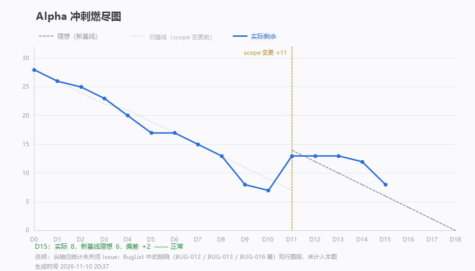

# 第 15 天站会记录（2026-11-10 20:21）· Alpha 第十五次例会

> 会议 20:21 开始，约 20 分钟 · 记录整理：P1 林子航（依会议实际发言）
> 规范：[`每日站会SOP.md`](../../每日站会SOP.md)

- 形式：腾讯会议（线上，会议号 301 816 650）
- 出席：**7 / 7**（全员到齐）
- 缺席：无
- 剩余 Issue：站会时点 **9 条**；会后按口径变更②调整为 **8 条**（`#44` `#45` `#46` 三条文档 issue 不再计入本轮剩余）
- 理想 6 条，偏差 **+2**

---

## 一、每人三问

| 成员 | ① 昨天推到哪一步 | ② 今天推到哪一步 | ③ 卡在哪 |
|---|---|---|---|
| **P1 林子航** | 契约 1.1.0 冻结（`482ba58`）；D15 燃尽数据（`0d9ae0d`）；口径变更②（`f53cfd0`） | `#45` 软工原理报告出大纲；`#28` 出口条件给复核意见 | 文档三条（博客/测试报告/软工报告）截止时间**助教未通知** |
| **P2 杨靖** | 尝试用 AI 生成前端预览图 | 先保核心页面功能，**前端美化后置到后续迭代** | 生成代码量过大，改起来效率低 |
| **P3 杨绎平** | `#39` 检索与导入页面完成（`f232600`，19:21） | 与后端联调 `/api/search` | 无 |
| **P4 刘万礼** | 导入接口完成（`/api/papers/import`） | 正在接 bbox；排查系统漏洞 | OA 元数据等可选项暂留，待定归属 |
| **P5 吴啸天** | **`#40` 完成并关闭**：问答引用返回真实 bbox + `bboxMode`（`6b4ef19`），附库/接口对账断言与 `f6_04_evidence.py` | 配合 `#41` 联调；AI 相关问题统一找他 | 无 |
| **P6 刘征** | `#43` 缓存代码完成 | 明天测试并把结果截图发 issue | 无 |
| **P7 李义朋** | 冒烟用例表全面测试 + 延展段表初步测试；发现断网降级时契约返回值缺失（**BUG-017**） | 今晚确认 BUG-017 修复情况 | 晚课无电脑，检测要等到课后 |

---

## 二、今日交付盘点

| 谁 | 提交 | 交付内容 |
|---|---|---|
| 吴啸天 | `6b4ef19` | **问答引用返回 `bboxX0~Y1` 与 `bboxMode`**（`RAG.py` 补 `SELECT` 与引用回填），库/接口对账断言 |
| 吴啸天 | `59e8e2f` | **`#40` 验收报告**：单栏 10/10 覆盖、双栏 10/10 标 `block`，bbox 均在 0–1，老数据 null 正常返回 |
| 杨绎平 | `f232600` | `#39` 检索与导入页面（`SearchView.vue` + API 封装 + 路由） |
| 李义朋 | `cfad300` | BugList 新增 BUG-017；延展段用例表回填 12 条结论 |
| 林子航 | `0d9ae0d` `f53cfd0` | D15 燃尽数据；燃尽口径变更② |

- **本轮关闭**：`#40` 引用 bbox 精确定位（11-10 20:29）
- 剩余 open：**11 条**（排除三条文档 issue 后为 **8 条**）

---

## 三、今日三个问题

### 问题一：前端美化要不要现在做

杨靖反馈：用 AI 生成前端预览图，**产出代码量过大，改动效率反而低**。

**决定：前端美化后置到后续迭代（Beta）**，本轮只保证核心页面功能可用。理由很简单 —— 美化不进入 Alpha 出口条件的任何一条验收标准，现在花时间是纯消耗。

### 问题二：文档三条 issue 算不算本轮交付

站会时点三条文档 issue（`#44` 测试报告、`#45` 软工原理报告、`#46` 每周心得）**还没有布置到具体某一天**，助教也未给出测试报告与原理报告的提交时间。

**处理**：这三条**从本轮迭代的燃尽计数里移出**（GitHub 上保持 open，照常交付），剩余数由 9 变为 **8**。理由：任务没有落到某一天，就无法按天烧进燃尽图；留在图里只会让「落后」变成假象。

### 问题三：BUG-017 是什么

李义朋测出：**断网降级时，契约要求的返回值缺失** —— `/api/search` 在超时降级时只返回空列表，没有 `degraded` / `cached` 标记，前端分不清「真没搜到」和「网断了」。

已登记 **BUG-017（S1 / P4 / 待修复）**。这条和我在代码检查时发现的是同一处，测试与走查互相印证了。

另外要表扬一句：延展段 36 条用例**全部回填了结论**（12 通过 / 1 不通过 / 22 测不了 / 2 不适用），且每条「测不了」都写明了依赖哪条 issue、引用到具体代码行 —— 这是本轮质量最高的一份测试产出。

---

## 四、会上决定

| # | 决定 | 说明 |
|---|---|---|
| 1 | **本轮不砍功能** | 逐人确认后均表示可按时交付，出口条件与交付口径**不做临时调整** |
| 2 | **前端美化后置到 Beta** | 不进 Alpha 任何验收标准，本轮只保核心功能 |
| 3 | **文档三条移出燃尽计数** | GitHub 保持 open，照常交付；剩余数 9 → 8 |
| 4 | **AI 相关问题统一找吴啸天** | 避免多人重复排查 |
| 5 | **保留动态调整机制** | 若后续出现紧迫情况，组员可随时提出，再行调整 |
| 6 | **`#28` 出口条件定稿依赖前置任务** | `#24` 用例状态、`#44` 报告均未完成，定稿时间顺延至 D17 |

---

## 五、待办

| 待办 | 负责人 | 期限 |
|---|---|---|
| `#41` 引用高亮层（接 `#40` 返回的真实 bbox 与 `bboxMode`） | 杨靖 | 11-11 |
| `#39` 检索页与 `/api/search` 联调 | 杨绎平 + 刘万礼 | 11-11 |
| BUG-017 修 `degraded` / `cached` 返回 | 刘万礼 | 11-11 |
| `#43` 缓存测试并把结果截图发 issue | 刘征 | 11-11 |
| `#24` 用例表按回执持续回填（含 BUG-017 回归） | 李义朋 | 11-11 |
| `#45` 软工原理报告大纲 → 全文 | 林子航 | 大纲 11-11 / 全文 11-12 |
| `#28` 出口条件初稿 | 李义朋（林子航复核） | 11-12 |
| `#44` 测试报告搭骨架 | 李义朋 | 11-12 |
| 三条文档 issue 的具体截止日 | 待助教通知后由 P1 补 | — |

---

## 六、留证

| 证据 | 文件 | 状态 |
|---|---|---|
| **会议画面截图** | `附件/meeting.png` | ✅ 已存（20:21，会议号 301 816 650，共 7 人） |
| **参会名单截图** | `附件/meeting-attendance.png` | ✅ 已存（7 人齐全） |
| 燃尽图 | `燃尽图-D15.png` | ✅ 已存（口径变更②后） |
| 签入记录 | `附件/commits.txt` | ✅ 已存 |
| `#40` 验收证据 | `ai-service/scripts/f6_04_evidence.py` | ✅ 已入库 |

---

## 七、今日小结

**今天最实的一件事是 `#40` 真正闭环了。**

白天我核代码时发现「数据写进库、但没有读出来的通道」—— `RAG.py` 里 `SELECT` 不取 bbox，引用硬编码 `null`。晚上吴啸天补了 `SELECT`、回填了真实坐标与 `bboxMode`，还附了库/接口对账断言和独立的证据脚本，验收数据是「单栏 10/10 覆盖、双栏 10/10 标 block」。

**更难得的是他写清了边界**：「框为 chunk 级并集，不承诺逐句精确」。这句话比「已精确实现」值钱得多 —— 前面三次都是含糊其辞把我们自己带进坑里，这次是他主动划清。

**今天的另一个收获是测试反哺开发**：李义朋把 36 条用例全填了结论，22 条「测不了」逐条写明依赖哪条 issue、卡在哪一行代码。我提的 `degraded` 缺失被他立成 BUG-017，两条独立路径指向同一个问题 —— **这说明测试和走查真的在起作用，不是走过场。**

**风险仍在最后两天**：`#41` 画框、`#42` 划词翻译、`#43` 缓存三条都没落地，而 D17 就要交。今天全员说能交，我信；但 **11-11 晚上如果 `#41` 还没画出第一个框，就必须启动降级**（只保「跳页 + 整段框」，砍细框与缩放对齐）。
