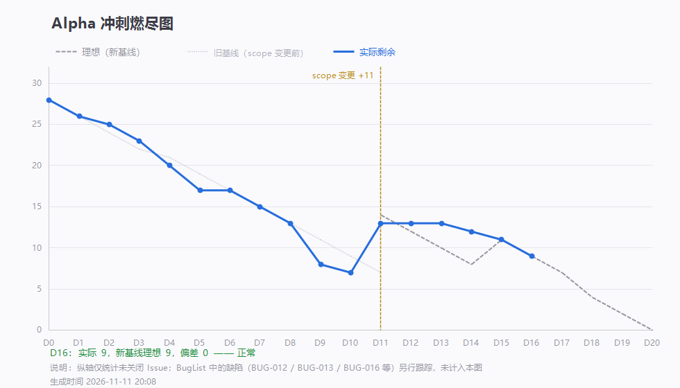

# 第 16 天站会记录（2026-11-11 20:24）· Alpha 第十六次例会

> 会议 20:24 开始，约 10 分钟 · 记录整理：P1 林子航（依会议实际发言）
> 规范：[`每日站会SOP.md`](../../每日站会SOP.md)

- 形式：腾讯会议（线上，会议号 505 727 203）
- 出席：**7 / 7**（全员到齐）
- 缺席：无
- 剩余 Issue：**9 条**，理想 9 条 —— **正好在理想线上**，累计完成 28 条



---

## 一、每人三问

| 成员 | ① 推到哪一步 | ② 卡在哪 | ③ 接下来做什么 |
|---|---|---|---|
| **P1 林子航** | `#45` 并入 `#44`，期末博客方案与分工落地（`880dcd5`）；契约 1.2.0 审定合并（`251f3ac`） | 下周站会与燃尽图的衔接时间不清楚，需要向老师确认有无缓冲期 | 写 `#44` 的「迭代回顾 + 软工原理」两块；整理全员心得 |
| **P2 杨靖** | `#41` 引用高亮**基本开发完成** | 自测出一个小 bug | 明天改完提交（**今天仍未提交**） |
| **P3 杨绎平** | 划词翻译 / 解释的浮层**未完成** | — | 明天提交 |
| **P4 刘万礼** | 修掉翻页 bug：**不同页码返回完全相同的结果**（假分页）；把误放进 `data` 的 `message` 移到顶层；新增 `/api/explain` 转发（`a3a4733`）；缓存时间改东八区（`510a874`） | 发现自己的代码被他人误改过 | 配合前端跑通 `#42` |
| **P5 吴啸天** | 划词翻译 / 术语解释的 **AI 接口完成**（`56cf3b0` `d03bae6` `01bab2e`） | 因需前端配合，`#42` 暂时关不掉 | 跑通全流程；**检查大家代码的逻辑类问题** |
| **P6 刘征** | `#43` 检索缓存与降级完成（`1bc9439`）；修部分 bug | — | 承接时差 bug（见第三节） |
| **P7 李义朋** | 新测 4 条用例；复测 BUG-017 **通过**；新发现 2 个 bug（BUG-018 时间、BUG-019 缺列） | — | `#24` 用例继续回填；`#44` 测试报告块出初稿 |

---

## 二、今日交付盘点（6 条提交）

| 谁 | 提交 | 交付内容 |
|---|---|---|
| 刘征 | `1bc9439` | **`#43` 检索缓存 + 外部接口降级**：Redis 24 小时、断网返回缓存、不再抛 500 |
| 刘万礼 | `a3a4733` | 新增 `POST /api/explain` 转发（划词翻译与术语解释） |
| 刘万礼 | `510a874` | 检索缓存**按分页隔离**、缓存时间**改东八区**、提示移到顶层 `message` |
| 李义朋 | `9041c1c` | BugList v1.2 新增 **BUG-018 / BUG-019**；延展段用例表回填到 **16 条通过** |
| 林子航 | `6f1226b` `880dcd5` | D16 燃尽数据；期末博客合并方案 + 心得归档 |

- **本轮关闭**：`#39`（检索与导入页面）、`#45`（并入 `#44`）
- 剩余 open：**9 条**

---

## 三、会上三个问题

### 问题一：测试报告与软工原理要合成一篇博客

助教新要求：**测试报告与习得的软工原理、方法写在同一个文档里**。

处理：

- `#44` 升级为「**期末博客：会议记录 + 测试报告 + 软工原理与方法**」，`#45` 并入后关闭
- **模板直接照李义朋的第一篇博客**，不另起格式
- 分工：**李义朋**写测试报告块（依据 BugList、用例表、`#20` 抽样）；**林子航**写迭代回顾块与软工原理块，并整理全员心得

### 问题二：时差 8 小时又出现了

李义朋新报 **BUG-018**：检索命中缓存时，`message` 里的更新时间慢 8 小时。

根因还是容器时区：`LocalDateTime.now()` 取 JVM 默认时区，容器里是 UTC。

**会上的处理**：指派 P6 刘征负责，要求代码里明确写 `Asia/Shanghai`。

**实际情况**：刘征在会前 19:53 已经修了（`510a874`，`ZonedDateTime.now(ZoneId.of("Asia/Shanghai"))`）。所以确切状态是**代码已改，尚未复测** —— 又是一次「代码改了 ≠ 验证过了」。

### 问题三：`bbox_mode` 缺列导致问答全挂（S0）

李义朋新报 **BUG-019**：`chunks.bbox_mode` 列没在库里创建，`RAG.py` 查询直接报错，`/api/qa/ask` 全部返回 `3001`，**问答主链不可用**。

这是文档改了、库没跟上的典型：表结构文档 11-09 就加了这一列，但没人执行 `ALTER`。

**修法（一句 SQL）**：

```
docker compose exec -T postgres psql -U papermind -d papermind -c "ALTER TABLE chunks ADD COLUMN IF NOT EXISTS bbox_mode TEXT;"
```

⚠️ **不能用 `docker compose down -v` 代替** —— 会连 `hf-cache`（2.2GB 模型）和已上传 PDF 一起删掉，按 BUG-012 的决定我们正靠这个模型演示。

---

## 四、会上决定

| # | 决定 | 说明 |
|---|---|---|
| 1 | **`#44` = 期末博客（测试报告 + 软工原理）** | 模板照第一篇博客；P1 与 P7 分工，`#45` 已并入 |
| 2 | **全员交心得** | 由 P1 收集整理进 `docs/报告/心得-汇总.md`，11-13 前交齐 |
| 3 | **时区问题一律显式写 `Asia/Shanghai`** | 取当前时间用 `ZonedDateTime.now(ZONE)`；读数据库用 `AT TIME ZONE 'Asia/Shanghai'` |
| 4 | **BUG-019 优先于所有功能开发** | 主链断了，其余做得再好也演示不了 |
| 5 | **向老师确认下周站会与燃尽图的衔接** | 下周是否直接衔接 Beta、有无缓冲期，待确认后更新计划 |

---

## 五、待办

| 待办 | 负责人 | 期限 |
|---|---|---|
| 执行 `ALTER` 补 `bbox_mode` 列，恢复问答（BUG-019，S0） | 刘征 | **11-11 当晚** |
| BUG-018 复测（缓存时间是否已是北京时间），状态改「待复测 → 已修复」 | 李义朋 | 11-12 |
| `#41` 改完自测 bug 并提交（今天仍是零提交） | 杨靖 | **11-12** |
| 划词翻译浮层提交并与后端联调（`#42`） | 杨绎平 + 吴啸天 | 11-12 |
| `#24` 用例继续回填；`#44` 测试报告块出初稿 | 李义朋 | 11-13 |
| 跑通全流程 + 检查全组代码逻辑问题 | 吴啸天 | 11-13 |
| 全员心得一条 | 全员 | 11-13 |
| `#44` 迭代回顾 + 软工原理块，并统稿 | 林子航 | 11-14 |
| 向老师确认下周站会与燃尽衔接 | 林子航 | 11-12 |

---

## 六、留证

| 证据 | 文件 | 状态 |
|---|---|---|
| **会议画面截图** | `附件/meeting.png` | ✅ 已存（20:24，会议号 505 727 203，共 7 人） |
| **参会名单截图** | `附件/meeting-attendance.png` | ✅ 已存（7 人齐全） |
| 燃尽图 | `燃尽图-D16.png` | ✅ 已存（剩余 9 / 理想 9） |
| 签入记录 | `附件/commits.txt` | ✅ 已存（6 条提交） |
| 心得汇总素材 | `../报告/心得-汇总.md` | ✅ 已建（P1 已交，其余 6 人待收） |

---

## 七、今日小结

**今天的三个问题，指向同一件事：我们验证得不够。**

时差 8 小时「又出现了」—— 实际刘征会前已经修好，但没人复测，所以大家以为它还坏着。`bbox_mode` 缺列 —— 文档 11-09 就改了，库没跟上，主链直接挂掉。杨靖的 `#41` 说「基本完成」，但一行代码没提交，别人无法验证。

**代码写了、文档改了、设计定了，都不等于「这件事做完了」。** 唯一算数的是有人在真实环境里跑一遍、看到预期结果 —— 这条从 D11 到今天，我们已经踩了四次（BUG-004 回归、BUG-011 时区、BUG-013 白屏、BUG-019 缺列）。

**好的一面也在**：剩余数第一次回到理想线上（9 / 9），累计完成 28 条；检索链路（搜索 + 缓存 + 降级 + 导入）、翻译接口、引用坐标三块后端都已落地，剩下的是前端和联调。

**明天是功能冻结日。** `#41` 与 `#42` 必须见到可运行的提交，否则当天夜里按降级方案定稿：`#41` 只做「跳页 + 整段框」，`#42` 只做「选中即译」、砍术语解释。
