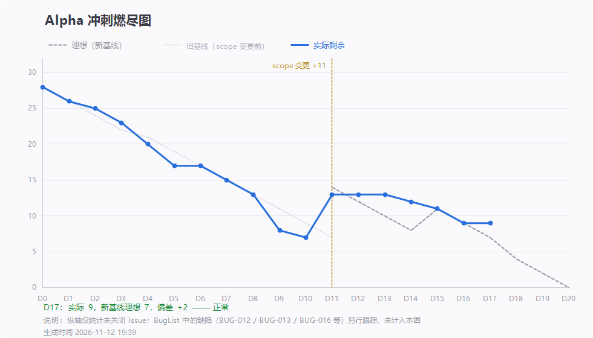

# 第 17 天站会记录（2026-11-12 20:21）· Alpha 第十七次例会

> 会议 20:21 开始，约 15 分钟 · 记录整理：P1 林子航（依会议实际发言）
> 规范：[`每日站会SOP.md`](../../每日站会SOP.md)

- 形式：腾讯会议（线上，会议号 710 339 087）
- 出席：**7 / 7**（全员到齐）
- 缺席：无
- 剩余 Issue：**9 条**，理想 7 条，偏差 **+2（落后）**，累计完成 28 条

---

## 一、每人三问

| 成员 | ① 推到哪一步 | ② 卡在哪 | ③ 接下来做什么 |
|---|---|---|---|
| **P1 林子航** | `#44` 更名为「**Alpha 阶段交付博客**」（`51d8909`）；心得汇总补入杨靖条目（`6aac1cf`） | 下周直接衔接 Beta 每日例会与燃尽图，节奏偏紧 | 整理 **Beta 阶段功能划分与交付口径**；`#44` 迭代回顾块 |
| **P2 杨靖** | `#41` 引用高亮层已提交（`a94f22c`，16:47） | **自测发现 bbox 位置异常**，尚未修复；排查不下去会请他人协助 | 继续排查 bbox 位置，或转 `#19` 相关问题 |
| **P3 杨绎平** | 划词翻译前端完成（`6778fad`，21:10），并在 `#42` 写了完整交付说明 | 无 | 待命，随时修潜在 bug |
| **P4 刘万礼** | `#38` OpenAlex 兜底源接入完成并提交（`bf8403c`，18:09），非 OA 只返回 `landingUrl` | 无 | 心得已交，等待汇总 |
| **P5 吴啸天** | AI 服务侧全部内容完成 | **全站启动耗时较长，暂无测试结果** | 做全站启动测试；后续 AI 相关 bug 直接找他 |
| **P6 刘征** | 任务完成，无遗留问题 | 无 | — |
| **P7 李义朋** | **复测 BUG-018 / BUG-019 均通过**；新测 10 条冒烟用例**无新 bug** | 仅发现「引用展示美观度」问题（见第三节） | 继续补测；`#44` 测试报告块 |

---

## 二、今日交付盘点（2 条提交）

| 谁 | 提交 | 交付内容 |
|---|---|---|
| 杨靖 | `a94f22c` | **`#41` 引用 bbox 高亮层**：跳页 + 画框 + 淡出 + 缩放对齐 |
| 刘万礼 | `bf8403c` | **`#38` OpenAlex 兜底源**：新增 `OpenAlexClient`，非 OA 仅返回 `landingUrl` |

- **本轮关闭**：无（9 条全开，卡在「未在真实环境验证」）
- **重要状态更新**：BUG-018（缓存时间时区）、BUG-019（`bbox_mode` 缺列致问答 3001）**均已修并按复测通过** —— 问答主链已恢复

---

## 三、会上两个问题

### 问题一：下周直接衔接 Beta，节奏偏紧

要求：下周（11-16 起）**直接衔接 Beta 阶段每日例会与燃尽图**，中间没有缓冲期。

**决定**：

- Beta **第一周安排相对宽松**，预留整理时间（吸取本次「出口口径与实际日程对不上」的教训）
- 近期安排**一次长会**，专门总结经验
- 由 P1 重新梳理 **Beta 阶段的功能划分与交付口径**，划分口径**相对松散**，避免重演 issue 依赖链过长、燃尽不均衡的问题

### 问题二：引用展示的美观度问题（暂不处理）

**现象**：回答里的引用可能在**词中被截断**，或引用了小标题、表格数据，导致显示不美观。

**性质判定**（李义朋）：该现象在原文中确有依据，**不构成功能性 bug**，属于视觉瑕疵。

**历史背景**（P1）：早期开发时已发现，当时的临时方案是把 Markdown 格式（公式等）直接切掉显示原文。

**决定**：**暂不处理**，留到 Beta 阶段或最后一轮优化。理由是它不影响「答案 + 页码 + 跳转」这条主链，而 Alpha 只剩三天。

---

## 四、会上决定

| # | 决定 | 说明 |
|---|---|---|
| 1 | **Beta 首周宽松**，预留整理时间 | 避免再次出现口径与日程对不上 |
| 2 | 近期开**一次长会**总结经验 | 时间待定 |
| 3 | **P1 整理 Beta 功能划分与交付口径**，划分相对松散 | 吸取 issue 依赖链过长的教训 |
| 4 | **引用美观度问题暂不处理** | 视觉瑕疵，留 Beta / RC |
| 5 | 提交物**直接发群内**，不再逐一报 P1 审核 | 避免单人审核成为瓶颈 |
| 6 | **燃尽图当日更新并上传** | 全员有变动及时提交 |

---

## 五、待办

| 待办 | 负责人 | 期限 |
|---|---|---|
| 修 `#41` bbox 位置异常（自测已发现，未修） | 杨靖 | 11-13 |
| 全站启动测试，出测试结果 | 吴啸天 | 11-13 |
| `#24` 用例继续回填；`#44` 测试报告块初稿 | 李义朋 | 11-13 |
| `#44` 迭代回顾 + 软工原理块 | 林子航 | 11-14 |
| 整理 Beta 功能划分与交付口径 | 林子航 | 11-14 |
| 心得补齐（已收 2/7：林子航、杨靖） | P3–P7 | 11-13 |
| 每日燃尽图更新上传 | 全员 | 每日 |

---

## 六、留证

| 证据 | 文件 | 状态 |
|---|---|---|
| **会议画面截图** | `附件/meeting.png` | ✅ 已存（20:21，会议号 710 339 087，共 7 人） |
| **参会名单截图** | `附件/meeting-attendance.png` | ✅ 已存（7 人齐全） |
| 燃尽图 | `燃尽图-D17.png` | ✅ 已存（剩余 9 / 理想 7） |
| 签入记录 | `附件/commits.txt` | ✅ 已存（2 条提交） |

---

## 七、今日小结

**今天是功能冻结日，三条新功能的代码全部到位**：检索导入（`#38` arXiv + OpenAlex、`#43` 缓存降级）、引用高亮（`#40` 坐标 + `#41` 画框）、划词翻译（`#42` 前后端），这是延展段三个目标的**代码完成**。

**更重要的是两条 S1 清掉了**：BUG-018（缓存时间时区）与 BUG-019（`bbox_mode` 缺列导致问答全 3001）。尤其是 BUG-019，它是这几天唯一一条**真的把主链打断**的问题 —— 文档改了、库没跟上，一句 `ALTER` 就解决，却卡了整整两天。

**但 9 条 issue 一条没关，这是我有意为之。** 代码写了不等于能跑，`#41` 的画框位置异常就是明证 —— 提交了，自测发现有偏差，还在修。明天集成走查就是要把「代码完成」变成「验收通过」。

**今天还认清了一件事**：推迟处理是门手艺。引用美观度这种视觉瑕疵，早期发现、当时用临时方案绕过、现在明确记下来留到 Beta —— **这不是拖延，是把有限的时间压在主链上**。Alpha 只剩三天，能守住的只有「问答能用、引用能跳、三功能能演示」。
