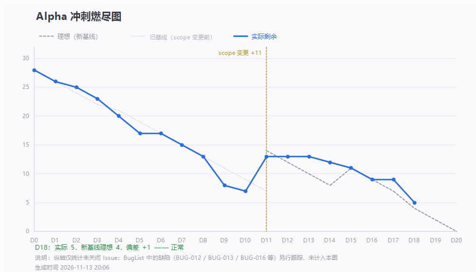

# 第 18 天站会记录（2026-11-13 20:26）· Alpha 最后一次例会

> 会议 20:26 开始，约 15 分钟 · 记录整理：P1 林子航（依会议实际发言）
> 规范：[`每日站会SOP.md`](../../每日站会SOP.md)

- 形式：腾讯会议（线上，会议号 963 870 483）
- 出席：**7 / 7**（全员到齐）
- 缺席：无
- 剩余 Issue：**5 条**，理想 4 条，偏差 **+1**，累计完成 32 条
- **本次为 Alpha 阶段最后一次例会**（11-14、11-15 只做收尾，不再日会）

---

## 一、每人三问

| 成员 | ① 推到哪一步 | ② 卡在哪 | ③ 接下来做什么 |
|---|---|---|---|
| **P1 林子航** | `#28` 出口条件初稿（`e41b2f0`）；三条新功能全部关单 | 心得只差李义朋一份；`#44` 测试报告块未出 | `#44` 迭代回顾与软工原理块；检查刘万礼提交的合并冲突 |
| **P2 杨靖** | 之前报的 bbox 异常**是自测数据常量配错**，代码本身无误，自查后任务完成 | 无 | 配合全量回归 |
| **P3 杨绎平** | 支持「方案一」（删除两行代码即可），待确认后提交 | 方案待全员确认 | 把段落预处理（上限判断等）从 PDF 文字模块移到后端 |
| **P4 刘万礼** | **重新提交后端 `explain` 转发（`8da2ab6`）**，已验证基本无问题 | 等待合并冲突处理 | 跟进群内后端任务 |
| **P5 吴啸天** | 完成前后端联调与 AI 服务测试，关闭相关 issue，提交优化建议 | 无 | 继续排查 AI 服务问题、审查其他成员代码 |
| **P6 刘征** | 数据部分全部完成，无遗留问题 | 无 | — |
| **P7 李义朋** | 冒烟测试完成，**主链全部跑通**；用例表 v0.4 收官（33 通过 / 3 不适用 / 0 测不了，`dcbd9e1`） | F7-05 需等前后端改动后再测 | 修改提交后重测 F7-05，通过后关闭相关 issue |

---

## 二、今日交付盘点（4 条提交）

| 谁 | 提交 | 交付内容 |
|---|---|---|
| 刘万礼 | `8da2ab6` | **恢复 `POST /api/explain` 转发层**（`ExplainController.java`，撤销此前 `28ce007` 的撤回） |
| 李义朋 | `dcbd9e1` | **延展段用例表 v0.4 收官**：36 条全部有结论（33 通过 / 3 不适用 / 0 测不了） |
| 林子航 | `e41b2f0` | Alpha 出口条件初稿 |
| 林子航 | `09cabd1` | D18 燃尽数据 |

- **本轮关闭**：`#38` `#41` `#42` `#43` —— **三条新功能全部关单**
- 剩余 open：**5 条**（`#24` `#25` `#28` `#44` `#46`），均为文档 / 测试收尾

---

## 三、会上讨论的三个问题

### 问题一：段落预处理逻辑放前端还是后端

**背景**：PDF 文字模块与翻译模块的内容耦合，前端目前只做「信息传递」，把选中的原文直接抛给后端。

**讨论结论：把上限判断等段落预处理逻辑移到后端。**

三条理由：

1. **形成完整数据流** —— 后端能拿到「截断前 → 截断后」的全过程，便于捕捉日志
2. **为后续扩展铺路** —— 翻译记忆化、段落合并等复杂处理应集中在后端，前端不该承担
3. **避免前端越做越重** —— 前端只做展示与交互，逻辑下沉到后端更易维护

**杨绎平提方案一**：改造成本极低，**只需删除两行代码**即可把上限判断让给后端。待全员确认后提交。

### 问题二：F7-04 判定「不适用」是否合理

**现象**：在 PDF 里选中空格或单个字母时，也会触发划词翻译。

**判定**（李义朋）：**契约未强制要求拦截这类输入**，属于「非核心场景」，记为**不适用**，不算缺陷。

**组内确认**：同意。测试用例的状态只有「通过 / 不通过 / 测不了 / 不适用」，用「不适用」标注契约未覆盖的场景是正确的做法，不是回避问题。

### 问题三：团队意见大面积写「暂无」

心得收集里，**除一人外都写了「暂无」**。

**P1 明确表态**：

- 这不是「没意见」，是**没认真想**。意见反馈写「暂无」，等于把这一栏作废。
- 团队要克服「心虚」心理，通过**互相监督**真正做到实事求是。
- 鼓励大家对团队、**包括对组长本人**提意见 —— 目标是一起把成绩做上去，不是走过场。

> 这件事和出口条件里写「口径改过三次」是同一件事的两面：**只写好看的部分，报告就没有价值。**

---

## 四、会上决定

| # | 决定 | 说明 |
|---|---|---|
| 1 | **本次为 Alpha 最后一次例会** | 11-14、11-15 只做收尾与彩排，不再每日开会 |
| 2 | **段落预处理逻辑移到后端**（方案一） | 杨绎平确认后提交 |
| 3 | **F7-04 记「不适用」** | 契约未强制，不构成缺陷 |
| 4 | **全员复习各自模块核心代码逻辑** | 下周有实验课，老师会逐人提问；**不能过度依赖 AI 写代码** |
| 5 | **会后发布 Beta 阶段功能列表**，供团队讨论工作量、可行性与创新点 | 由 P1 整理 |
| 6 | **团队意见不许只写「暂无」** | 实事求是，互相监督 |

---

## 五、待办

| 待办 | 负责人 | 期限 |
|---|---|---|
| 段落预处理（上限判断）移到后端，按方案一提交 | 杨绎平 | 11-14 |
| 检查刘万礼提交是否存在合并冲突并完成合并 | 林子航 | 11-14 |
| 继续测试 AI 服务与各成员代码 | 吴啸天 | 11-14 |
| 修改提交后重测 F7-05，通过后关 issue | 李义朋 | 11-14 |
| `#44` 测试报告块 | 李义朋 | 11-14 |
| `#44` 迭代回顾 + 软工原理块、统稿 | 林子航 | 11-14 |
| `#28` 出口条件定稿 | 林子航 | 11-14 |
| 发布 Beta 阶段功能列表 | 林子航 | 11-14 |
| 复习各自模块核心逻辑（实验课考核） | 全员 | 11-15 前 |

---

## 六、留证

| 证据 | 文件 | 状态 |
|---|---|---|
| **会议画面截图** | `附件/meeting.png` | ✅ 已存（20:26，会议号 963 870 483，共 7 人） |
| **参会名单截图** | `附件/meeting-attendance.png` | ✅ 已存（7 人齐全） |
| 燃尽图 | `燃尽图-D18.png` | ✅ 已存（剩余 5 / 理想 4） |
| 签入记录 | `附件/commits.txt` | ✅ 已存（4 条提交） |

---

## 七、今日小结

**今天是这一轮最像"收工"的一天。**

四条 issue 一起关，三条新功能全部落地：检索导入能搜能导、引用坐标能跳到原文并画框、划词翻译前后端接通。刘万礼把两天前撤回去的转发层重新提交了（`8da2ab6`）—— 这次没等我兜底。

测试这边也干净：用例表 v0.4，36 条全部有结论，**33 通过 / 3 不适用 / 0 测不了**。加上原表 35 条全绿，现在可以说「我们没有测不了的项」。

**今天做的一个技术决定值得写下来**：把「截断/上限判断」从 PDF 模块挪到后端。这不是为了好看 —— 前端不该承担业务判断，数据流完整了后端才能记日志、才能做翻译记忆化。**一个小逻辑放错层，后面所有扩展都要还债。**

**今天还批评了一件事：心得里一片「暂无」。** 我自己的那条写了十个问题，包括出口条件没摸底、issue 划分不合理、组员参与度不高 —— 这些都指向我。**如果有人对着这一栏写「暂无」，那这份报告就只是形式。**

**Alpha 阶段到这里就结束了。** 剩下两天只有三件事：把博客写完、把出口条件定稿、把演示跑熟。**不再加任何功能。**
