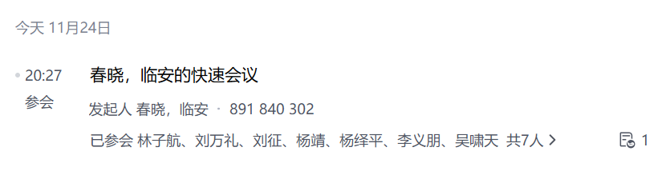

# Beta B7 站会记录（2026-11-24 20:27）

> 会议 20:27 开始 · 记录整理：P1 林子航
> 依据：腾讯会议元宝 AI 实时纪要（**由林子航当场发我，我当晚只核了数字没落盘，11-26 补记**）+ 会议概览截图 + 参会人截图
> 说明：AI 纪要里有若干识别错误（「杨一平」= 杨绎平、「杨靖」重复指代、「贝塔」= Beta），整理时已校正；数字口径按 GitHub 实际状态核对过，与纪要原文不一致处标「⚠️ 核对」。

- 时间：**2026-11-24（周二）20:27**
- 形式：腾讯会议（线上），会议号 **891 840 302**
- 发起：春晓、临安（会议软件账号）／实际主持：林子航
- 出席：**7 / 7**（林子航、刘万礼、刘征、杨靖、杨绎平、李义朋、吴啸天）
- 缺席：无
- 性质：**Beta 每日站会（B7）**

---

## 一、燃尽图与 Issue 管理

| 项 | 纪要说法 | 实际（核对） |
|---|---|---|
| 进度 | 「进度正常，当前落后两条但在正常范围内」 | ✅ 一致：剩余 **38**，理想 36，偏差 **+2** |
| 关单规范 | 验收通过后须立即关闭；新合入代码中如有可关闭的 Issue 也需核实 | — |
| 支线优化 | 暂缓：以用户视角提的优化已更新进 Issue，先跟 Beta 核心进度，主线做完再做支线 | — |

> **⚠️ 核对补充**：当晚 `#65` 关闭后剩 37。另有 **`#72` `#74` `#82` 代码都在 master 上但 Issue 未关**，站会只提了 `#65` 一条，其余三条漏了——这是后面两天燃尽图难看的主要原因。

---

## 二、各成员进展汇报

| 成员 | 汇报内容 | 备注 |
|---|---|---|
| 杨靖（P2） | 课程增加时间紧张；部分 Issue 存在依赖关系；PPT 里渲染逻辑表达不清，会后需单独沟通 | 会后单独确认 |
| 杨绎平（P3） | 已完成 `#65`（扫描件无文字层提示）但忘了关闭，当期补关 | ✅ 当晚关闭 |
| 刘万礼（P4） | 完成令牌签发验签工具、请求拦截、papers 列表／问答／导入的登录过滤，密码存储改 bcrypt | 与 `#71` `#74` `#75` 对应 |
| 吴啸天（P5） | 完成文本块切分、双栏识别、按阅读顺序重排；无重大问题，继续推进新 Issue | 与 `#79` `#80` `#81` 对应 |
| 刘征（P6） | 完成 `users` 表与 `papers.user_id` 外键，并已修改对应 PPT | 与 `#87` 对应 |
| 李义朋（P7） | 测约 20 条用例；Beta 分配的 Issue 多、回填分散，测试略显混乱；新发现 Bug 较少，**且多源于组长** | ⚠️ 见下方核对 |

> **⚠️ 核对**：「新发现的 Bug 多源于组长」这句属实。当晚起 P1 通过代码审查与容器实跑产出 `BUG-024`～`BUG-030` 共七条（explain 越权、8000 端口无鉴权、登录态静默回退、`reading_order` 缺列、`users` 表未迁移、DB 异常错码、检索无兜底），全部记在 BugList，不因提出者是谁而淡化。同时也要说清：**这七条没有一条是跑测试跑出来的，是读代码和起容器跑出来的**——说明测试面还没铺到。

---

## 三、PPT 准备与后续安排

| 事项 | 内容 |
|---|---|
| PPT 独立讲解 | 每位成员需对自己负责的模块准备 PPT，确保能独立清晰讲解；PPT 仅作辅助，不必过度纠结描述细节 |
| 明日例会 | 因周三晚有课时间较迟，拟投票表决是否取消 11-25 晚例会，结果群内发布 |

---

## 四、待办

| 待办 | 负责人 | 期限 |
|---|---|---|
| 会后微信单独沟通 `#65` 及相关 Bug 问题 | 杨靖 ↔ 杨绎平 | 11-24 当晚 |
| 补关 `#72` `#74` `#82`（代码已在 master） | P4 / P5 | 11-25 |
| 逐人准备 PPT（独立讲解自己模块） | 全员 | 11-25 |

---

## 五、留证

| 证据 | 文件 | 状态 |
|---|---|---|
| 会议概览截图（20:27，7 人） | `附件/meeting.png` | ✅ |
| 参会名单截图（7 人齐全） | `附件/meeting-attendance.png` | ✅ |
| 元宝 AI 纪要 | 群内留存 | ✅ |
| 本会议记录 | `docs/例会/2026-11-24/例会记录.md` | ✅（11-26 补记） |
| 燃尽图 B7 | `docs/燃尽图/燃尽图-Beta模板.csv` | ✅ 剩余 37（`#65` 关后） |

---

## 六、记录人补记（非会议决议）

1. **纪要没写谁主持**：腾讯会议显示发起人是「春晓、临安」，实际主持与排期都是 P1，记录里已补。
2. **「落后两条」这个数字当晚对，第二天就变**：所以燃尽图的数必须以 GitHub 关单时间为准，不能照抄纪要。
3. **本轮最大的教训不是落后两条，是「修完不关单」**：`#72` `#74` `#82` 三条代码都在 master 上挂了三天，直到 11-26 站会才被要求验收。下一条同类问题出现时，直接按「合并后 24 小时必须关单或写明还差什么」处理。
