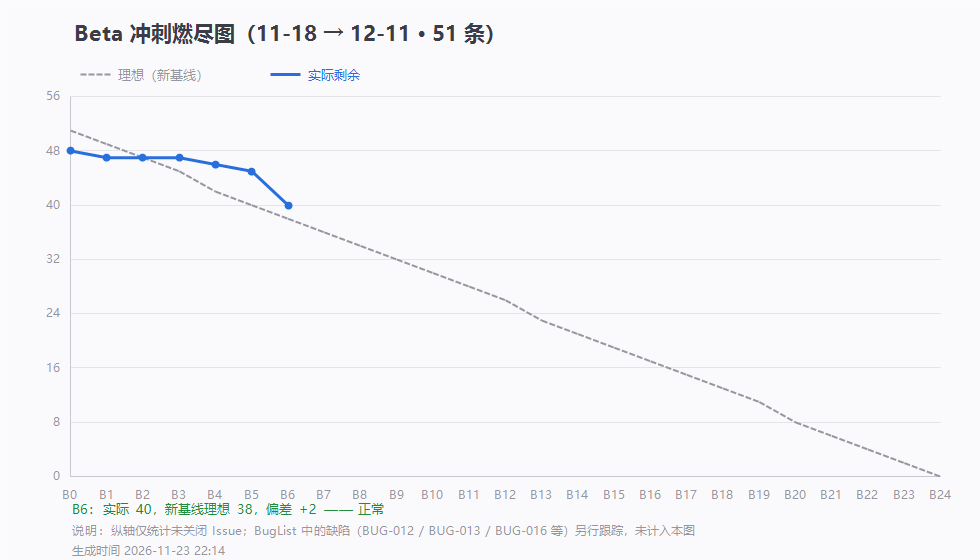
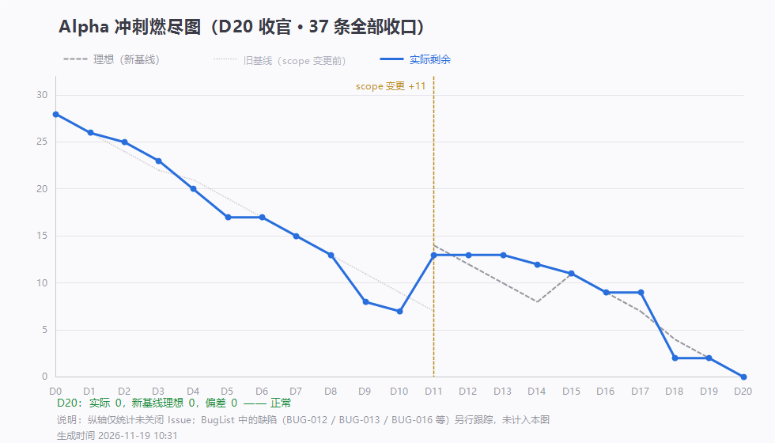

# 燃尽图（当前）

> **当前轮次：Beta**（D21–D44，11-17 基线 → 12-11 收口，基线 **51 条**）
> 数据源：`燃尽图-Beta模板.csv` · 生成脚本：`scripts/burndown-chart.ps1`
> Alpha 阶段已收官，图归档在 `燃尽图-Alpha-最终-D20.png`

## Beta 燃尽图



## Alpha 收官图（归档）



---

## 怎么读

| 看到什么 | 含义 |
|---|---|
| 灰色虚线 | 理想进度（**51 条 ÷ 24 天**匀速烧完） |
| 蓝色实线 | 真实进度（未关闭 Issue 数） |
| 蓝线在虚线上方 | 落后 —— 差距越大越危险 |
| 蓝线在虚线下方 | 领先 |
| 底部一行字 | 自动判定：正常 / 落后 / 严重落后（建议砍范围） |

## 当前读数（2026-11-23 · B6）

| 项 | 值 |
|---|---|
| 基线 | 51 条（`#51`–`#101`） |
| 已关闭 | **11**（11-17 三契约；11-18 `#54`；11-21 `#80`；11-22 `#95`；**11-23 `#79` `#81` `#87` `#88` `#89`**） |
| 实际剩余 | **40** |
| 理想剩余 | 38 |
| 偏差 | **+2 —— 正常**（≤2 不动） |

> **一天从 +7 拉回 +2。** 曲线今天陡降，是下午连关 5 单：P5 的 `#79`（通栏切带）`#81`（按 `(band, column, y0, x0)` 写 `reading_order`），P6 的 `#87` `#88` `#89`（`users` 表 + `papers.user_id` 外键 + 幂等迁移脚本 + 旧论文回归）。这批质量是够的：迁移脚本幂等（`ON CONFLICT` / `DO $$` 兜 `pg_constraint`）、显式插 `id=1` 后用 `setval` 把序列拨正（否则下一个注册用户撞 1）、`RAG.py` 这次**主动探测列**而不是硬查（没重演 BUG-019 那种整条 SQL 炸）。
>
> **但审查发现一条硬伤：`chunks.reading_order` 全仓没有建列语句。** `#81` 把产出、写库、读取、回填 `citations[].readingOrder` 全做齐了，独独 `03-数据库表结构.sql` 的 `chunks` 建表里没有这一列，`scripts/migrate-users-1.1.0.sql` 也只补了 `users` 与外键。于是 `_has_column(cur, "reading_order")` 恒为 False → **入库恒 NULL，前端拿到的 `readingOrder` 永远是 null**。
>
> 这就是 BUG-019 的同型复发，只是从"报错"变成了"静默为空"——更难发现。已立 **`BUG-027`（S1）**，卡住的不止 `#82` 的验收，还有 B02：B02 的「当前栏判定」按验收要看阅读顺序里最后可见的块，没数据就退化成按页判定。
>
> **口径说明**：本图只统计 **Issue**，BugList 的缺陷不进曲线，所以图上是 +2，真实风险没有反映在这条线上——不过 `BUG-024`（explain 越权）、`BUG-025`（8000 端口无鉴权）、`BUG-026`（登录态静默回退 user1）、`BUG-027`（缺列）四条都还开着，**出口条件前必须清完**。
>
> 另：`#74` 可关；`#75` 仍不能关（explain 那处还没补）；`#71`（JwtFilter）代码早在 master 上，单还挂着。

## 每天怎么更新（2 分钟）

```powershell
cd PaperMind

# 1. 记录今天剩余多少条（Beta 表）
.\scripts\burndown.ps1 -Csv docs\燃尽图\燃尽图-Beta模板.csv -Remaining 40 -Total 51

# 2. 重画图（三条参数：Beta 表 / Beta 图 / 关掉 scope 标记）
.\scripts\burndown-chart.ps1 -Csv docs\燃尽图\燃尽图-Beta模板.csv `
  -Out docs\燃尽图\燃尽图-Beta-当前.png `
  -Title "Beta 冲刺燃尽图（11-18 → 12-11 · 51 条）" -MarkLabel ""

# 3. 提交
git add docs/燃尽图 && git commit -m "chore: 更新燃尽图 (#3)" && git push
```

> Alpha 表（`燃尽图模板.csv`）保留不动，出历史图时用它；两轮日号各自从 0 起算（D / B）。

## 每次出「里程碑图」

| 时机 | 另存为 |
|---|---|
| Beta 第 1 周总结（11-22） | `燃尽图-Beta-第1周.png`（B0–B5） |
| Beta 第 2 周总结（11-29） | `燃尽图-Beta-第2周.png`（B0–B12） |
| Beta 收口（12-11） | `燃尽图-Beta-最终.png`（B0–B24） |
