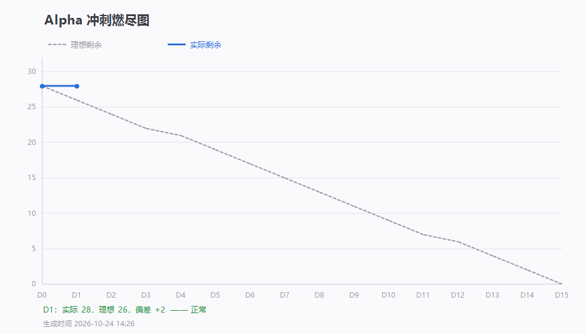

# 燃尽图（当前）



> 这张图由 `scripts/burndown-chart.ps1` 自动生成，数据源是 [`燃尽图模板.csv`](燃尽图模板.csv)。
> 看曲线只需要看这一页；每天更新后这里会显示最新进度。

## 怎么读

| 看到什么 | 含义 |
|---|---|
| 灰色虚线 | 理想进度（28 条 ÷ 15 天匀速烧完） |
| 蓝色实线 | 真实进度（未关闭 Issue 数） |
| 蓝线在虚线上方 | 落后 —— 差距越大越危险 |
| 蓝线在虚线下方 | 领先 |
| 底部一行字 | 自动判定：正常 / 落后 / 严重落后（建议砍范围） |

## 每天怎么更新（3 步，2 分钟）

```powershell
cd PaperMind

# 1. 记录今天剩余多少条（gh 已登录可省略 -Remaining）
.\scripts\burndown.ps1 -Remaining 24

# 2. 重画图
.\scripts\burndown-chart.ps1

# 3. 提交
git add docs/燃尽图 && git commit -m "chore: 更新燃尽图 D5 (#3)" && git push
```

## 每次出「里程碑图」

博客要的两张图各存一份，别只留当前图：

| 时机 | 另存为 |
|---|---|
| 第 6 周博客发布前 | `燃尽图-第6周.png`（D0–D8） |
| 第 7 周博客发布前 | `燃尽图-第7周.png`（D0–D15） |

```powershell
.\scripts\burndown-chart.ps1 -Out ..\docs\燃尽图\燃尽图-第6周.png -Title 'Alpha 冲刺燃尽图（第 6 周）'
```
